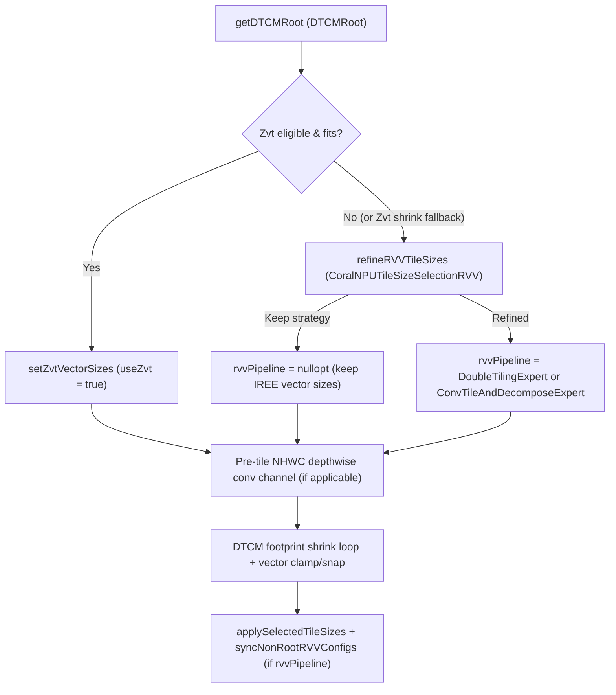

# Refine RVV Vector Tile Sizes, Lowering Pipelines, and Multi-Op Reduction Configs

- **Author(s)**: Lun Dong, Shaked Flur
- **Component Doc(s)**: [dtcm_tiling.md](../dtcm_tiling.md), [tiling_levels_explained.md](../tiling_levels_explained.md)
- **Bug(s)**: None

---

## Part 1: Design Specification

### 1.1 Objective & Scope
- **Problem Statement**:
  1. After removing the legacy 2,107-line operation-name-based register
     tile-size selection pass, non-matrix-unit dispatches rely entirely on
     IREE's generic `LLVMCPUSelectLoweringStrategyPass` for RISC-V Vector
     (`RVV`) register-level tile sizes (`vector_common_parallel`,
     `vector_reduction`) and CPU lowering pipelines.
  2. IREE's generic RISC-V strategy heuristics do not model CoralNPU's
     32-register `zvl128b` vector file (`LMUL=4` and `LMUL=8` register
     grouping), widening (`i8 -> i32`) accumulator register pressure, `8x8`
     in-register transpose shuffles, or channel-last (`NHWC`) convolution and
     depthwise window unrolling. In addition, the Data Tightly-Coupled Memory
     (`DTCM`) tile search leaves the channel dimension of `NHWC` depthwise
     convolutions untiled while shrinking spatial rows, increasing duplicated
     input halo rows per DTCM tile. Together, these gaps regress `mpact`
     simulator cycle counts by 15x on `keyword` (`266K -> 4.04M` cycles),
     +65% on `moonshine`, +51% on `mobilenetv1`, +37% on `rtmpose_rvv`, +29% on
     `rtmpose_zvt`, +26% on `person`, and +12% on `yolo`.
  3. On multi-op reduction dispatches (such as decomposed `linalg.softmax` and
     `layernorm`), IREE's strategy pass tiles the outer parallel dimension
     (`vector_common_parallel = [8, 0]`, `vector_reduction = [0, 8]`) instead of
     vectorizing 4 registers across the contiguous reduction dimension with a
     single-row parallel tile (`vector_common_parallel = [1, 0]`,
     `vector_reduction = [0, 16]`), and leaves non-root reduction and
     post-reduction parallel operations unsynchronized when the root operation's
     vector tile sizes change.
- **Goals**:
  1. Refine non-Zvt RVV register tile sizes (`vector_common_parallel`,
     `vector_reduction`), CPU lowering pipelines (`DoubleTilingExpert` vs.
     `ConvTileAndDecomposeExpert`), and partial-tile loop peeling
     (`enable_loop_peeling`) using structural `LinalgOp` interfaces
     (convolution and contraction dimension inference, projected permutations,
     and body live-value analysis) rather than hardcoded operation class names.
  2. Pre-tile the channel dimension of 2D channel-last (`NHWC`) depthwise
     convolutions without a channel multiplier to a single exact-divisor RVV
     vector tile before the DTCM shrink loop when the untiled dispatch exceeds
     the DTCM budget, so DTCM tiles keep taller spatial frames with fewer input
     halo rows.
  3. Synchronize the shared reduction tile size and non-root `lowering_config`
     attributes across multi-op reduction dispatches (`vector_common_parallel`
     and `vector_reduction` on non-root reductions; `vector_common_parallel` and
     `vector_inner_parallel` on post-reduction parallel consumers; erased
     `lowering_config` on pure parallel producers that only feed reductions).
  4. Recover `mpact` simulator cycle counts across the 16-model benchmark suite
     to within +0.71% of (or faster than) the pre-DTCM baseline.
- **Non-Goals**:
  - Overriding IREE's RVV vector tile sizes on 2D contractions with reuse
    (`M > 1` and `N > 1`) unless the reduction loop `K` is innermost in both
    input indexing maps: IREE's `LLVMCPUSelectLoweringStrategyPass` (with patch
    `0011` bounding register space to `32 * VLEN`) already selects
    register-fitted 2D outer-product tiles.
  - Overriding IREE's vector tile sizes on dispatches containing `linalg.pack`
    or `linalg.unpack` operations, data-tiled convolutions, bare spatial
    convolutions without batch/channel dimensions (`linalg.conv_1d`/`2d`/`3d`),
    or convolutions that IREE assigns to `ConvTileAndDecomposeExpert` when the
    RVV rules would not decompose them (such as channel-first `NCHW`
    convolutions and poolings).
  - Upstreaming CoralNPU's RVV register tile heuristics into
    `third_party/iree`'s `KernelDispatch.cpp` in this iteration (tracked in
    **Part 3: Follow-Up Items**).

### 1.2 Background & Invariants
In the CoralNPU configuration pipeline (see [dtcm_tiling.md](../dtcm_tiling.md),
[tiling_levels_explained.md](../tiling_levels_explained.md), and the companion
design [dtcm_root_and_non_root_tiling.md](dtcm_root_and_non_root_tiling.md)),
IREE's `LLVMCPUSelectLoweringStrategyPass` runs first to attach an initial
`translation_info` pipeline (`Default`, `DoubleTilingExpert`,
`ConvTileAndDecomposeExpert`, etc.) to the dispatch function and a
`lowering_config` (`distribution`, `vector_common_parallel`, `vector_reduction`,
`vector_inner_parallel`) to compute operations. Next,
`CoralNPUTileSizeSelectionDTCMPass` (`CoralNPUTileSizeSelectionDTCM.cpp`)
identifies the dispatch root (`DTCMRoot`), selects matrix-unit (`Zvt`, see
[matrix_codegen.md](../matrix_codegen.md)) or RVV vector tile sizes, searches
for DTCM cache tile sizes (`cache_parallel`, `cache_reduction`) that fit within
the DTCM budget using the selected vector tile sizes as initial loop alignments,
clamps vector tiles that exceed the DTCM tile, and writes `distribution =
cache_parallel`.

The following hardware and lowering invariants govern RVV vector tile selection:
- **RVV Register File Capacity (`32 x VLEN`)**: CoralNPU provides 32 vector
  registers (`v0`–`v31`) of bit width `VLEN` (`128` bits on `+zvl128b`, yielding
  `vectorWidth = max(1, (VLEN / 8) / elemBytes)` lanes per register: 4 lanes for
  32-bit types, 8 for 16-bit types, and 16 for 8-bit types). Register grouping
  at `LMUL=4` or `LMUL=8` processes `4 * vectorWidth` or `8 * vectorWidth` lanes
  per instruction while consuming 4 or 8 registers per live vector value.
  Transcendental math operations (`math.exp`, `math.tanh`, etc.) expand to
  polynomial approximations that require additional temporary vector registers.
- **Decomposed Convolution Pipeline Requirement**: IREE's
  `ConvTileAndDecomposeExpert` pipeline lowers tiled 2D/1D convolutions and
  poolings to 1D vector operations via `DecomposeConv2D` /
  `DownscaleSizeOneWindowed2DConvolution`, which requires the non-unrolled
  spatial and filter dimensions to be tiled to `1`. If IREE's strategy pass
  selected `ConvTileAndDecomposeExpert` for a layout that CoralNPU's RVV rules
  do not decompose (such as channel-first `NCHW`), replacing the vector tiles
  without setting `ConvTileAndDecomposeExpert`-compatible unit dimensions breaks
  decomposition; such dispatches must retain IREE's strategy sizes.
- **Masked Vector Fallback on Prime / Unaligned Ranges**: Snapping a
  vector-wide inner parallel or reduction tile (`tile >= vectorWidth`) to an
  exact divisor of a prime or coprime static loop range (such as `197`)
  collapses the tile to `1` scalar lane. Whenever divisor snapping collapses a
  vector-wide inner parallel or reduction tile below `min(vectorWidth, 4)`
  lanes, the pass must discard the refined sizes and retain IREE's masked vector
  tile sizes.
- **Multi-Op Reduction Synchronization**: In a multi-op reduction dispatch (such
  as decomposed `linalg.softmax`: `%max` reduction -> `%exp_sum` reduction root
  -> `%div` parallel consumer), all operations share the root's loop domain
  (`[parallel..., reduction]`) and innermost reduction loop. When the root's RVV
  config is refined, all operations in the dispatch must agree on the shared
  innermost dimension tile size `R` (the minimum refined tile across the root
  and non-root ops): non-root reduction ops receive `vector_common_parallel` and
  `vector_reduction = [0, ..., 0, R]`, post-reduction parallel consumers receive
  `vector_common_parallel` and `vector_inner_parallel = [0, ..., 0, R]`, and
  pure parallel producers whose users only feed reductions have their
  `lowering_config` erased so they fuse into their reduction consumers.

### 1.3 Alternatives Considered

| Option                                                                                          | Pros                                                                                   | Cons                                                                                   | Est. LOC    |
| :---------------------------------------------------------------------------------------------- | :------------------------------------------------------------------------------------- | :------------------------------------------------------------------------------------- | :---------- |
| **Option 1 (Chosen)**: Structural RVV refinement inside `CoralNPUTileSizeSelectionDTCMPass`     | - Uses `LinalgOp` interfaces (~1/3 the size of old pass).<br>- Zero IREE patches.      | - Duplicates part of IREE's strategy pass responsibility until upstreamed.             | +860 / -25  |
| **Option 2**: Restore the legacy `CoralNPUTileSizeSelectionRegisterPass` before DTCM pass       | - Known historical behavior on named Linalg ops.                                       | - 2,107 LOC of brittle op-name switches; misses generic quantized/fused ops.           | +2110 / -0  |
| **Option 3**: Patch IREE's `KernelDispatch.cpp` to add CoralNPU RVV heuristics upstream         | - Single strategy pass sets final RVV and non-root configs directly.                   | - Large `third_party/iree` patch (`>600` LOC) blocking submodule upgrades.             | +650 / -0   |

- **Decision Rationale**: Recovering RVV performance across generic and named
  `LinalgOp` dispatches without introducing a large `third_party/iree` patch or
  restoring 2,107 lines of op-name switches is a priority over single-pass
  upstream integration, so we chose Option 1, accepting that
  `CoralNPUTileSizeSelectionDTCMPass` overrides IREE's RVV vector levels and
  synchronizes non-root reduction configs post-strategy.
- **Reconsideration Trigger**:
  - **Option 2**: Considered because the removed register pass previously
    produced the baseline RVV tile sizes, but failed because it relied on
    hardcoded operation class names (`Conv2DNhwcHwcfOp`, `MatvecOp`, etc.) that
    miss generalized/quantized `linalg.generic` ops and duplicated pass/analysis
    boilerplate. It would not be reconsidered over structural interface checks.
  - **Option 3**: Considered so `LLVMCPUSelectLoweringStrategyPass` would emit
    the final RVV tiles natively, but failed because `.agents/AGENTS.md`
    restricts `third_party/iree` patches to minimal hooks. It will be
    reconsidered piece-by-piece when upstreaming individual RISC-V heuristics to
    IREE (tracked in **Part 3**).

### 1.4 Detailed Technical Design

#### Architecture / Control Flow



In [`CoralNPUTileSizeSelectionDTCM.cpp`](../../compiler/Transforms/CoralNPUTileSizeSelectionDTCM.cpp)
and [`CoralNPUTileSizeSelectionRVV.cpp`](../../compiler/Transforms/CoralNPUTileSizeSelectionRVV.cpp):
1. `DTCMRoot` is moved to
   [`CoralNPUTileSizeSelectionUtils.h`](../../compiler/Transforms/CoralNPUTileSizeSelectionUtils.h)
   so `CoralNPUTileSizeSelectionRVV` can inspect `root.nonRootOps` (populated
   in block order by `getDTCMRoot`).
2. Whenever `selectDTCMTileSizes` selects RVV (`!useZvt` initially, or when a
   Zvt candidate falls back to RVV inside the DTCM shrink loop), `useRVV()`
   restores the strategy pass's `rvvParallelSizes` and `rvvReductionSizes` and
   calls `refineRVVTileSizes(funcOp, root, vectorParallelSizes,
   vectorReductionSizes)`.
3. Before entering the DTCM shrink loop, if the root is a 2D channel-last
   depthwise convolution without a channel multiplier
   (`dims->inputChannel.empty() && dims->outputChannel.empty() &&
   dims->depth.size() == 1 && dims->depth[0] == root.parallelLoops.back()`)
   whose channel vector tile divides the channel loop range and whose untiled
   footprint exceeds the DTCM budget, `selectDTCMTileSizes` pre-tiles
   `dtcmTileSizes[c] = vectorParallelSizes[c]`.
4. After the DTCM shrink loop and vector clamping (`clampToTileSizes` and, when
   `!root.nonRootOps.empty()`, `snapParallelVectorSizesToStaticTiles`), if
   `selected.rvvPipeline` is present, `applySelectedTileSizes`:
   - Replaces the root's vector levels (`setOrEraseTilingLevel` erasing
     `VectorInnerParallelTiles` and setting or erasing
     `VectorCommonParallelTiles` and `VectorReductionTiles`);
   - Updates `translation_info` with `*selected.rvvPipeline` and sets
     `enable_loop_peeling` if and only if `selected.useZvt` is true or any
     parallel loop has `vectorParallelSizes[i] > 1 &&
     root.loopRanges[i] % vectorParallelSizes[i] != 0` (erasing
     `enable_loop_peeling` otherwise);
   - Erases `lowering_config` from all non-root compute operations and calls
     `syncNonRootRVVConfigs(root, selected.vectorParallelSizes,
     selected.vectorReductionSizes)`.

#### Contracts & Boundaries
- **Imposed Preconditions (Caller / Input Obligations)**:
  - `root` is a valid `DTCMRoot` returned by `getDTCMRoot(funcOp, computeOps)`
    with non-empty static `loopRanges`, outermost-first `parallelLoops` and
    `reductionLoops` (`parallelLoops.back()` is the innermost parallel loop;
    `reductionLoops.back()` is the innermost reduction loop), and `nonRootOps`
    containing all non-root `TilingInterface` operations with reduction or extra
    parallel loops in block order.
  - `vectorParallelSizes` and `vectorReductionSizes` have length
    `root.loopRanges.size()` and contain IREE's strategy vector tile sizes on
    entry to `refineRVVTileSizes`.
- **Offered Postconditions (Callee / Output Guarantees)**:
  - `refineRVVTileSizes` returns `std::optional<IREE::CPU::LoweringPipeline>`:
    - When `std::nullopt` is returned (strategy sizes kept or divisor snapping
      collapsed a vector-wide tile), `vectorParallelSizes` and
      `vectorReductionSizes` remain unchanged at their strategy values.
    - When a pipeline (`DoubleTilingExpert` or `ConvTileAndDecomposeExpert`) is
      returned, `vectorParallelSizes` and `vectorReductionSizes` hold the
      refined RVV tile sizes (`0` for untiled dimensions covering the full loop
      range), with any multi-op shared reduction dimension clamped to the
      minimum positive tile size across `root.op` and `root.nonRootOps`.
  - `syncNonRootRVVConfigs` leaves pure parallel producers that only feed
    reductions without a `lowering_config`, attaches `vector_common_parallel`
    and `vector_reduction` to non-root reduction ops in `root.nonRootOps`, and
    attaches `vector_common_parallel` and `vector_inner_parallel` to remaining
    all-parallel ops in `root.nonRootOps`.

#### Interfaces & Signatures

In [`CoralNPUTileSizeSelectionUtils.h`](../../compiler/Transforms/CoralNPUTileSizeSelectionUtils.h):
```cpp
// The root op of a dispatch and its loops, for the DTCM tile-size selection.
struct DTCMRoot {
  Operation *op = nullptr;                     // has the strategy config
  iree_compiler::IREE::CPU::LoweringConfigAttr config;
  SmallVector<int64_t> loopRanges;             // static ranges
  SmallVector<unsigned> parallelLoops;         // outermost first
  SmallVector<unsigned> reductionLoops;        // outermost first
  SmallVector<TilingInterface> nonRootOps;     // multi-op reduction peers
};

// Classifies loops of `tilingOp` into parallel and reduction loops (outermost
// first).
void classifyLoops(TilingInterface tilingOp,
                   SmallVectorImpl<unsigned> &parallelLoops,
                   SmallVectorImpl<unsigned> &reductionLoops);

// Returns true if `op`'s first DPS input has a narrower integer/float bit width
// (>= 8 bits) than `op`'s first result.
bool hasWideningInput(linalg::LinalgOp op);

// Infers the convolution dimensions of `op` if it is a named or generic
// convolution or pooling (including 3/4-input quantized ops).
FailureOr<linalg::ConvolutionDimensions> inferConvDims(Operation *op);
```

In [`CoralNPUTileSizeSelectionRVV.h`](../../compiler/Transforms/CoralNPUTileSizeSelectionRVV.h):
```cpp
namespace mlir::coralnpu_compiler {

// Refines the RVV vector tile sizes of a non-Zvt root op (clamping the shared
// reduction tile to the smallest tile of `root.nonRootOps`), returning the CPU
// pipeline, or `std::nullopt` to keep IREE's strategy sizes.
std::optional<iree_compiler::IREE::CPU::LoweringPipeline> refineRVVTileSizes(
    FunctionOpInterface funcOp, const DTCMRoot &root,
    MutableArrayRef<int64_t> vectorParallelSizes,
    MutableArrayRef<int64_t> vectorReductionSizes);

// Writes synchronized vector lowering_configs for `root.nonRootOps` (except
// parallel producers that only feed reductions) after DTCM clamping.
void syncNonRootRVVConfigs(const DTCMRoot &root,
                           ArrayRef<int64_t> vectorParallelSizes,
                           ArrayRef<int64_t> vectorReductionSizes);

}  // namespace mlir::coralnpu_compiler
```

#### RVV Tile Selection Rules by Structural Category

Given `vlenBits = getVlenFromTargetFeatures(funcOp).value_or(128)`,
`elemBytes` from `linalgOp->getResult(0)`'s bit width (`bitWidth / 8`),
and `vectorWidth = std::max<int64_t>(1, (vlenBits / 8) / elemBytes)`:
- All parallel loops in `parallelLoops` and reduction loops in `reductionLoops`
  are initialized to `1`, and `pipeline` defaults to `DoubleTilingExpert`.
  Because `parallelLoops` and `reductionLoops` are stored **outermost-first**,
  the innermost parallel loop is `innerPar = parallelLoops.back()`, the
  second-innermost parallel loop (when `parallelLoops.size() >= 2`) is
  `secondPar = parallelLoops[parallelLoops.size() - 2]`, and the innermost
  reduction loop is `innerRed = reductionLoops.back()`.
- **1. All-Parallel Operations (`reductionLoops.empty()`)**:
  - *2D+ Transposes*: When `nonRootOps.empty()` and
    `linalgOp.hasOnlyProjectedPermutations()`, if the init map and any input map
    both have rank `>= 2` with different innermost dimensions
    (`inDim != outDim`) and `inMap.isFunctionOfDim(outDim)`, set
    `vectorParallelSizes[inDim] = 8` and `vectorParallelSizes[outDim] = 8` for
    `8x8` in-register RVV shuffles.
  - *Pure Broadcasts* (`linalg::BroadcastOp` or single-yield projected
    permutation `linalg::GenericOp` with `inMap.getNumResults() <
    outMap.getNumResults()` and `outMap.isPermutation()`): set
    `vectorParallelSizes[innerPar] = (range % vectorWidth == 0 ? 8 : 4) *
    vectorWidth`.
  - *Elementwise Operations*: If `hasExpensiveBody(linalgOp)` (division,
    remainder, rounding, `sqrt`/`rsqrt`, `ipowi`, or transcendental math) and
    `linalg::isElementwise(linalgOp)`, set `4 * vectorWidth`. Otherwise,
    `getElementwiseTileSize` selects `8 * vectorWidth` (`LMUL=8`) when the
    innermost parallel range is a multiple of `8 * vectorWidth`,
    `peakLiveValuesInBlock(linalgOp) * 8 <= 24` (`3/4` of 32 vector registers,
    counting +2 polynomial temporaries per transcendental op), no operand has a
    wider element type than the result, and `innerPar` is the last result of
    every indexing map that references it; otherwise `4 * vectorWidth`
    (`LMUL=4`).
- **2. Convolutions, Depthwise Convolutions, and Poolings (`inferConvDims`)**:
  - Let `nSpatial = dims->outputImage.size()`, `isChannelLast =
    !llvm::is_contained(dims->outputImage, innerPar)`, and `innerAligned =
    loopRanges[innerPar] % vectorWidth == 0`.
  - *Grouped Convolutions* (`!inputChannel.empty() && !outputChannel.empty() &&
    !depth.empty()`): set `ConvTileAndDecomposeExpert` when `isChannelLast`, and
    `vectorParallelSizes[innerPar] = 8 * vectorWidth`.
  - *Depthwise Convolutions* (`inputChannel.empty() && !depth.empty()`):
    - For 2D channel-last depthwise convolutions without a channel multiplier
      (`outputChannel.empty() && isChannelLast && nSpatial == 2`): set
      `ConvTileAndDecomposeExpert`, `cTile = pickTileDivisor(cRange,
      (isWidening ? 8 : 4) * vectorWidth)`,
      `accRegs = 32 / (isWidening ? 2 : 4)`,
      `cRegs = llvm::PowerOf2Ceil(divideCeil(cTile, vectorWidth))`,
      `vectorParallelSizes[innerPar] = cTile`,
      `vectorParallelSizes[secondPar] = std::min<int64_t>(accRegs / cRegs, 8)`,
      and if `isWidening && loopRanges[innerRed] <= 5`, unroll the filter width
      `vectorReductionSizes[innerRed] = loopRanges[innerRed]`.
    - For other depthwise convolutions: set `ConvTileAndDecomposeExpert` when
      `outputChannel.empty() && (isChannelLast || nSpatial == 1)`, set
      `vectorParallelSizes[innerPar] = 4 * vectorWidth`, and when
      `!outputChannel.empty() || isChannelLast || nSpatial == 1`, set
      `vectorParallelSizes[secondPar] = nSpatial >= 3 ? 2 * vectorWidth :
      (innerAligned ? 2 : 1)`.
  - *Poolings* (`inputChannel.empty() && outputChannel.empty() &&
    depth.empty()`): if `!isChannelLast`, set `vectorParallelSizes[innerPar] =
    4 * vectorWidth`. If `isChannelLast`, set `ConvTileAndDecomposeExpert` and
    call `setChannelLastWindowVectorSizes` for `nSpatial <= 2` (`4` output
    columns at `LMUL=8`, or `7` output columns at `LMUL=4` when `ow` has a
    divisor in `[5, 7]` but none in `[2, 4]` and
    `cRange % (4 * vectorWidth) == 0`; `1` output column when
    `cRange % vectorWidth != 0`), or `[vectorWidth, vectorWidth]` for
    `nSpatial >= 3`.
  - *Regular Convolutions*: if `isChannelLast` and the filter's last dimension
    is the innermost output channel (`isFilterChannelLast`), set
    `ConvTileAndDecomposeExpert` and call `setChannelLastWindowVectorSizes`
    (with `unitStrideW = (dims->strides.back() == 1)` and `capToLmul4 =
    hasTranscendentalInBlock(op)`) for `nSpatial <= 2`, or
    `[4 * vectorWidth, innerAligned ? 4 : 1]` for `nSpatial >= 3`. Otherwise
    (non-channel-last or folded unit output channel), set
    `vectorParallelSizes[innerPar] = (!isChannelLast && nSpatial == 1 ? 1 : 4) *
    vectorWidth` and (when `isChannelLast || nSpatial != 2`)
    `vectorParallelSizes[secondPar] = innerAligned ? 4 : 1`.
- **3. Contractions (`inferContractionLikeDims`) & `K`-Innermost
  Vectorization**:
  - For zero-reuse contractions (`vecmat` with unit `M`, or `matvec` with unit
    `N`) and contractions left on the `Default` pipeline or with `K` innermost
    in both inputs:
    - Base `vecTile = (outTy.isF32() ? 8 : 4) * vectorWidth`.
    - For `vecmat` (`isUnit(dims->m)`): on widening integer `vecmat`
      (`innerPar == nLoop`, integer input to `i32` output, `hasWideningInput`),
      select two `LMUL=8` accumulator groups (`16 * vectorWidth`) when the
      peeled `N` remainder fits in one `LMUL=8` group
      (`nRange % (16 * vectorWidth) <= 8 * vectorWidth`), else
      `8 * vectorWidth`.
    - For `matvec` (`isUnit(dims->n)`): select `vecTile` when `mLoop` is
      innermost in the LHS map, else `std::min<int64_t>(4, vectorWidth)`.
    - For 2D `M x N` contractions reaching this rule: `mTile =
      pickTileDivisor(mRange, 8)` and `nTile = (mTile <= 4 ? 4 : 2) *
      vectorWidth`.
  - When `isKInnermostInBothInputs` holds (`innerRed` is the last dimension of
    both `lhsMap` and `rhsMap` on a non-Zvt projected-permutation op) and
    `std::gcd(vectorWidth, loopRanges[innerRed]) >= 4`: if the effective `M` and
    `N` tiles are not both wide (`eff(innerPar) >= 4 && eff(secondPar) >= 2`),
    reset parallel vector tiles to `1` and vectorize `K` to `(hasWideningInput ?
    8 : 4) * vectorWidth` (or `1 * vectorWidth` when `wideMN` holds).
- **4. Single-Op and Multi-Op Reductions**:
  - If the first input's innermost dimension is not in `reductionLoops` (a
    parallel-inner column reduction) and `nonRootOps.empty()`, vectorize
    `innerPar` to `(range % vectorWidth == 0 ? 8 : 4) * vectorWidth`.
  - Otherwise (contiguous row reduction or multi-op reduction), keep parallel
    vector tiles at `1` (`[1, ..., 1, 0]`) and set
    `vectorReductionSizes[innerRed] = 4 * effVw`, where `effVw` scales
    `vectorWidth` by `outBits / inBits` on widening reductions.
- **5. Divisor Snapping (`capVectorSizes`) & Narrow-Inner 2D+ Broadcast
  Unrolling**:
  - `capVectorSizes` snaps each active parallel and reduction tile to an exact
    divisor of its static loop range (`0` when `tile >= range`), except on a
    single-reduction op with one non-unit parallel loop (such as `1001x1280`
    `vecmat` or `512x1000` `i8 -> i32` `vecmat`) when `gcd(tile, range) <
    tile / 2` and `range % tile >= vectorWidth` (preserving the full `LMUL=8`
    tile and peeling the remainder). If any vector-wide inner parallel or
    reduction tile (`tile >= vectorWidth`) snaps below `min(vectorWidth, 4)`
    lanes, `capVectorSizes` returns `false` and `refineRVVTileSizes` returns
    `std::nullopt`.
  - For non-transpose single-op all-parallel dispatches with `>= 2` parallel
    loops, a broadcast input, `peakLiveValuesInBlock * 8 <= 24`, and effective
    inner parallel tile `<= 2 * vectorWidth`, unroll `secondPar` to
    `pickTileDivisor(outerRange, 8)`.

#### Representative Examples

1. **Widening 2D `NHWC` Depthwise Convolution (`@depthwise_3x3_c120` on
   `1x34x34x120xi8 -> 1x32x32x120xi32`)**:
   - `refineRVVTileSizes` selects `ConvTileAndDecomposeExpert`, snaps channel
     `c = 120` to `pickTileDivisor(120, 32) = 30` (`cRegs = 8`), sets
     `ow = 16 / 8 = 2`, and unrolls `kw = 3`:
     `vector_common_parallel = [0, 1, 2, 30, 0, 0]`,
     `vector_reduction = [0, 0, 0, 0, 1, 0]`.
   - Before the DTCM shrink loop, channel `c` is pre-tiled to `30`, and `oh`
     shrinks to `4`: `distribution = [0, 4, 0, 30, 0, 0]`.
2. **Widening Integer `vecmat` with Loop Peeling (`@vecmat_i8_i32_1000` on
   `512xi8 * 512x1000xi8 -> 1000xi32`)**:
   - `1000 % 64 = 40 > 32`, so `selectBaseRVVVectorSizes` picks one `LMUL=8`
     accumulator group (`8 * 4 = 32`). Because `gcd(32, 1000) = 8 < 16` and
     `1000 % 32 = 8 >= 4`, `capVectorSizes` keeps `32` and
     `applySelectedTileSizes` sets `enable_loop_peeling`:
     `vector_common_parallel = [32, 0], vector_reduction = [0, 1]`.
3. **Synchronized Multi-Op `@softmax` (`64x256xf32`)**:
   - `refineRVVTileSizes` refines `%exp_sum` (and clamps across `%max` and
     `%div`) to `vector_common_parallel = [1, 0], vector_reduction = [0, 16]`.
   - After DTCM tiling (`cache_parallel = [8, 0], distribution = [8, 0]`),
     `syncNonRootRVVConfigs` sets:
     ```mlir
     %max = linalg.generic ...
       {lowering_config = #iree_cpu.lowering_config<vector_common_parallel = [1, 0], vector_reduction = [0, 16]>}
     %exp_sum = linalg.generic ...
       {lowering_config = #iree_cpu.lowering_config<cache_parallel = [8, 0], cache_reduction = [0, 0], distribution = [8, 0], vector_common_parallel = [1, 0], vector_reduction = [0, 16]>}
     %div = linalg.generic ...
       {lowering_config = #iree_cpu.lowering_config<vector_common_parallel = [1, 0], vector_inner_parallel = [0, 16]>}
     ```

#### Edge Cases & Fallbacks
- **Keeping IREE Strategy Sizes (`shouldKeepStrategyRVVSizes`)**: Returns `true`
  (causing `refineRVVTileSizes` to return `std::nullopt`) when the root is not a
  `linalg::LinalgOp`, is a data-tiled convolution (`isDataTiledConvGeneric`),
  resides in a block with `linalg::PackOp` or `linalg::UnPackOp`, has an IREE
  pipeline other than `Default`, `DoubleTilingExpert`, or
  `ConvTileAndDecomposeExpert`, is a contraction with reuse
  (`hasContractionReuse`) where `K` is not innermost in both inputs, or is a
  bare spatial convolution (`batch`, `inputChannel`, `outputChannel`, and
  `depth` all empty, such as `@conv_2d`).
- **Decomposed `NCHW` Convolutions and Poolings (`@pooling_nchw_sum`)**: When
  IREE selects `ConvTileAndDecomposeExpert` for an `NCHW` pooling or
  convolution, `matchConvOrPooling` leaves `pipeline` at `DoubleTilingExpert`
  because `!isChannelLast`. `refineRVVTileSizes` detects
  `cpuPipeline == ConvTileAndDecomposeExpert && *pipeline !=
  ConvTileAndDecomposeExpert` and returns `std::nullopt`, preserving IREE's
  decomposable `[1, 2, 1, 8, 0, 0]` / `[0, 0, 0, 0, 1, 3]` tiles.
- **Prime / Unaligned Reduction Ranges (`@reduce_sum_197`)**: On a `64x197xf32`
  row reduction, `pickTileDivisor(197, 16)` snaps `16` to `1 < minLanes (4)`.
  `capVectorSizes` reports `collapsed = true` and `refineRVVTileSizes` returns
  `std::nullopt`, preserving IREE's masked `vector_common_parallel = [8, 0],
  vector_reduction = [0, 8]` tiles.
- **Folded Unit Output Channel Convolution (`@conv_3x3_f1`)**: When a
  `1x32x32x1` `NHWC` convolution has its unit output channel folded away into a
  5-loop `linalg.generic` (`dims->outputChannel.empty()`), `isFilterChannelLast`
  is `false` and `matchConvOrPooling` falls through to the non-channel-last 2D
  convolution rule (`vector_common_parallel = [1, 16, 0, 0, 0],
  vector_reduction = [0, 0, 1, 1, 1]`).

### 1.5 Verification Plan
- **Positive Tests**:
  - `bazel test --config=dev //tests/transforms:lit` verifying refined RVV tiles
    and synchronized multi-op configs on `@conv_3x3_n20`, `@conv_3x3_f1`,
    `@depthwise_3x3_c120`, `@vecmat_f32`, `@vecmat_i8_i32_1000`,
    `@transpose_2d_f32`, `@softmax`, `@softmax_scaled`, `@softmax_unaligned`,
    `@softmax_f32`, and `@softmax_scaled_max` in
    `tests/transforms/tile_size_selection_dtcm.mlir` and
    `tests/transforms/tile_size_selection_footprint.mlir`.
- **Negative / Fallback Tests**:
  - `bazel test --config=dev //tests/transforms:lit` verifying strategy fallback
    on `@pooling_nchw_sum` (`ConvTileAndDecomposeExpert` mismatch),
    `@reduce_sum_197` (prime range divisor collapse), `@conv_2d` (bare spatial
    conv), and 2D reuse matmuls (`@matmul_f32`, `@matmul_i8`,
    `@matmul_bias_trunc`, `@matmul_swapped_n12`).
- **End-to-End / Model / Hardware Checks**:
  - `bazel test --config=dev //tests:ci` (all unit, LIT, model, and example
    tests).
  - Verify `mpact` cycle counts across example models.

---

## Part 2: Implementation Plan

### 2.1 Expected Affected Files

- **Build**:
  - `compiler/Transforms/BUILD.bazel`
      - Add `CoralNPUTileSizeSelectionRVV.h` and
        `CoralNPUTileSizeSelectionRVV.cpp` to `Transforms`.
  - `compiler/Transforms/CMakeLists.txt`
      - Add `CoralNPUTileSizeSelectionRVV.h` and
        `CoralNPUTileSizeSelectionRVV.cpp` to `Transforms`.

- **Compiler**:
  - `compiler/Target/CoralNPUTargetBackend.cpp`
      - Update comment in `buildConfigurationPassPipeline` describing Zvt and
        RVV vector tile refinement in `CoralNPUTileSizeSelectionDTCMPass`.
  - `compiler/Transforms/CoralNPUTileSizeSelectionDTCM.cpp`
      - Move `DTCMRoot` and `classifyLoops` to
        `CoralNPUTileSizeSelectionUtils.{h,cpp}`, call `refineRVVTileSizes` in
        `useRVV()`, pre-tile 2D `NHWC` depthwise conv channels, replace root
        vector levels via `setOrEraseTilingLevel`, update `translation_info`
        pipeline and `enable_loop_peeling`, and call `syncNonRootRVVConfigs`.
  - `compiler/Transforms/CoralNPUTileSizeSelectionRVV.cpp` *(new)*
      - Implement structural RVV vector tile and pipeline selection
        (`refineRVVTileSizes`) and multi-op config synchronization
        (`syncNonRootRVVConfigs`).
  - `compiler/Transforms/CoralNPUTileSizeSelectionRVV.h` *(new)*
      - Declare `refineRVVTileSizes` and `syncNonRootRVVConfigs`.
  - `compiler/Transforms/CoralNPUTileSizeSelectionUtils.cpp`
      - Implement `classifyLoops`, `hasWideningInput`, and `inferConvDims`.
  - `compiler/Transforms/CoralNPUTileSizeSelectionUtils.h`
      - Define `DTCMRoot` and declare `classifyLoops`, `hasWideningInput`, and
        `inferConvDims`.
  - `compiler/Transforms/Passes.td`
      - Update `CoralNPUTileSizeSelectionDTCM` pass summary and description to
        document RVV vector tile, pipeline, and multi-op synchronization.

- **Documentation**:
  - `docs/design/INDEX.md`
      - Add `CoralNPUTileSizeSelectionRVV.{h,cpp}` to the `dtcm_tiling.md` and
        `tiling_levels_explained.md` entries.
  - `docs/design/dtcm_tiling.md`
      - Update pass table and description to reflect RVV vector tile and
        pipeline refinement in `CoralNPUTileSizeSelectionDTCM`.
  - `docs/design/tiling_levels_explained.md`
      - Update Level 2 (`Vector`) configuration summary and pipeline diagram to
        describe RVV refinement and multi-op config synchronization.

- **Tests**:
  - `tests/transforms/tile_size_selection_dtcm.mlir`
      - Update `@conv_3x3_n20`, `@vecmat_f32`, `@softmax`, `@softmax_scaled`,
        and `@softmax_unaligned` for refined RVV sizes and add `@conv_3x3_f1`,
        `@depthwise_3x3_c120`, `@vecmat_i8_i32_1000`, `@transpose_2d_f32`,
        `@pooling_nchw_sum`, `@reduce_sum_197`, and `@softmax_f32`.
  - `tests/transforms/tile_size_selection_footprint.mlir`
      - Update `@softmax_scaled_max` expected vector tile sizes for synchronized
        RVV multi-op reduction refinement (`[1, 0]` and `[0, 16]`).

### 2.2 Implementation Tasks (`code` step)

- [x] **Task 1**: Move `DTCMRoot` and outermost-first `classifyLoops` to
      `CoralNPUTileSizeSelectionUtils.{h,cpp}`, and add `hasWideningInput` and
      `inferConvDims`.
  - *Target*: `compiler/Transforms/CoralNPUTileSizeSelectionUtils.h`,
    `compiler/Transforms/CoralNPUTileSizeSelectionUtils.cpp`,
    `compiler/Transforms/CoralNPUTileSizeSelectionDTCM.cpp`
  - *Verify*: `bazel test --config=dev //tests/transforms:lit`
- [x] **Task 2**: Implement `CoralNPUTileSizeSelectionRVV.{h,cpp}`
      (`refineRVVTileSizes` and `syncNonRootRVVConfigs` operating on
      `const DTCMRoot &root` with outermost-first `parallelLoops` and
      `reductionLoops`), integrate `refineRVVTileSizes`, 2D `NHWC` depthwise
      channel pre-tiling, `setOrEraseTilingLevel`, RVV pipeline / loop-peeling
      updates, and `syncNonRootRVVConfigs` into
      `CoralNPUTileSizeSelectionDTCM.cpp`, and add the new files to
      `compiler/Transforms/BUILD.bazel`.
  - *Target*: `compiler/Transforms/CoralNPUTileSizeSelectionRVV.h`,
    `compiler/Transforms/CoralNPUTileSizeSelectionRVV.cpp`,
    `compiler/Transforms/CoralNPUTileSizeSelectionDTCM.cpp`,
    `compiler/Transforms/BUILD.bazel`
  - *Verify*: `bazel build --config=dev @iree_core//tools:iree-compile`
- [x] **Task 3**: Update existing LIT expectations and add `@conv_3x3_f1`,
      `@depthwise_3x3_c120`, `@vecmat_i8_i32_1000`, `@transpose_2d_f32`,
      `@pooling_nchw_sum`, `@reduce_sum_197`, and `@softmax_f32` in
      `tests/transforms/tile_size_selection_dtcm.mlir` and
      `tests/transforms/tile_size_selection_footprint.mlir`.
  - *Target*: `tests/transforms/tile_size_selection_dtcm.mlir`,
    `tests/transforms/tile_size_selection_footprint.mlir`
  - *Verify*: `bazel test --config=dev //tests/transforms:lit`
- [x] **Task 4 (Build & Doc Sync)**: Sync `compiler/Transforms/CMakeLists.txt`,
      `compiler/Target/CoralNPUTargetBackend.cpp`, `compiler/Transforms/Passes.td`,
      `docs/design/INDEX.md`, `docs/design/dtcm_tiling.md`, and
      `docs/design/tiling_levels_explained.md`, and run the CI test suite.
  - *Target*: `compiler/Transforms/CMakeLists.txt`,
    `compiler/Target/CoralNPUTargetBackend.cpp`, `compiler/Transforms/Passes.td`,
    `docs/design/INDEX.md`, `docs/design/dtcm_tiling.md`,
    `docs/design/tiling_levels_explained.md`
  - *Verify*: `bazel test --config=dev //tests:ci`

### 2.3 Implementation Notes & Adaptations
- In `tests/transforms/tile_size_selection_footprint.mlir`, extended
  `@softmax_scaled_max` with an unfused 2D parallel producer (`%ex`, kept
  unfused by an external capture) that only feeds `%sum`, directly exercising
  the `onlyFeedsReduction` branch of `syncNonRootRVVConfigs` alongside the
  stored 2D parallel producer `%mul`.

### 2.4 Documentation Archive Checklist (`archive` step — Pre-Submit)
Run this step in the final implementation CL before uploading for review:

- [x] Fold lasting architectural changes (including non-obvious "Why Not X"
      rejected-alternative rationales) into `docs/design/dtcm_tiling.md` and
      `docs/design/tiling_levels_explained.md`, and update
      `docs/design/INDEX.md` if a component doc was added or its scope changed.
- [x] Move this document from
      `docs/design/changes/rvv_tile_size_selection.md` to
      `docs/design/archive/rvv_tile_size_selection.md` using `git mv`.
- [x] Format modified code with `./scripts/format-code.sh`.

---

## Part 3: Follow-Up Items (For Reviewer Approval -> Buganizer `564546727`)

- [ ] **Upstream CoralNPU RVV register tile heuristics into IREE's `LLVMCPUSelectLoweringStrategyPass`** (`P2` | `third_party/iree/compiler/src/iree/compiler/Codegen/LLVMCPU/KernelDispatch.cpp`):
      Incrementally upstream the structural RISC-V vector tile selection rules
      from `CoralNPUTileSizeSelectionRVV.cpp` (`LMUL=4`/`LMUL=8` elementwise
      live-range sizing, `NHWC` depthwise and windowed conv unrolling, `8x8`
      transpose shuffles, widening `vecmat` and `K`-innermost contractions, and
      contiguous row-reduction vectorization) into IREE's `KernelDispatch.cpp`
      behind target feature queries so `CoralNPUTileSizeSelectionRVV` can
      eventually be retired.
