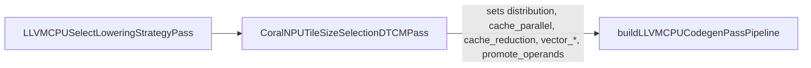

# Consolidate DTCM Tile-Size Selection, Non-Root Reductions, and Contraction Reuse

- **Author(s)**: Shaked Flur, Lun Dong
- **Component Doc(s)**: [dtcm_tiling.md](../dtcm_tiling.md), [tiling_levels_explained.md](../tiling_levels_explained.md)
- **Bug(s)**: None

---

## Part 1: Design Specification

### 1.1 Objective & Scope
- **Problem Statement**:
  1. Workgroup distribution tile assignment currently runs as a separate pass
     immediately after Data Tightly-Coupled Memory (`DTCM`) tile-size selection
     solely to copy the DTCM parallel tile sizes (`cache_parallel`) into the
     workgroup tile sizes (`distribution`) on the root operation's
     `lowering_config`. Maintaining two separate passes requires a shared MLIR
     analysis class (`TypeID`, pass-manager caching, and
     `markAnalysesPreserved`) that stores loop indices innermost-first (a
     convention from the removed register tile-size selection pass) only for
     the DTCM shrink loop to reverse them back to outermost-first order.
  2. Multiple unsupported-dispatch and alignment-fallback paths in tile-size
     selection and footprint estimation emit compiler warnings (`emitWarning`)
     to `stderr` on valid models (for example, dispatches with dynamic shapes),
     violating the silent-compilation requirement in
     [`AGENTS.md`](../../.agents/AGENTS.md).
  3. Dispatches containing non-root compute operations with reduction loops or
     more parallel loops than the root operation (such as a decomposed
     `linalg.softmax` containing a `max` reduction producer, an `exp` + `sum`
     reduction root, and a `div` elementwise consumer) are rejected by DTCM
     tile-size selection, leaving IREE's default `distribution` tile sizes
     unbounded by the DTCM capacity.
  4. Every non-Zvt contraction is currently marked for DTCM operand promotion
     (`promote_operands`) and reduction-loop splitting (`cache_reduction`),
     including zero-reuse vector-matrix (`vecmat`), matrix-vector (`matvec`),
     and dot-product contractions where one parallel dimension has unit extent
     (`M == 1` or `N == 1`). Copying single-use weight matrices into DTCM slows
     `gemma3` and `gemma4` by 3–4x and `anomaly` by 6x. In addition, the DTCM
     footprint estimator clamps untiled (`vector_reduction = 0`) streamed
     reduction loops to 1 iteration instead of their full loop range.
  5. When an unaligned Zvt matrix-unit `M` loop (`range % 16 != 0`, such as
     `M = 196` or `M = 49` in `efficientnet` and `mobilenetv2`) has no exact
     divisor in `[16, tile / 2]`, the DTCM tile search shrinks `M` down to its
     16-row alignment (`16`), which does not divide the loop range. The
     resulting dynamic partial workgroup slice falls back to masked RISC-V
     Vector (`RVV`) outer products, allocating a 4 KB stack buffer (exceeding
     the 3 KB stack limit) or overflowing Instruction Tightly-Coupled Memory
     (`ITCM`).
- **Goals**:
  1. **CL 2a (Pass & Analysis Consolidation)**:
     - Merge workgroup distribution tile assignment into the DTCM tile-size
       selection pass so the pass writes `distribution = cache_parallel`
       alongside `cache_parallel` and `cache_reduction`, and remove the
       standalone workgroup pass and shared analysis class.
     - Store loop indices in outermost-first order without reversing them in the
       DTCM shrink loop.
     - Convert all remaining `emitWarning` calls in tile-size selection and
       footprint estimation to `mlir::remark::missed` paired with `LDBG()`.
     - Preserve identical tile sizes across all LIT and model tests.
  2. **CL 2b (Non-Root Compute Op Support)**:
     - Bound DTCM tile sizes on dispatches with non-root `TilingInterface`
       compute operations that have reduction loops or more parallel loops than
       the root operation when both the root and non-root operations are
       same-block single-result projected-permutation non-contraction `LinalgOp`
       operations sharing the root's static loop ranges and single innermost
       reduction loop (such as decomposed `linalg.softmax`).
     - Keep `cache_reduction = [0, ...]` on multi-op reduction dispatches to
       prevent redundant producer-reduction recomputation inside
       `CacheReductionTiles`, accept the `1x...x1` parallel tile when a single
       row exceeds the DTCM budget, and snap parallel vector tiles to static
       slices so producer reductions do not fuse into the root's
       `vector_reduction` loop.
     - Enable the end-to-end `softmax_f32` and `softmax_bf16` model check tests
       in `tests/models/linalg/`.
  3. **CL 2c (Contraction Reuse Gating & Static Zvt `M`-Divisor Shrinking)**:
     - Restrict DTCM operand promotion (`promote_operands`) and reduction-loop
       splitting (`cache_reduction`) to contractions with reuse (`M > 1` and
       `N > 1`), streaming the reduction loops of zero-reuse contractions
       (`vecmat`, `matvec`, `dot`) and all non-contractions.
     - Preserve the full loop range in the DTCM footprint estimator when a
       streamed reduction loop has no vector tile (`vector_reduction <= 0`).
     - Search `(tile / 2, tile - 1]` for exact divisors of unaligned loops when
       none exist in `[align, tile / 2]`, and keep Zvt `M` workgroup tiles on
       exact divisors of the loop range so `efficientnet` and `mobilenetv2`
       compile within the 3 KB stack and 8 KB ITCM limits, re-enabling
       `efficientnet_test` in CI.
- **Non-Goals**:
  - Refining RVV register-level vector tile sizes (`vector_common_parallel`,
    `vector_reduction`), CPU lowering pipelines, or synchronized non-root RVV
    lowering configs (addressed in the companion design document
    [rvv_tile_size_selection.md](rvv_tile_size_selection.md)).
  - Adding an upstream IREE callback in `LLVMCPUSelectLoweringStrategyPass`
    between root configuration and non-root configuration propagation (tracked
    in **Part 3: Follow-Up Items**).
  - Changing the relative shrink order between parallel and reduction loops for
    promoted contractions with reuse.

### 1.2 Background & Invariants
In the CoralNPU compilation pipeline (see [dtcm_tiling.md](../dtcm_tiling.md)
and [tiling_levels_explained.md](../tiling_levels_explained.md)), IREE's
`LLVMCPUSelectLoweringStrategyPass` first attaches a `lowering_config` attribute
to compute operations in each dispatch, setting initial workgroup
(`distribution`) and register (`vector_common_parallel`, `vector_reduction`,
`vector_inner_parallel`) tile sizes. Next, `CoralNPUTileSizeSelectionDTCMPass`
(`CoralNPUTileSizeSelectionDTCM.cpp`) selects matrix-extension (`Zvt`, see
[matrix_codegen.md](../matrix_codegen.md)) vector tile sizes when applicable,
searches for DTCM cache tile sizes (`cache_parallel`, `cache_reduction`) whose
estimated buffer footprint (`DTCMFootprintModel::estimate` in
`CoralNPUTileSizeSelectionFootprint.cpp`) fits within the DTCM budget, and sets
`promote_operands` on promoted RVV contractions so `CoralNPUPromoteOperandsPass`
allocates workgroup-local DTCM buffers.

The following invariants must hold across the tile-size selection pipeline:
- **Workgroup = DTCM parallel tile**: Each workgroup processes one DTCM parallel
  tile (`distribution == cache_parallel`).
- **Outermost-first loop shrinking**: The DTCM tile search (`shrinkLoops` in
  `CoralNPUTileSizeSelectionDTCM.cpp`) must shrink outer loops before inner
  loops so outer batch and spatial dimensions are partitioned before inner
  vectorized dimensions.
- **Silent normal compilation**: Internal compiler fallbacks and unsupported
  tile-size selection shapes (such as dynamic shapes or sub-byte types) must not
  emit warnings to `stderr`; they must report via `mlir::remark::missed` and
  `LDBG()`.
- **Operand promotion only on contractions with reuse**: Copying an input
  operand tile into DTCM only amortizes the copy cost when the contraction
  reuses each promoted slice across multiple iterations of the opposite parallel
  dimension (`M > 1` for the right-hand side and `N > 1` for the left-hand
  side). Zero-reuse contractions (`vecmat`, `matvec`, `dot`) and
  non-contractions read each input element once per reduction pass and must
  stream their reduction loops without `promote_operands` or `cache_reduction`
  splitting.
- **Static Zvt `M` workgroup slices**: When a Zvt contraction has a fused
  consumer, `CoralNPUMatrixCodegen` drains the Zvt accumulators through a DTCM
  scratch tile for each static peeled tile shape. If `distribution` tiles the
  `M` dimension to a non-divisor of the static `M` range, the workgroup loop
  produces a dynamic (`?`) `M` slice that cannot use the static Zvt microkernel
  and falls back to masked RVV outer products on a 4 KB stack buffer. Zvt `M`
  workgroup tiles must therefore stay on exact divisors of the static `M` loop
  range.
- **No `cache_reduction` split and static parallel slices on multi-op
  reductions**: In IREE's `addMultiTilingExpertPassPipeline`,
  `LLVMCPUTileRootAndFuseInputOperandsPass` tiles the root along
  `cache_reduction` and `vector_reduction`. On a multi-reduction chain like
  decomposed `linalg.softmax` (`%max` -> `%exp_sum` -> `%div`), a non-zero
  `cache_reduction` on `%exp_sum` fuses `%max` inside the outer reduction loop
  (`O(N^2)` recomputation), and a dynamic (`?`) parallel slice at
  `vector_reduction` prevents `createOrFold<tensor::ExtractSliceOp>` from
  folding the identity parallel slice on `%max`, fusing `%max` inside every
  `vector_reduction` step. Multi-op reduction dispatches must therefore keep
  `cache_reduction = [0, ...]` and snap parallel vector tile sizes to divisors
  of the DTCM tile (or `1` when the DTCM tile does not divide the loop range).
- **Root-anchored tiling and RISC-V vectorization on non-root ops**: When
  `CoralNPUTileSizeSelectionDTCMPass` updates the root operation's
  `lowering_config` (for `!useZvt`), non-root compute operations keep the
  `lowering_config` assigned by `LLVMCPUSelectLoweringStrategyPass`:
  - At the cache and vector parallel levels (`CacheParallelTiles`,
    `VectorCommonParallelTiles`), `LLVMCPUTileAndFuseProducerConsumerPass` uses
    the root operation (the unique operation with `distribution`) as its anchor
    (`getRootOp`) and tiles and fuses the other operations with the root's tile
    sizes.
  - At the vector level on RISC-V, `LLVMCPUTileToVectorSizePass` only re-tiles a
    fused operation if its configured `vector_common_parallel` size is smaller
    than its current tile (and the strategy sizes on non-root operations are
    always at least the clamped root tile size), and `GenericVectorizationPass`
    (`useConfiguredVectorSizes = false` on RISC-V) infers vector sizes directly
    from the IR.

### 1.3 Alternatives Considered

| Option                                                                                          | Pros                                                                                   | Cons                                                                                   | Est. LOC    |
| :---------------------------------------------------------------------------------------------- | :------------------------------------------------------------------------------------- | :------------------------------------------------------------------------------------- | :---------- |
| **Option 1 (Chosen)**: Consolidate into `CoralNPUTileSizeSelectionDTCM` + `getDTCMRoot` (3 CLs) | - Removes 1 pass and 1 analysis class.<br>- Isolates refactor, softmax, and perf fixes.| - Leaves non-root `lowering_config` attributes at strategy values until RVV sync lands.| +195 / -325 |
| **Option 2**: Keep `CoralNPUTileSizeSelectionAnalysis` and `Workgroup` pass; add non-root logic | - Smaller diff in `CoralNPUTileSizeSelectionDTCM.cpp`.                                 | - Retains dead analysis boilerplate, reversed loop order, and redundant pass walk.     | +135 / -35  |
| **Option 3**: Add a target callback inside IREE's `LLVMCPUSelectLoweringStrategyPass`           | - `MultiLoweringConfigGenerator` derives non-root configs from the DTCM root config.   | - Requires a new `third_party/iree` patch and an upstream `cache_reduction` fix.       | +250 / -325 |

- **Decision Rationale**: Avoiding new `third_party/iree` patches and removing
  redundant pass/analysis state is a priority over minimizing local line churn
  in `CoralNPUTileSizeSelectionDTCM.cpp`, so we chose Option 1, accepting that
  non-root `lowering_config` attributes remain at their strategy values until
  the companion RVV synchronization change lands.
- **Reconsideration Trigger**:
  - **Option 2**: Considered to minimize edits in
    `CoralNPUTileSizeSelectionDTCM.cpp`, but failed because it preserves a
    redundant pass walk and innermost-first loop reversal across passes. It
    would only be reconsidered if an external pass outside
    `CoralNPUTileSizeSelectionDTCMPass` needed cached MLIR pass-manager queries
    for `DTCMRoot`.
  - **Option 3**: Considered so IREE's `MultiLoweringConfigGenerator` could
    derive non-root configs after DTCM root sizing, but failed because it
    requires patching `third_party/iree` and fixing upstream `cache_reduction`
    propagation. It will be reconsidered when upstreaming local-memory fitting
    into IREE's `LLVMCPUSelectLoweringStrategyPass` (tracked in **Part 3**).

### 1.4 Detailed Technical Design

#### Architecture / Control Flow



In [`CoralNPUTargetBackend.cpp`](../../compiler/Target/CoralNPUTargetBackend.cpp),
`buildConfigurationPassPipeline` schedules only
`createCoralNPUTileSizeSelectionDTCMPass(dtcmOptions)` after
`createLLVMCPUSelectLoweringStrategyPass()`.

During `CoralNPUTileSizeSelectionDTCMPass::runOnOperation()`
([`CoralNPUTileSizeSelectionDTCM.cpp`](../../compiler/Transforms/CoralNPUTileSizeSelectionDTCM.cpp)):
1. The pass collects `SmallVector<Operation *> computeOps =
   getComputeOps(funcOp);` once, calls `getDTCMRoot(funcOp, computeOps)` to
   identify and validate the unique root operation and any supported non-root
   compute operations, and constructs `DTCMFootprintModel`.
2. `selectDTCMTileSizes` determines whether the root is a contraction with
   reuse (`hasContractionReuse(root.op)`), sets
   `streamReduction = !hasReuseContraction` (or `true` when `useZvt` is chosen),
   and searches for DTCM tile sizes (`dtcmTileSizes`) that fit within
   `budgetBytes` by shrinking parallel loops first (keeping Zvt `M` tiles on
   exact divisors of the static `M` range) and reduction loops only when
   `!streamReduction`.
3. After the search, the pass clamps vector tile sizes to the selected DTCM tile
   sizes (`clampToTileSizes`), snaps parallel vector tile sizes to static slices
   on multi-op reductions (`snapParallelVectorSizesToStaticTiles`), and calls
   `applySelectedTileSizes` to write `cache_parallel`, `cache_reduction`,
   `distribution = cache_parallel`, updated vector levels, and (when
   `!selected.useZvt && hasContractionReuse(root.op)`) `promote_operands`.

#### Contracts & Boundaries
- **Imposed Preconditions (Caller / Input Obligations)**:
  - `LLVMCPUSelectLoweringStrategyPass` has executed on `funcOp`, attaching
    `translation_info` to `funcOp` and a `lowering_config` with a workgroup
    (`distribution`) tiling level to at most one root compute operation in
    `computeOps`.
- **Offered Postconditions (Callee / Output Guarantees)**:
  - On supported dispatches (`getDTCMRoot` succeeds and a valid tile is found):
    - The root operation's `lowering_config` has `cache_parallel` and
      `distribution` set to identical tile sizes (`0` for untiled dimensions),
      `cache_reduction` set to `[0, ...]` whenever `streamReduction` is `true`
      (all Zvt roots, convolutions, zero-reuse contractions, and single- or
      multi-op reductions), and `vector_common_parallel` / `vector_reduction`
      clamped so no active vector tile exceeds its DTCM tile.
    - On multi-op reduction dispatches (`!root.nonRootOps.empty()`), each
      parallel loop's `vector_common_parallel` entry divides its DTCM tile (or
      is `1` when the DTCM tile does not divide the static loop range).
    - `promote_operands` is attached to the root operation's `lowering_config`
      if and only if `!useZvt && hasContractionReuse(root.op)`.
    - On Zvt dispatches (`useZvt`), `dtcmTileSizes[m]` divides `loopRanges[m]`,
      `enable_loop_peeling` is set on `translation_info`, and `lowering_config`
      is erased from all non-root compute operations.
  - On unsupported dispatches (dynamic loop ranges, sub-byte or non-int/float
    result types, missing unique root or `translation_info`, or unsupported
    non-root compute operations):
    - `getDTCMRoot` emits `mlir::remark::missed` (`DTCMTileSizes` or
      `NonRootTiling`) paired with `LDBG()` (without printing to `stderr`) and
      returns `failure()`, leaving the strategy pass's `lowering_config` and
      `translation_info` untouched.

#### Interfaces & Signatures

In [`CoralNPUTileSizeSelectionUtils.h`](../../compiler/Transforms/CoralNPUTileSizeSelectionUtils.h)
(`CL 2c`):
```cpp
// Returns true if `op` is a contraction with extent > 1 (or dynamic) along
// both M and N, excluding zero-reuse matvec, vecmat, and dot products.
bool hasContractionReuse(Operation *op);
```

In [`CoralNPUTileSizeSelectionDTCM.cpp`](../../compiler/Transforms/CoralNPUTileSizeSelectionDTCM.cpp)
(`CL 2a`–`CL 2c`):
```cpp
// The root op of a dispatch and its loops, for the DTCM tile-size selection.
struct DTCMRoot {
  Operation *op = nullptr;                  // has the strategy config
  IREE::CPU::LoweringConfigAttr config;
  SmallVector<int64_t> loopRanges;          // static ranges
  SmallVector<unsigned> parallelLoops;      // outermost first
  SmallVector<unsigned> reductionLoops;     // outermost first
  SmallVector<TilingInterface> nonRootOps;  // added in CL 2b
};

// Returns the root op if the DTCM tile-size selection supports the dispatch;
// else emits a missed remark (unless `computeOps` is empty) and returns
// failure.
FailureOr<DTCMRoot> getDTCMRoot(FunctionOpInterface funcOp,
                                ArrayRef<Operation *> computeOps);

// Shrinks the first loop in `loopIndices` whose tile in `dtcmTileSizes` can
// shrink; `zvtMLoop` (added in CL 2c) and `zvtNLoop` are the M and N loops of
// a Zvt root.
bool shrinkLoops(ArrayRef<unsigned> loopIndices, ArrayRef<int64_t> alignments,
                 ArrayRef<int64_t> ranges, std::optional<unsigned> zvtMLoop,
                 std::optional<unsigned> zvtNLoop,
                 MutableArrayRef<int64_t> dtcmTileSizes);
```

1. **Root Identification & Outermost-First Loops (`CL 2a`)**:
   - `getDTCMRoot` finds the unique operation in `computeOps` whose
     `getLoweringConfig<IREE::CPU::LoweringConfigAttr>(op)` exists and satisfies
     `config.hasWorkgroupTilingLevel()`, checks `getTranslationInfo(funcOp)`,
     verifies that the root implements `TilingInterface` with an integer/float
     result bit width `>= 8` and static loop ranges (`getStaticLoopRanges`), and
     populates `parallelLoops` and `reductionLoops` in **outermost-first** order
     (`0 .. loopRanges.size() - 1`).
   - `shrinkLoops` iterates directly over `loopIndices` without `llvm::reverse`.
   - In [`CoralNPUTileSizeSelectionFootprint.cpp`](../../compiler/Transforms/CoralNPUTileSizeSelectionFootprint.cpp)
     (`getOperandSpans`) and [`CoralNPUTileSizeSelectionDTCM.cpp`](../../compiler/Transforms/CoralNPUTileSizeSelectionDTCM.cpp),
     all remaining `emitWarning` calls are replaced with `LDBG()` and
     `remark::missed`.
2. **Non-Root Compute Op Support (`CL 2b`)**:
   - In `getDTCMRoot`, when a non-root `TilingInterface` op in `computeOps` has
     `!opReductionLoops.empty()` or
     `opParallelLoops.size() > root.parallelLoops.size()`, append `tilingOp` to
     `root.nonRootOps` and accept the dispatch if all of the following hold:
     - `root.reductionLoops == ArrayRef<unsigned>{static_cast<unsigned>(root.loopRanges.size() - 1)}`
       (the root has a single innermost reduction loop);
     - `computeOp->getBlock() == root.op->getBlock()`;
     - Both `root.op` and `computeOp` satisfy `isSupportedMultiOp`: they are
       single-result `linalg::LinalgOp` operations with projected-permutation
       indexing maps (`linalgOp.hasOnlyProjectedPermutations()`) and are not
       contractions (`!linalg::isaContractionOpInterface(linalgOp)`);
       - *Why `isFloat()` and `linalg::inferContractionDims({maps[0], maps[1],
         maps.back()})` from earlier prototypes are omitted*: Both checks
         existed solely to match the removed
         `CoralNPUTileSizeSelectionRegisterPass` (which only tuned float
         reductions and inspected `{maps[0], maps[1], maps.back()}` to classify
         4-input quantized `linalg.generic` matmuls as contractions). In
         `CoralNPUTileSizeSelectionDTCM`, contractions are identified via
         `linalg::isaContractionOpInterface(linalgOp)`, whereas calling
         `inferContractionDims({maps[0], maps[1], maps.back()})` falsely
         classifies a 2-input row reduction over two 2D `(d0, d1)` tensors (such
         as `max_j(x[i, j] + mask[i, j])`) as having contraction dimension
         `k = {1}` and rejects it.
     - `getStaticLoopRanges(tilingOp) == root.loopRanges`, and if
       `!opReductionLoops.empty()`, `opReductionLoops == root.reductionLoops`.
   - After `clampToTileSizes`, when `!root.nonRootOps.empty()` is `true`,
     `snapParallelVectorSizesToStaticTiles` snaps each parallel vector tile size
     to `1` when `range % dtcmSize != 0`, or `std::gcd(dtcmSize, vectorSize)`
     when `vectorSize > 0`.
3. **Contraction Reuse Gating & Zvt `M`-Divisor Shrinking (`CL 2c`)**:
   - `hasContractionReuse(Operation *op)` in
     [`CoralNPUTileSizeSelectionUtils.cpp`](../../compiler/Transforms/CoralNPUTileSizeSelectionUtils.cpp)
     checks that `op` is a `linalg::LinalgOp` satisfying
     `linalg::isaContractionOpInterface(linalgOp)` with `linalg::inferContractionDims(linalgOp)`
     succeeding, `!dims->k.empty()`, and both `dims->m` and `dims->n` having no
     zero-extent dimension and at least one dimension with dynamic extent or
     static extent `> 1`.
   - In `selectDTCMTileSizes`, `streamReduction` is initialized to
     `!hasContractionReuse(root.op)` (and restored to `!hasReuseContraction` in
     the Zvt-to-RVV fallback), the `1x...x1` parallel-tile fallback break is
     generalized from `!root.nonRootOps.empty()` to `streamReduction`, and
     `applySelectedTileSizes` sets `promote_operands` only when
     `!selected.useZvt && hasContractionReuse(root.op)`.
   - In [`DTCMFootprintModel::estimate`](../../compiler/Transforms/CoralNPUTileSizeSelectionFootprint.cpp),
     when `streamReduction` is `true`, reduction loops with `vectorSize <= 0`
     are skipped (`if (iteratorType != utils::IteratorType::reduction ||
     vectorSize <= 0) continue;`) so untiled streamed reduction loops retain
     their full range instead of clamping to `1`.
   - In `setZvtVectorSizes`, the minimum `M` DTCM tile size `minM =
     std::min(mTile, ranges[m])` advances to the smallest exact divisor of
     `ranges[m]` (`while (ranges[m] % minM != 0) ++minM; dtcmTileSizes[m] =
     minM;`).
   - In `shrinkLoops`, when `range % align != 0 && loopIdx != zvtNLoop`:
     - First search `div` down from `dtcmTileSizes[loopIdx] / 2` to `align` for
       an exact divisor of `range`.
     - If `div < align`, search `div` down from `dtcmTileSizes[loopIdx] - 1` to
       `align` for the largest exact divisor below the current tile (for
       example, shrinking `49 -> 28` when `range = 196` and `align = 16`).
     - If still `div < align` and `loopIdx == zvtMLoop`, `continue` without
       shrinking `M` so `M` remains a static divisor of `range` and `N` shrinks
       instead.

#### Representative Examples

1. **Decomposed `@softmax` (`64x256xf32`, `CL 2b`)**:
   - Input to `CoralNPUTileSizeSelectionDTCM` (after
     `LLVMCPUSelectLoweringStrategyPass`):
     ```mlir
     %max = linalg.generic ... // [64, 256] ["parallel", "reduction"]
       {lowering_config = #iree_cpu.lowering_config<vector_common_parallel = [8, 0], vector_reduction = [0, 8]>}
     %exp_sum = linalg.generic ... // [64, 256] ["parallel", "reduction"] (root)
       {lowering_config = #iree_cpu.lowering_config<distribution = [8, 0], vector_common_parallel = [8, 0], vector_reduction = [0, 8]>}
     %div = linalg.generic ... // [64, 256] ["parallel", "parallel"]
       {lowering_config = #iree_cpu.lowering_config<vector_common_parallel = [8, 0], vector_inner_parallel = [0, 8]>}
     ```
   - Output of `CoralNPUTileSizeSelectionDTCM` (24 KB budget; untiled
     `64x256xf32` input + output = 128 KB > 24 KB, so `d0` shrinks to `8`,
     footprint = 16 KB):
     ```mlir
     %exp_sum = linalg.generic ...
       {lowering_config = #iree_cpu.lowering_config<cache_parallel = [8, 0], cache_reduction = [0, 0], distribution = [8, 0], vector_common_parallel = [8, 0], vector_reduction = [0, 8]>}
     ```
   - With a 4 KB budget (`--coralnpu-dtcm-size-kb=12`), `d0` relaxes alignment
     to `1` and shrinks to `2` (`2 * 256 * 4 * 2 = 4096 B`), setting
     `cache_parallel = [2, 0]`, `distribution = [2, 0]`, and
     `vector_common_parallel = [2, 0]` on `%exp_sum`.
2. **Zero-Reuse `@vecmat_f32` (`640xf32 * 640x1024xf32`, `CL 2c`) and Unaligned
   Zvt `@matmul_zvt_m196_consumer` (`196x64xf32`, `CL 2c`)**:
   - On `@vecmat_f32`, `hasContractionReuse` returns `false` (`m` is empty), so
     `CoralNPUTileSizeSelectionDTCM` sets `cache_reduction = [0, 0]` and omits
     `promote_operands`.
   - On `@matmul_zvt_m196_consumer` (`196x64xf32` Zvt matmul with a fused bias +
     residual add consumer), `49` rows exceed the 24 KB budget (`49 * 64 * 4`
     bytes for `res` + output + `64x64` scratch), and no divisor of `196` exists
     in `[16, 24]`; `shrinkLoops` finds the exact divisor `28` in `(24, 48]`,
     setting `cache_parallel = [28, 0, 0]` and `distribution = [28, 0, 0]`
     instead of `16`.

#### Edge Cases & Fallbacks
- **Streamed-Reduction Root Exceeding DTCM at `1x...x1` Parallel Tile (`CL 2b`,
  `CL 2c`)**:
  When `streamReduction` is `true` (`!root.nonRootOps.empty()` in `CL 2b`,
  generalized to `streamReduction` in `CL 2c`) and `fallback` is already `true`
  (all parallel loops have shrunk to `1`, such as `@softmax_scaled` on
  `16x512xf32` with a 4 KB budget where 1 row needs 6 KB), the search emits
  `LDBG()` and `remark::missed` (`DTCMTileSizes`, reason `"workload cannot fit
  in DTCM even with 1x1x... parallel tile size; keeping 1x1x... parallel
  tile"`) and breaks out of the loop with the `1x...x1` parallel tile instead of
  failing compilation with `emitOpError`, because unpromoted roots do not
  allocate `#iree_codegen.workgroup_local` buffers.
- **Zvt Contraction Where Even the Smallest Exact-Divisor `M` Tile Exceeds
  Budget (`CL 2c`)**: If `minM` (snapped up to the smallest divisor of
  `ranges[m]` at least `16`, such as `49` for `M = 49`) still exceeds the DTCM
  budget even at `nTile = 16`, `setZvtVectorSizes` returns `false` and the pass
  falls back cleanly to RVV vector tile sizes, allowing `M` and `K` to split
  with RVV operand promotion.
- **Dead `linalg.fill` in `softmax_f32` and `softmax_bf16` Templates
  (`CL 2b`)**:
  In [`tests/models/linalg/check_gen_templates/softmax_f32.mlir`](../../tests/models/linalg/check_gen_templates/softmax_f32.mlir)
  and [`softmax_bf16.mlir`](../../tests/models/linalg/check_gen_templates/softmax_bf16.mlir),
  passing `outs(%empty)` directly instead of a dead 2D `linalg.fill` avoids the
  `llvm-cpu` dynamic-shape reference compilation error (`'vector.store' op write
  affecting operations on global resources`).

### 1.5 Verification Plan
- **Positive Tests**:
  - `bazel test --config=dev //tests/transforms:lit` verifying:
    - Zero tile-size changes in `CL 2a`;
    - `@softmax`, `@softmax_scaled`, `@softmax_unaligned`, and
      `@softmax_scaled_max` in `tests/transforms/tile_size_selection_dtcm.mlir`
      and `tests/transforms/tile_size_selection_footprint.mlir` in `CL 2b`;
    - `@vecmat_f32` (`cache_reduction = [0, 0]`, no `promote_operands`) and
      `@matmul_zvt_m196_consumer` (`cache_parallel = [28, 0, 0]`) in
      `tests/transforms/tile_size_selection_dtcm.mlir` in `CL 2c`.
- **Negative / Fallback Tests**:
  - `bazel test --config=dev //tests/transforms:lit` verifying
    `--implicit-check-not=warning:` on `SMALL` and `SMALL_NOZVT` runs (`CL 2a`),
    the single-row `SMALL` fallback on `@softmax_scaled` (`CL 2b`), and the
    Zvt-to-RVV fallback when no Zvt divisor tile fits (`CL 2c`).
- **End-to-End / Model / Hardware Checks**:
  - `bazel test --config=dev //tests/models/linalg:all //tests:check_generated`
    (verifying `softmax_f32` and `softmax_bf16` on `(4,8)`, `(120,256)`, and
    `(300,450)` in `CL 2b`).
  - `bazel test --config=dev //tests/examples:efficientnet_test //tests:ci`
    (verifying `efficientnet_test` compiles and passes in CI in `CL 2c`).

---

## Part 2: Implementation Plan

### 2.1 Expected Affected Files

- **Build**:
  - `compiler/Transforms/BUILD.bazel`
      - Remove deleted `CoralNPUTileSizeSelectionAnalysis.{h,cpp}` and
        `CoralNPUTileSizeSelectionWorkgroup.cpp` (`CL 2a`).
  - `compiler/Transforms/CMakeLists.txt`
      - Remove deleted `CoralNPUTileSizeSelectionAnalysis.{h,cpp}` and
        `CoralNPUTileSizeSelectionWorkgroup.cpp` (`CL 2a`).

- **Compiler**:
  - `compiler/Target/CoralNPUTargetBackend.cpp`
      - Remove `createCoralNPUTileSizeSelectionWorkgroupPass()` from
        `buildConfigurationPassPipeline` and update pipeline comments (`CL 2a`).
  - `compiler/Transforms/CoralNPUTileSizeSelectionAnalysis.cpp` *(deleted)*
      - Replaced by `DTCMRoot` and `getDTCMRoot` (`CL 2a`).
  - `compiler/Transforms/CoralNPUTileSizeSelectionAnalysis.h` *(deleted)*
      - Replaced by `DTCMRoot` and `getDTCMRoot` (`CL 2a`).
  - `compiler/Transforms/CoralNPUTileSizeSelectionDTCM.cpp`
      - Merge workgroup distribution assignment, add `DTCMRoot` and
        `getDTCMRoot` with outermost-first loops, convert warnings to missed
        remarks (`CL 2a`), support non-root multi-op reductions (`CL 2b`), and
        gate contraction promotion on `hasContractionReuse` while keeping Zvt
        `M` tiles on exact divisors (`CL 2c`).
  - `compiler/Transforms/CoralNPUTileSizeSelectionFootprint.cpp`
      - Convert unknown-bound `emitWarning` in `getOperandSpans` to
        `remark::missed` + `LDBG()` (`CL 2a`), and preserve full ranges on
        streamed reduction loops with `vectorSize <= 0` in
        `DTCMFootprintModel::estimate` (`CL 2c`).
  - `compiler/Transforms/CoralNPUTileSizeSelectionFootprint.h`
      - Update `DTCMFootprintModel::estimate` doc comment for streamed reduction
        loops without a vector tile (`CL 2c`).
  - `compiler/Transforms/CoralNPUTileSizeSelectionUtils.cpp`
      - Document 4 KB workgroup local memory page granularity (`CL 2a`) and
        implement `hasContractionReuse(Operation *op)` (`CL 2c`).
  - `compiler/Transforms/CoralNPUTileSizeSelectionUtils.h`
      - Declare `hasContractionReuse(Operation *op)` (`CL 2c`).
  - `compiler/Transforms/CoralNPUTileSizeSelectionWorkgroup.cpp` *(deleted)*
      - Merged into `CoralNPUTileSizeSelectionDTCM.cpp` (`CL 2a`).
  - `compiler/Transforms/Passes.h`
      - Remove `createCoralNPUTileSizeSelectionWorkgroupPass()` (`CL 2a`).
  - `compiler/Transforms/Passes.td`
      - Remove `CoralNPUTileSizeSelectionWorkgroup` and update the description
        of `CoralNPUTileSizeSelectionDTCM` (`CL 2a`, `CL 2c`).

- **Documentation**:
  - `docs/design/INDEX.md`
      - Update component descriptions and source paths (`CL 2a`, `CL 2c`).
  - `docs/design/dtcm_tiling.md`
      - Update pass table (`CL 2a`) and streamed reduction / reuse description
        (`CL 2c`).
  - `docs/design/tiling_levels_explained.md`
      - Update references to `CoralNPUTileSizeSelectionWorkgroupPass` (`CL 2a`),
        multi-op reduction alignment fallback (`CL 2b`), and Zvt `M` exact
        divisor shrinking (`CL 2c`).

- **Tests**:
  - `tests/examples/BUILD.bazel`
      - Re-enable `efficientnet_test` with `tags = ["ci"]` (`CL 2c`).
  - `tests/models/linalg/check_gen_templates/softmax_bf16.mlir`
      - Pass `outs(%empty)` directly (`CL 2b`).
  - `tests/models/linalg/check_gen_templates/softmax_f32.mlir`
      - Pass `outs(%empty)` directly (`CL 2b`).
  - `tests/models/linalg/generated_bf16/softmax_bf16_*.mlir` *(new)*
      - Static generated check tests for `softmax_bf16` (`CL 2b`).
  - `tests/models/linalg/generated_f32/softmax_f32_*.mlir` *(new)*
      - Static generated check tests for `softmax_f32` (`CL 2b`).
  - `tests/models/linalg/op_tests_bf16.bzl`
      - Enable `softmax_bf16` in CI (`CL 2b`).
  - `tests/models/linalg/op_tests_f32.bzl`
      - Enable `softmax_f32` in CI (`CL 2b`).
  - `tests/transforms/tile_size_selection_dtcm.mlir`
      - Add `--implicit-check-not=warning:` (`CL 2a`), `@softmax`,
        `@softmax_scaled`, and `@softmax_unaligned` (`CL 2b`), and
        `@vecmat_f32` and `@matmul_zvt_m196_consumer` (`CL 2c`).
  - `tests/transforms/tile_size_selection_footprint.mlir`
      - Add `@softmax_scaled_max` executable-source LIT test (`CL 2b`).

### 2.2 Implementation Tasks (`code` step)

#### CL 2a: Consolidate Workgroup Pass & Replace Analysis with `getDTCMRoot` (Pure Refactor)
- [x] **Task 1**: Merge `CoralNPUTileSizeSelectionWorkgroupPass` into
      `CoralNPUTileSizeSelectionDTCMPass` by setting `DistributionTiles` to
      `distParallelSizes`, removing `createCoralNPUTileSizeSelectionWorkgroupPass`
      in `CoralNPUTargetBackend.cpp`, `Passes.td`, and `Passes.h`, and deleting
      `CoralNPUTileSizeSelectionWorkgroup.cpp`.
  - *Target*: `compiler/Transforms/CoralNPUTileSizeSelectionDTCM.cpp`,
    `compiler/Target/CoralNPUTargetBackend.cpp`, `compiler/Transforms/Passes.td`,
    `compiler/Transforms/Passes.h`,
    `compiler/Transforms/CoralNPUTileSizeSelectionWorkgroup.cpp`,
    `compiler/Transforms/BUILD.bazel`
  - *Verify*: `bazel test --config=dev //tests/transforms:lit`
- [x] **Task 2**: Replace `CoralNPUTileSizeSelectionAnalysis` with `DTCMRoot`
      and `getDTCMRoot` in `CoralNPUTileSizeSelectionDTCM.cpp`, compute
      `computeOps` once in `runOnOperation()`, keep loop indices outermost-first
      without `llvm::reverse`, convert remaining `emitWarning` calls in
      `CoralNPUTileSizeSelectionDTCM.cpp` and
      `CoralNPUTileSizeSelectionFootprint.cpp` to `remark::missed` + `LDBG()`,
      and delete `CoralNPUTileSizeSelectionAnalysis.{h,cpp}`.
  - *Target*: `compiler/Transforms/CoralNPUTileSizeSelectionDTCM.cpp`,
    `compiler/Transforms/CoralNPUTileSizeSelectionFootprint.cpp`,
    `compiler/Transforms/CoralNPUTileSizeSelectionAnalysis.h`,
    `compiler/Transforms/CoralNPUTileSizeSelectionAnalysis.cpp`,
    `compiler/Transforms/BUILD.bazel`
  - *Verify*: `bazel test --config=dev //tests/transforms:lit`
- [x] **Task 3 (CL 2a Build & Doc Sync)**: Sync
      `compiler/Transforms/CMakeLists.txt`, `docs/design/dtcm_tiling.md`,
      `docs/design/tiling_levels_explained.md`, and
      `tests/transforms/tile_size_selection_dtcm.mlir`.
  - *Target*: `compiler/Transforms/CMakeLists.txt`,
    `docs/design/dtcm_tiling.md`, `docs/design/tiling_levels_explained.md`,
    `tests/transforms/tile_size_selection_dtcm.mlir`
  - *Verify*: `bazel test --config=dev //tests:ci`

#### CL 2b: Support Non-Root Compute Ops in `getDTCMRoot` & Enable Softmax Tests
- [x] **Task 4**: Extend `getDTCMRoot` and `CoralNPUTileSizeSelectionDTCM.cpp`
      to record supported non-root compute ops (`isSupportedMultiOp`) in
      `root.nonRootOps`, skip reduction-loop shrinking when
      `streamReduction || !root.nonRootOps.empty()`, break out of the search
      loop with a `DTCMTileSizes` missed remark when
      `!root.nonRootOps.empty() && fallback`, snap parallel vector tile sizes to
      static slices (`snapParallelVectorSizesToStaticTiles`), and update
      `docs/design/tiling_levels_explained.md`.
  - *Target*: `compiler/Transforms/CoralNPUTileSizeSelectionDTCM.cpp`,
    `docs/design/tiling_levels_explained.md`
  - *Verify*: `bazel test --config=dev //tests/transforms:lit`
- [x] **Task 5**: Add `@softmax`, `@softmax_scaled`, and `@softmax_unaligned`
      LIT test coverage (`CHECK`, `SMALL`, `HIGHMEM`) to
      `tests/transforms/tile_size_selection_dtcm.mlir`, and add
      `@softmax_scaled_max` executable-source coverage to
      `tests/transforms/tile_size_selection_footprint.mlir`.
  - *Target*: `tests/transforms/tile_size_selection_dtcm.mlir`,
    `tests/transforms/tile_size_selection_footprint.mlir`
  - *Verify*: `bazel test --config=dev //tests/transforms:lit`
- [x] **Task 6**: Fix `softmax_f32.mlir` and `softmax_bf16.mlir` templates in
      `tests/models/linalg/check_gen_templates/` to pass `outs(%empty)`
      directly, enable `softmax_f32` and `softmax_bf16` in `op_tests_f32.bzl`
      and `op_tests_bf16.bzl`, and generate static `.mlir` test files with
      `bazel run --config=dev //tests:copy_missing`.
  - *Target*: `tests/models/linalg/check_gen_templates/softmax_f32.mlir`,
    `tests/models/linalg/check_gen_templates/softmax_bf16.mlir`,
    `tests/models/linalg/op_tests_f32.bzl`,
    `tests/models/linalg/op_tests_bf16.bzl`,
    `tests/models/linalg/generated_f32/`, `tests/models/linalg/generated_bf16/`
  - *Verify*: `bazel test --config=dev //tests/models/linalg:all //tests:check_generated`

#### CL 2c: Gate Contraction Promotion on Reuse & Keep Zvt `M` Tiles on Exact Divisors
- [ ] **Task 7**: Add `hasContractionReuse(Operation *op)` to
      `CoralNPUTileSizeSelectionUtils.{h,cpp}`, set
      `streamReduction = !hasContractionReuse(root.op)` and gate
      `promote_operands` on `!selected.useZvt && hasContractionReuse(root.op)`
      in `CoralNPUTileSizeSelectionDTCM.cpp`, and skip reduction loops with
      `vectorSize <= 0` when `streamReduction` is `true` in
      `DTCMFootprintModel::estimate` (`CoralNPUTileSizeSelectionFootprint.{h,cpp}`).
  - *Target*: `compiler/Transforms/CoralNPUTileSizeSelectionUtils.h`,
    `compiler/Transforms/CoralNPUTileSizeSelectionUtils.cpp`,
    `compiler/Transforms/CoralNPUTileSizeSelectionDTCM.cpp`,
    `compiler/Transforms/CoralNPUTileSizeSelectionFootprint.h`,
    `compiler/Transforms/CoralNPUTileSizeSelectionFootprint.cpp`
  - *Verify*: `bazel test --config=dev //tests/transforms:lit`
- [ ] **Task 8**: Update `setZvtVectorSizes` and `shrinkLoops` in
      `CoralNPUTileSizeSelectionDTCM.cpp` to snap `minM` up to a divisor of
      `ranges[m]`, search `(tile / 2, tile - 1]` for unaligned exact divisors,
      and skip shrinking `zvtMLoop` when no divisor `>= align` exists.
  - *Target*: `compiler/Transforms/CoralNPUTileSizeSelectionDTCM.cpp`
  - *Verify*: `bazel test --config=dev //tests/transforms:lit`
- [ ] **Task 9 (CL 2c Tests, Docs & CI Sync)**: Add `@vecmat_f32` and
      `@matmul_zvt_m196_consumer` LIT tests to
      `tests/transforms/tile_size_selection_dtcm.mlir`, re-enable
      `efficientnet_test` (`tags = ["ci"]`) in `tests/examples/BUILD.bazel`, and
      update `Passes.td`, `docs/design/dtcm_tiling.md`, and
      `docs/design/tiling_levels_explained.md`.
  - *Target*: `tests/transforms/tile_size_selection_dtcm.mlir`,
    `tests/examples/BUILD.bazel`, `compiler/Transforms/Passes.td`,
    `docs/design/dtcm_tiling.md`, `docs/design/tiling_levels_explained.md`
  - *Verify*: `bazel test --config=dev //tests/transforms:lit //tests/examples:efficientnet_test`

### 2.3 Implementation Notes & Adaptations
- `getStaticLoopRanges` returns `std::optional<SmallVector<int64_t>>` using
  `getOffsetsSizesAndStrides` and `getConstantIntValues` from
  `mlir/Dialect/Utils/StaticValueUtils.h`, eliminating the
  `ShapedType::kDynamic` sentinel and the separate `llvm::is_contained` check.
- Factored `CoralNPUTileSizeSelectionDTCMPass::runOnOperation()` into focused
  helpers (`getTilingLevelSizes`, `setZeroAlignmentsToOne`,
  `selectDTCMTileSizes`, `enableLoopPeeling`, `setTilingLevel`, and
  `applySelectedTileSizes` using `NamedAttrList`), and updated
  `setZvtVectorSizes` to accept `const DTCMFootprintModel &` and `budgetBytes`
  directly (only mutating the output vector sizes when a Zvt tile fits).
- Switched the `RUN` lines in `tests/transforms/tile_size_selection_dtcm.mlir`
  from multi-device `%iree_compile ... --coralnpu-roofline-speedup-threshold=0`
  to single-device `iree-compile --mlir-disable-threading
  --iree-hal-target-device=coralnpu` because `CoralNPUAffinityAnnotationPass`
  checks `isa<linalg::LinalgOp>(*rootOp)` before `DecomposeSoftmaxPass` runs and
  routes `linalg::SoftmaxOp` (`AggregatedOpInterface`) to the host CPU in
  multi-device compilations (tracked in **Part 3**).
- Added `snapParallelVectorSizesToStaticTiles` in `selectDTCMTileSizes` when
  `!root.nonRootOps.empty()` is `true` after discovering that
  `softmax_bf16_300_450_check_test` (`300 % 8 != 0`) overflowed 8 KB ITCM
  (`.text` = 12,425 B): a dynamic parallel slice (`?`) prevents
  `createOrFold<tensor::ExtractSliceOp>` from folding the identity slice on
  `%max` during `LLVMCPUTileRootAndFuseInputOperandsPass(VectorReductionTiles)`,
  fusing `%max` inside every step of `%exp_sum`'s `vector_reduction` loop.
  Snapping `vector_common_parallel` to `[1, 0]` keeps `%max` outside the
  reduction loop, shrinking `.text` to 5,483 B with zero vector register spills
  (covered by `@softmax_unaligned` on `196x256xf32`, and tracked upstream in
  **Part 3**).

### 2.4 Documentation Archive Checklist (`archive` step — Pre-Submit)
Run this step in the final implementation CL before uploading for review:

- [ ] Fold lasting architectural changes (including non-obvious "Why Not X"
      rejected-alternative rationales) into `docs/design/dtcm_tiling.md` and
      `docs/design/tiling_levels_explained.md`, and update
      `docs/design/INDEX.md` if a component doc was added or its scope changed.
- [ ] Move this document from
      `docs/design/changes/dtcm_root_and_non_root_tiling.md` to
      `docs/design/archive/dtcm_root_and_non_root_tiling.md` using `git mv`.
- [ ] Format modified code with `./scripts/format-code.sh`.

---

## Part 3: Follow-Up Items (For Reviewer Approval -> Buganizer `564546727`)

- [ ] **Prevent `LLVMCPUTileRootAndFuseInputOperandsPass(VectorReductionTiles)` from fusing producer reductions across dynamic identity parallel slices in IREE** (`P2` | `third_party/iree/compiler/src/iree/compiler/Codegen/LLVMCPU/LLVMCPUTileAndFuseProducerConsumer.cpp`):
      When a reduction root's parallel tile size is dynamic (`?`),
      `createOrFold<tensor::ExtractSliceOp>` cannot fold the identity
      `[0] [%d0] [1]` slice on a 1D producer reduction result (such as `%max` in
      decomposed `linalg.softmax`), causing
      `scf::tileConsumerAndFuseProducersUsingSCF` to fuse the producer reduction
      inside every iteration of the root's `vector_reduction` loop (`O(N^2)`
      work). Fix upstream IREE (either by folding full-extent dynamic identity
      `tensor.extract_slice` ops or by filtering reduction-untiled operands in
      `tileRootAndFuseInputOperands`) so multi-row dynamic parallel vector tiles
      remain safe without snapping `vector_common_parallel` to `1`.
- [ ] **Support `linalg.softmax` and aggregated ops in `CoralNPUAffinityAnnotationPass`** (`P2` | `compiler/Transforms/CoralNPUAffinityAnnotation.cpp`):
      `CoralNPUAffinityAnnotationPass` runs during `DispatchCreation` (before
      `DecomposeSoftmaxPass` in target configuration) and requires
      `isa<linalg::LinalgOp>(*rootOp)`, routing `linalg::SoftmaxOp`
      (`AggregatedOpInterface`) to the host CPU in multi-device compilations
      (such as PJRT). Teach `CoralNPUAffinityAnnotationPass` and its roofline
      estimator to recognize `linalg::SoftmaxOp` (and evaluate other
      non-`LinalgOp` compute roots supported by CoralNPU codegen).
- [ ] **Run target tile-size selection before `setLoweringConfigForComputeOps` in IREE** (`P3` | `compiler/Transforms/CoralNPUTileSizeSelectionDTCM.cpp`):
      Evaluate adding an upstreamable hook in `setTranslationInfoAndRootConfig`
      between `setRootConfigImpl` and `setLoweringConfigForComputeOps` (together
      with fixing `cache_reduction` propagation in
      `MultiLoweringConfigGenerator`) so IREE automatically derives non-root
      compute op lowering configs from the DTCM-refined root config.
