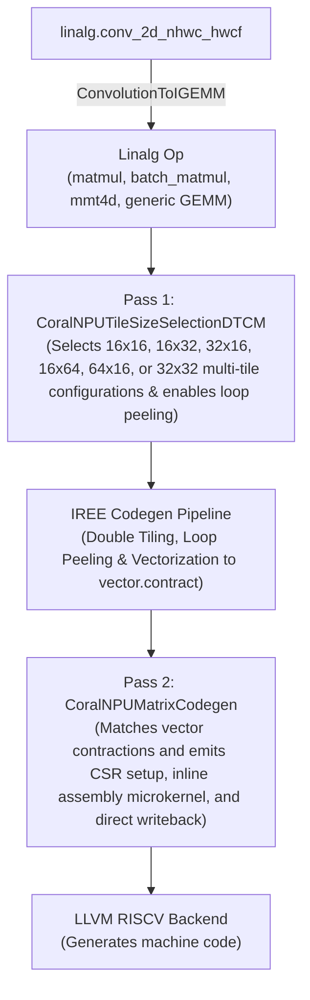

# CoralNPU Matrix Codegen Design & Implementation

This document describes the design and implementation of the direct codegen path in the CoralNPU compiler targeting the RISC-V **Zvt (Matrix)** extension.

## 1. Overview

The Zvt extension adds matrix-multiply instructions to the CoralNPU. The goal of this codegen path is to lower matrix multiplication operations (`linalg.matmul`, `linalg.batch_matmul`, 2D/batched/N-D `linalg.generic` contractions and `linalg.mmt4d`), spatial convolutions, and, once enabled (§2.0), convolutions via implicit GEMM directly to Zvt instructions when supported by the hardware, falling back to the standard vector (RVV / Zve) path otherwise.

The Zvt unit computes outer-product multiply-accumulates with $TM=16, TN=16$, and $TK \in \{1, 2, 4\}$ (`TK=1` for FP32, up to `TK=2` for BF16 and `TK=4` for INT8). It has 16 tile registers (`mt0`–`mt15`); a $16 \times 16$ tile of 32-bit accumulators occupies four of them, so the four 32-bit accumulators are `mt0`, `mt4`, `mt8` and `mt12`.

To reuse loaded operands across tiles and interleave the accumulators so consecutive multiplies target different tiles, the compiler picks one of the following accumulation layouts by shape:
*   **$2 \times 2$ Multi-Tile Grid** ($32 \times 32$ output block per iteration) utilizing all 4 independent 32-bit matrix accumulators (`mt0`, `mt4`, `mt8`, `mt12`), each updated once per $TK$ step, when $M$ and $N$ are both multiples of 32 and the tile fits the DTCM (§2.1).
*   **$1 \times 4$ / $4 \times 1$ Multi-Tile Strip** ($16 \times 64$ or $64 \times 16$ output block) utilizing all 4 accumulators (`mt0`, `mt4`, `mt8`, `mt12`) with a single shared LHS or RHS load per K step when $M$ is not a multiple of 32 and $N$ a multiple of 64, or $M$ is a multiple of 64 and $N$ takes 16-column tiles (§2.1).
*   **$1 \times 2$ / $2 \times 1$ Multi-Tile Strip** ($16 \times 32$ or $32 \times 16$ output block) utilizing 2 accumulators (`mt0` and `mt4`) when one dimension is a multiple of 32, or a 4-tile layout does not fit.
*   **$1 \times 1$ Single-Tile** ($16 \times 16$ output block) utilizing `mt0` otherwise, and always for `linalg.mmt4d`.

The codegen also handles partial tiles with $M < 16$ or $N \in \{8, 12\}$ (§2.3).

---

## 2. Compilation Pipeline



### 2.0. ConvolutionToIGEMM (Preprocessing)
`CoralNPUSession::extendPreprocessingPassPipeline` invokes IREE's `ConvolutionToIGEMMPass` (`createConvolutionToIGEMMPass`) with a CoralNPU affinity filter before partitioning, converting convolutions targeted for CoralNPU into an implicit GEMM format (`iree_linalg_ext.im2col` + a generic contraction op):
*   **Target-Aware**: Only converts convolutions whose `stream.affinity` device symbol name contains `coralnpu` (see Current status).
*   **Affinity Propagation**: The generated generic GEMM operation inherits the `coralnpu` `stream.affinity` attribute from the source convolution.
*   **GEMM Mapping**: The generic contraction is a Zvt candidate if `isZvtMatrixContraction` accepts it (§2.1); this is unverified on `im2col` output, since the filter never matches in a real compile.
*   **Current status**: in a real compile no convolution carries a CoralNPU `stream.affinity` during preprocessing (`CoralNPUAffinityAnnotation` assigns affinity to dispatches later, in DispatchCreation, and device globals are named `@__device_N`), so the filter never matches and convolutions take the RVV fallback. Enabling it needs an earlier placement decision and a convolution allowlist; depthwise and dilated convolutions produce `im2col` that fails to lower.

### 2.1. Pass 1: CoralNPUTileSizeSelectionDTCM (Configuration & Loop Peeling)
Before tile-size selection in `buildConfigurationPassPipeline`, `CoralNPURestoreConvInputChannelPass` restores unit input channels stripped by unit-dim folding on single-channel convolutions, and `FoldReshapeIntoInterfaceTensorPass` + `CleanupBufferAllocViewPass` fold resulting interface reshapes into row-major buffers. `CoralNPUTileSizeSelectionDTCM` then picks the DTCM (cache-level) tile sizes for the root Linalg operation (`CPUDoubleTilingExpert` pipeline); for a Zvt contraction whose tile fits, it also replaces the RVV vector parallel tile sizes set by `CoralNPUTileSizeSelectionRegister`:
*   **Contraction Detection**: Uses `isZvtMatrixContraction(op)` (gated by `hasZvtTargetFeature(op)`) to identify Zvt-compatible 2D/batched/N-D contractions and spatial convolutions (`linalg.matmul`, `linalg.batch_matmul`, `linalg.conv_2d_nhwc_hwcf`, and `linalg.generic` ops with trailing A dims $M \times K$ or $K \times M$ or spatial window `oh * sh + kh, ow * sw + kw`, trailing B dims $K \times N$ or $N \times K$, in either input order, and trailing C dims $M \times N$ or $N \times M$) and `linalg.mmt4d` operations across FP32 (FP32 $\times$ FP32 $\to$ FP32), BF16 (BF16 $\times$ BF16 $\to$ FP32) and INT8 (INT8 $\times$ INT8 $\to$ INT32). It requires a static init shape; for contractions at least two parallel loops, one or more reduction loops (leading spatial reduction loops are tiled to 1 around the innermost $K$ loop), $M \ge 3$ ($M$ a multiple of 16, any $M$ when A is indexed by C's rows and $K$, or a spatial window with $K > 1$ and an exact divisor of $M$ in $[3, 15]$), and $N \ge 8$ ($N$ a multiple of 16, or a multiple of 8 or 12 with C indexed $M \times N$, A as the first input and an exact divisor of $M$ in $[3, 15]$); for `mmt4d` a static LHS shape and $16 \times 16 \times 1$ inner tiles; no reduction `linalg` consumer in the dispatch (fused elementwise consumers such as bias, BatchNorm, activations, or `tosa.apply_scale` requantization are supported), and an init that is a zero constant, a zero `linalg.fill` or a value loaded from memory (the tiles are zeroed or seeded from it); a computed init stays on RVV.
*   **Loop Dimension Order**: `m` and `n` are taken from the trailing two dimensions of the output indexing map (row then column); any leading parallel loops are tiled to 1.
*   **Multi-Tile Register Selection**:
    *   $M \ge 32$ and $N \ge 32$ both multiples of 32: **$2 \times 2$**, `mTile = nTile = 32`.
    *   $M$ not a multiple of 32 and $N$ a multiple of 64: **$1 \times 4$**, `16x64`; $M$ a multiple of 64 and `nTile` = 16 (e.g. $N \le 16$, or $N = 24$ as 16 + 8): **$4 \times 1$**, `64x16`. When $M > 16$ is not a multiple of 16, `mTile` snaps to the largest exact divisor of $M$ in $[3, 15]$ whenever peeling is disallowed (convolutions decomposed to 1D with two or more window loops, a convolution tail under 3 rows, e.g. $M = 49$ uses `mTile = 7`, or $N \bmod 16 \neq 0$) or when the divisor tile requires no more tile-steps than peeling (e.g. $M = 30$ uses `mTile = 15`); otherwise contractions and 1D convolutions peel $M$. For contractions and 1D convolutions with unpeeled $M$, an $N \ge 32$ with $N \bmod 8 = 0$ and $0 < N \bmod 32 \le 16$ takes the 64-column tile when $N \ge 64$, $N \bmod 64 \le 16$ and `mTile` $\le 16$, else the 32-column one, and peels the $\le 16$-column remainder (e.g. 40 as 32 + 8, 48 as 32 + 16, 80 as 64 + 16).
    *   Only one of $M$, $N$ a multiple of 32: **$1 \times 2$** / **$2 \times 1$**, `16x32` or `32x16`.
    *   Base fallback tile configuration (including $3 \le M < 16$), and always for `linalg.mmt4d`: `mTile = 16` ($\min(M, 16)$), `nTile = 16` when $N$ is a multiple of 16 or peeling is enabled and leaves no 4-column remainder, else 12 when $N$ is a multiple of 12 (e.g. 24 as $2 \times 12$), else 8 ($\min(N, \text{nTile})$).
*   **DTCM Fit**: Zvt streams reduction loops one step at a time into tile accumulators and `CoralNPUMatrixCodegen` cannot lower a split reduction loop, so the register tile shrinks ($16 \times 64 \to 16 \times 32$, $64 \times 16 \to 32 \times 16$, $32 \times 32 \to 16 \times 32$, $16 \times 32 / 32 \times 16 \to 16 \times 16$) until a single-reduction-step tile fits `--coralnpu-dtcm-size-kb` (otherwise the op stays on RVV), and DTCM tile shrinking stops at a single register tile per workgroup instead of splitting reduction dims. When shrinking DTCM tile sizes, aligned dimensions ($R \bmod \text{align} = 0$) shrink before unaligned ones, and each step picks an exact divisor of the loop range ($\ge \text{align}$) so workgroup tiles stay static and avoid remainder overhead; an unaligned Zvt $N$ shrinks to multiples of its register tile instead.
*   **Loop Peeling**: Adds `enable_loop_peeling` to the `translation_info` configuration when the root op takes the Zvt tile sizes (or an RVV vector tile does not divide its loop range), so a dimension that is not a multiple of its tile size (e.g. $N=80$ tiled by 64, $M=196$ tiled by 16 into a $16 \times N$ main loop and a peeled $4 \times N$ tail loop, or $M=50$ tiled by 16 into a $16 \times N$ main loop and a peeled $2 \times N$ tail) yields a static remainder subview instead of a masked `affine.min` slice.

### 2.2. Vectorization & Pre-LLVM Lowering Hook
This phase runs the standard IREE codegen pipeline:
*   **Double Tiling & Vectorization**: Lowers Linalg operations into 2D `vector.contract` operations (e.g., `vector<16x16xf32>`, `vector<16x32xf32>`, or `vector<16x32xi32>`).
*   **Pre-LLVM Lowering Hook (`beforeLowerToLLVMHook`)**: Before converting to LLVM dialect, `CoralNPUTargetBackend` invokes a callback that executes:
    1.  `MemrefCopyToLinalgPass` and `GenericVectorizationPass`: vectorize leftover ops of fewer than 1024 elements, e.g. the `memref.copy` / `linalg.copy` ops emitted during bufferization.
    2.  `DropVectorUnitDimsPass`: Folds unit vector dimensions.
    3.  `CoralNPUApproximateMathPass` (`--coralnpu-fast-math`, default on) and `MathTransformPass`: replace `math.tanh`, `math.exp`, `math.erf` and the erfc expansion with cheaper approximations, then expand the remaining math ops.
    4.  `CoralNPUOptimizeVectorLoopsPass`: accumulates loop-carried `vector.reduction` sums in vectors, and unrolls, unroll-and-jams and interchanges vectorized loops.
    5.  `CoralNPULimitLoopUnrollingPass`: limits LLVM loop unrolling to bound ITCM code size.
    6.  `CoralNPUMatrixCodegenPass`: Lowers supported vector contractions to Zvt inline assembly.

### 2.3. Pass 2: CoralNPUMatrixCodegen
This pass runs on MLIR `FunctionOpInterface` within `beforeLowerToLLVMHook` and converts vector contractions into Zvt inline assembly:

> [!NOTE]
> **Why raw inline assembly rather than the `llvm.riscv.zvt.*` intrinsics.**
> 1. The tile configuration has to live in the same assembly block as the tile
>    operations it governs (step 2 below); with intrinsics, LLVM is free to place
>    a `vsetvli` in between, which would clear `mtype` and `vtype.altfmt`.
> 2. The K-loop is written as an assembly loop so its body and code size are
>    fixed by construction rather than left to the unroller — ITCM is small, and
>    a contraction-level lowering would expand per K step.
> 3. The fused microkernel and the seed/drain blocks use a fixed register
>    assignment (`t0`–`t6`, `v0`–`v31`); unfused multiply blocks pin their
>    operands to the bases of slots 0, 1, 2, ... (`getZvtOperandBase`). Zvt
>    v0.4 requires each operand base to be LMUL-aligned and in the first
>    $8 / K_{max}$ registers of its 8-register group ($K_{max} = 32 / SEW$).
>
> The cost is deliberate: the register allocator is shut out of the microkernel,
> and the `~{memory}` clobber on the microkernel and seed/drain blocks prevents
> scheduling and alias analysis across them.
> `llvm-project-0001-add-zvt-support.patch` also defines the full Zvt intrinsic
> and ISel surface; this pass does not use it today and it is kept for ISA
> completeness and eventual upstreaming. The *instruction*
> definitions in `RISCVInstrInfoZvt.td` are not optional — the inline assembler
> needs them to parse `vtmms.tvv`, `vtfmm.tvv`, `vtfmm.alt.tvv`, `vtzero`, the
> `vtmv` tile moves and the `mset*` family.

1.  **Contraction Identification & Chain Analysis**:
    *   Gates the pass on `hasZvtTargetFeature(funcOp)` (`backend == "coralnpu"` and `+zvtbase`), reassembles per-row outer products emitted by strided 1D convolution vectorization ($M$ scalar-broadcast FMAs/muls inserted into a 2D accumulator) into a single 2D `vector.contract`, then walks `vector.contract` operations and validates hardware constraints (`isSupportedMatrixContraction`), swapping LHS and RHS when RHS indexes C's rows ($M$) and LHS indexes C's columns ($N$).
    *   Identifies accumulator chains: an `add` contraction, optionally the only value carried by a K-reduction `scf.for` (and up to two enclosing unit-step single-iter-arg outer reduction `scf.for` loops for multi-reduction convolutions), whose result (optionally narrowed to `bf16` by `arith.truncf`) is written back by one in-bounds `vector.transfer_write` or by per-row `vector.extract` + `vector.store` covering every row of one tile (including $M = 1$ peeled tails). A loop's writes must be in the loop's block. Otherwise the tiles drain to an entry-block scratch `memref.alloc` in `#iree_codegen.workgroup_local` memory (the 4 KiB stack could not hold a $16 \times 64$ f32 tile): 2D elementwise consumers then run as a 1D `scf.for` row loop over it, a `[1, 0]`-transposed writeback of an FP32 tile is copied out with strided `vlse32.v` + `vse32.v`, and any other use reads it back via `vector.transfer_read`.
    *   When `+zvfbfwma` is enabled and VLEN is 128, also matches 1D `vector<32xf32>` (`1×m8` or jammed `2×m8`) BF16 `vecmat` K-loops (`scf.for` with `vector.fma` of broadcast `bf16` scalars and contiguous `vector<32xbf16>` weight tiles) and lowers them to an $8\times$/$4\times$/$2\times$-unrolled `flh` + `vle16.v`/`vl8re16.v` + `vfwmaccbf16.vf` inline-asm loop.
    *   Traces through type conversions and vector operations (`arith.extsi`, `arith.extf`, `vector.shape_cast`, `vector.broadcast`, zero-offset unit-stride `vector.extract_strided_slice`, 0-indexed single-element `vector.extract`, `vector.from_elements` of in-order extracts from one vector) to identify the source element precision (FP32, BF16 or INT8); constant-step extracts from $N \times 1$ single-channel convolution tiles address rows at that step.
    *   Detects input matrix layouts: whether Matrix A ($K \times M$ vs. $M \times K$) and Matrix B ($K \times N$ vs. $N \times K$) are contiguous or strided along K (splitting $K$ out of combined spatial+filter indices on unit-channel tiles via `splitKIndex`). To fuse, the K induction variable must be the row or innermost index of A and B, both row-major (unit inner stride). Addresses fold every memref index, so rank-3/4 `mmt4d` operands with outer-tile indices and batched operands are handled.
2.  **Hardware CSR Configuration**:
    *   Every emitted assembly block opens with its own configuration preamble rather than relying on a single setup at function entry. This is mandatory: `vsetvli`/`vsetivli`/`vsetvl` clear `mtype` (`mtwiden`/`tk`/`tm`) and `vtype.altfmt` (see `RvvFrontEnd.sv`), and LLVM's vsetvli-insertion pass may place one between any two assembly blocks.
    *   The preamble is `li t5, <mtype>; li t6, <vtype>; msetmtype t5, t6; li t6, 16; msettn zero, t6` (clobbering `t5`/`t6`):
        *   **FP32 Mode**: `msetmtype(16417, 18)` with $TM=16, TK=1, mtwiden=1$, and `vtype = 18` (`SEW=32, LMUL=4`).
        *   **INT8 Mode**: `msetmtype(16419, 256)` for single-$K$ or `msetmtype(16515, 256)` for fused $TK=4$ ($K \bmod 4 = 0$), with $TM=16, mtwiden=3$ (widening INT8 $\to$ INT32 accumulation), and `vtype = 256` (`SEW=8, LMUL=1`, `altfmt=1`). `altfmt` (bit 8) makes the *second* matmul operand signed; `vtmms.tvv` only encodes the first operand's signedness in the opcode, so without it the hardware computes signed $\times$ unsigned.
        *   **BF16 Mode**: `msetmtype(16418, 265)` for single-$K$ or `msetmtype(16450, 265)` for fused $TK=2$ ($K \bmod 2 = 0$), with $TM=16, mtwiden=2$, and `vtype = 265` (`SEW=16, LMUL=2`, `altfmt=1`). As with INT8, the opcode sets the first operand's type (`vtfmm.alt.tvv` = BF16 rather than FP16) and `altfmt` sets the second's.
    *   Because `msetmtype` derives `LMUL`/`ta`/`ma` from `SEW` when `mtwiden != 0` (`SEW8` $\to$ `m1`, `SEW16` $\to$ `m2`, `SEW32` $\to$ `m4`) and programs `TM` and `TK` directly, it fully replaces a `vsetivli` + `msettm` pair. It zeroes `vl`, so `msettn` restores $TN=16$ (or $TN = N \in \{8, 12\}$ when seeding or draining a partial-$N$ tile). No `vset*` instruction appears in any Zvt block.
    *   Blocks that clear, seed or drain the accumulators use the FP32 configuration regardless of input type, since the accumulator tiles are always 32-bit; INT8 and BF16 blocks then switch to the narrow configuration before the operand loads and multiplies (for multi-reduction convolution loop chains whose outer filter loops only compute addresses, the input configuration is hoisted into the tile init block). A seeded FP32 kernel with $N < 16$ re-programs $TN = 16$ after seeding, and a BF16 narrowing drain (`+zvfbfmin`, $M \bmod 4 = 0$) alternates between the FP32 and BF16 configurations every 4 rows.
3.  **Inline Fused Assembly Microkernels**:
    *   Uses $K$-packing ($TK=2$ for BF16, $TK=4$ for INT8, when $K \bmod TK = 0$ and every contiguous operand is a full tile) so each `vtfmm.alt.tvv` / `vtmms.tvv` accumulates $TK$ consecutive $K$-steps held in registers $8 / TK$ apart, and unrolls the $K$-loop by $8\times$ when $K \ge 32$ and $K \bmod (8 \cdot TK) = 0$, $4\times$ when $K \ge 16$ and $K \bmod (4 \cdot TK) = 0$, or fully without a loop branch when $K \le 4 \cdot TK$ and $K \bmod TK = 0$.
    *   Masks the operand loads of a partial tile to its $M$ rows or $N$ columns (`vid.v` + `vmsltu.vx` before the loop), so they never read past the operands; with both partial, the two masks wait in registers no operand uses and are copied to `v0` before each operand's loads.
    *   Emits an assembly loop with loop counter `t6` (`li t6, numKSteps / step; 1: ...; addi t6, t6, -1; bnez t6, 1b`), so code size stays bounded regardless of $K$.
    *   BF16 uses `vtfmm.alt.tvv` wherever FP32 uses `vtfmm.tvv` below.
    *   The `vtzero` steps below apply to a zero `acc`; a loaded `acc` seeds the tiles instead (item 6).
    *   **$2 \times 2$ Multi-Tile Grid Accumulation ($32 \times 32$)**:
        *   Zeroes all 4 accumulators: `vtzero mt0`, `vtzero mt4`, `vtzero mt8`, and `vtzero mt12`.
        *   Loads LHS Tiles 0..1 and RHS Tiles 0..1 for each $kk \in [0, TK)$ into their slots, then issues four multiplies (`mt0`, `mt4`, `mt8`, `mt12`) per $TK$ group; each loaded LHS/RHS register group feeds two multiplies.
    *   **$1 \times 4$ / $4 \times 1$ Multi-Tile Strip Accumulation ($16 \times 64$ or $64 \times 16$)**:
        *   Zeroes all 4 accumulators: `vtzero mt0`, `vtzero mt4`, `vtzero mt8`, and `vtzero mt12`.
        *   Loads the single-tile operand once per $K$-step and walks a pointer across the 4 tiles of the other operand, then issues four multiplies (`mt0`, `mt4`, `mt8`, `mt12`) per $TK$ group reusing the shared operand.
    *   **$1 \times 2$ / $2 \times 1$ Multi-Tile Strip Accumulation ($16 \times 32$ or $32 \times 16$)**:
        *   Zeroes accumulators: `vtzero mt0` and `vtzero mt4`.
        *   Loads the single-tile operand and the two tiles of the other operand, then issues two multiplies (`mt0` and `mt4`) per $TK$ group.
    *   **Single-Tile Accumulation ($1 \times 1$, $16 \times 16$)**:
        *   Zeroes accumulator: `vtzero mt0`.
        *   Loads LHS and RHS for $kk \in [0, TK)$ and issues one multiply (`mt0`) per $TK$ group.
    *   **Contiguous vs. Strided Vector Loads**:
        *   For contiguous K-rows ($K \times M$ LHS or $K \times N$ RHS), single tiles use unit-stride loads (`vle32.v` for FP32; `vle16.v` for BF16; `vle8.v` for INT8), and adjacent tile pairs at full $TK = 4 / \text{inBytes}$ use whole-register loads (`vl8re32.v`, `vl4re16.v`, `vl2re8.v`).
        *   For strided K-columns ($M \times K$ LHS or $N \times K$ RHS), loads use strided vector loads (`vlse32.v` for FP32; `vlse16.v` for BF16; `vlse8.v` for INT8).
4.  **Tile Writeback**:
    *   Extracts 32-bit rows from matrix accumulators using `vtmv.v.t` and stores them via `vse32.v` (or narrows 4 rows at a time to BF16 via `vfncvtbf16.f.f.w` + `vse16.v`) directly into Matrix C memory.
    *   Tiles are indexed in row-major order (`tileIdx(m, n) = m * numTilesN + n`): `mt0`, `mt4` (`lui t0, 0x20000`), `mt8` (`lui t0, 0x40000`), and `mt12` (`lui t0, 0x60000`). When `numTilesN == 1` ($2 \times 1$ or $4 \times 1$), `t4` walks sequentially through all $16 \cdot \text{numTilesM}$ output rows without resetting between M-tiles.
5.  **Non-Fused Fallback**:
    *   When the chain cannot be fused into a single microkernel (no enclosing `scf.for`, bounds that are not constant or a step that is not 1, a loop body that may write memory, or an LHS/RHS address that is not row-major with k the row or innermost index of A and B), the contraction is lowered on its own: the LHS/RHS vectors stay as MLIR values passed through inline-asm operands pinned to the slot bases (A tiles, then B), and only the configuration preamble, the `vtfmm.tvv` / `vtfmm.alt.tvv` / `vtmms.tvv` multiplies and the tile writeback are emitted. This needs full $16 \times 16$ tiles and the widening `arith.ext` (if any) to be the operand's defining op; otherwise the contraction gets the generic lowering (last bullet).
    *   The accumulators are still initialized before the first multiply: a zero `acc` of a standalone contraction is cleared inline in its multiply block; otherwise a separate `vtzero` or seed block runs once immediately before the contraction or the unfused loop. Without this the tiles would retain whatever a previous microkernel left behind.
    *   Contractions the pass does not take are lowered at its end by MLIR's generic contract lowering, because `iree-v3.12.0-0006` makes `LLVMCPUVirtualVectorLowering` skip contract lowering in any function containing a Zvt-shaped contraction.
6.  **Accumulator Initialization**:
    *   A zero `acc` clears the tiles with `vtzero`. An `acc` loaded from memory (a row-major tile read, e.g. a matmul accumulating into its output) seeds them with the reverse of the writeback: `vle32.v` + `vtmv.t.v` per row. Any other `acc` (e.g. a computed bias) stays on RVV; `CoralNPUTileSizeSelectionDTCM` already rejects such inits.

### 2.4. LLVM RISCV Backend
The LLVM RISC-V backend supports the Zvt extension (`llvm-project-0001-add-zvt-support.patch`):
*   **Extension Features** (`RISCVFeatures.td`): `Zvtbase`, `Zvt8e`, `Zvt16e`, `Zvt64e`, `Zvti8i32mm`, `Zvtf8f32mm`, `Zvtf16f32mm`, `Zvtf32f32mm`. `CoralNPUTargetBackend` requests, by default, `+zvtbase,+zvt8e,+zvt16e,+zvti8i32mm,+zvtf16f32mm,+zvtf32f32mm`; `vtfmm.alt.tvv` is enabled by `Zvtf16f32mm` or `Zvtf8f32mm`.
*   **Instruction Registration** (`RISCVInstrInfoZvt.td`): Zvt v0.4 encodings, pseudos and assembler support for `vtfmm.tvv`, `vtfmm.alt.tvv`, `vtmms.tvv`, `vtmmu.tvv`, `vtzero`, `vtmv.v.t`, `vtmv.t.v`, `msetmtype`, `msetmtypei`, `msettm/tn/tk`, and the tile load/store family.
*   **VSETVLI Awareness** (`RISCVInsertVSETVLI.cpp`, `RISCVVSETVLIInfoAnalysis.cpp`): makes the VSETVLI passes account for the SEW/VL demands of Zvt pseudos (intrinsic pseudos only; this pass's inline asm is opaque to them).
*   **Intrinsics & ISel** (`IntrinsicsRISCVZvt.td`, `RISCVISelDAGToDAG.cpp`): the `llvm.riscv.zvt.*` surface, unused by this pass today (see the note in §2.3).

---

## 3. Supported Configurations

| Linalg Operation | Input Type | Accumulator Type | Extension | Target Instruction / Path | Status |
| :--- | :---: | :---: | :---: | :---: | :---: |
| `matmul`, `batch_matmul`, `mmt4d` | **FP32** | **FP32** | `+zvtf32f32mm` | `vtfmm.tvv` (Zvt Hardware) | **Supported** |
| `matmul`, `batch_matmul`, `mmt4d` | **BF16** | **FP32** | `+zvtf16f32mm` | `vtfmm.alt.tvv` (Zvt Hardware) | **Supported** |
| `matmul`, `batch_matmul`, `mmt4d` | **INT8** | **INT32** | `+zvti8i32mm` | `vtmms.tvv` (Zvt Hardware) | **Supported** |
| `matmul`, `batch_matmul`, `mmt4d` | **INT16** | **INT32** | `+m,+f,+zvl128b,+zve32f` | RVV Vector Path / Fallback | **Supported** |
| `matmul`, `batch_matmul`, `mmt4d` | **INT32** | **INT32** | `+m,+f,+zvl128b,+zve32f` | RVV Vector Path / Fallback | **Supported** |
| `conv_2d_nhwc_hwcf` / spatial conv | **FP32** / **BF16** / **INT8** | **FP32** / **INT32** | `+zvtf32f32mm` / `+zvtf16f32mm` / `+zvti8i32mm` | `vtfmm.tvv` / `vtfmm.alt.tvv` / `vtmms.tvv` | **Supported** (direct multi-reduction loop chain; IGEMM see §2.0) |

The pass gates only on `+zvtbase`; the Extension column lists each instruction's feature, though the assembler also accepts `vtfmm.tvv` with `+zvtf16f32mm` and `vtfmm.alt.tvv` with `+zvtf8f32mm`. With `+zvtbase` but no accepted feature, the inline assembler rejects the instruction instead of falling back.

### Fallback Behavior
An operation compiles via IREE's standard RVV pipeline unless the target has `+zvtbase`, `isZvtMatrixContraction` accepts it (§2.1), and `setZvtVectorSizes` (§2.1) finds a tile that fits the DTCM. A contraction `CoralNPUMatrixCodegen` still does not take (§2.3 item 5, last bullet) gets MLIR's generic contract lowering at the end of that pass.

---

## 4. Verification

### 4.1. Transform Unit Tests (MLIR Lit)
Unit tests for individual Zvt matrix compiler passes and lowerings are located in `tests/transforms/`:
*   `matrix_codegen.mlir`: Tests `CoralNPUMatrixCodegen` pattern matching, per-block CSR configuration (`msetmtype`, `msettn`) and the generated assembly: single-tile for FP32, BF16 and INT8; $1 \times 2$ multi-tile for INT8 and BF16, $1 \times 4$ and $4 \times 1$ for BF16 ($TK=2$, plus $4\times$ $K$-loop unrolling), $2 \times 1$ and $2 \times 2$ for FP32; peeled partial-$M$ ($M < 16$, including $M = 1$) and partial-$N$ ($8 \le N < 16$, $N \bmod 4 = 0$, also with an $N \times K$ RHS) tiles; nested outer spatial reduction loops and strided outer-product reassembly for convolutions; single-channel convolution K loops over $N \times 1$ image columns (unit and strided rows); jammed BF16 `vecmat` K-loops (`vfwmaccbf16.vf`); transposed LHS, RHS and output, a K loop with a non-zero lower bound, BF16 narrowing drain (`arith.truncf`, only with `+zvfbfmin`; without it the truncf runs in the consumer row loop), fused elementwise consumers (scratch drain + 1D row loop, or a `transfer_read` fallback when two chains share the scratch tile or an INT8 result is converted to f32 and transposed), zero and seeded accumulators, fused and unfused loops, writeback via `transfer_write` or per-row stores. In the negative cases, a CoralNPU target without `+zvtbase` and a non-CoralNPU backend are left untouched, an unsupported $8 \times 4$ shape gets no assembly and falls to the generic contract lowering, and a `vecmat` K-loop whose LHS is not one broadcast element keeps its loop. A second `FileCheck` prefix asserts that no `vset*` is emitted in any Zvt block and verifies the expected `vsetvli` in `@vecmat_bf16_jammed`. A third runs IREE's `LLVMCPUVirtualVectorLowering` instead and checks that `iree-v3.12.0-0006` leaves the partial-$N$ contraction with an $N \times K$ RHS to the pass.
*   `convolution_to_igemm.mlir`: Tests affinity-aware convolution to implicit GEMM (`im2col`) conversion in `ConvolutionToIGEMM`.

To run the transform test suite:
```bash
# Using Bazel:
bazel test --config=dev //tests/transforms/...

# Or using CMake / CTest:
ctest -L ci -R transforms
```

### 4.2. End-to-End Model & Operator Integration Tests
Integration tests covering StableHLO and Linalg models (matrix multiplications, batched matmuls, and 2D convolutions) execute compiled bytecode modules directly on the CoralNPU runtime simulator:
```bash
# Run all CI test targets:
# Using Bazel:
bazel test --config=dev --keep_going //tests:ci

# Or using CTest (with matching CI label):
ctest -L ci -j 64
```

### 4.3. AOT Matmul Harness (MPACT / Verilator)
The harness in `examples/matmul-aot/` exports a JAX matmul to StableHLO, compiles it for the host plus CoralNPU, and runs it through the IREE Python runtime on **MPACT** (functional simulator, default) or **Verilator** (cycle-accurate RTL, `--use-verilator`). Each `test_matmul.sh` run compiles and runs with and without Zvt and prints simulated cycle counts to stderr. It passes `--coralnpu-roofline-speedup-threshold=0` so the matmul always runs on CoralNPU; with the default threshold the roofline model keeps small INT8 matmuls (e.g. $N=32$) on the host unless Zvt is enabled.

```bash
cd examples/matmul-aot

# 1. Functional Simulation on MPACT (default):
# Run standard FP32:
./test_matmul.sh

# Run FP32 with transposed LHS:
./test_matmul.sh --transpose-lhs

# Run INT8 with transposed LHS:
./test_matmul.sh --int8 --transpose-lhs

# Run BF16:
./test_matmul.sh --bf16

# 2. Cycle-Accurate Hardware RTL Simulation on Verilator:
# Pass --use-verilator to run on Verilator:
./test_matmul.sh --transpose-lhs --use-verilator

# 3. End-to-End linalg.mmt4d Verification (FP32, BF16 and INT8; zero and accumulator inits):
# Needs: bazel build --config=dev @iree_core//tools:iree-compile @iree_core//tools:iree-run-module
python3 test_mmt4d.py --bazel

# 4. Large matrices with 1 MB ITCM/DTCM on MPACT (default N=128):
./test_matmul_highmem.sh
```

#### Key Script Options
*   `--use-verilator`: Runs on the cycle-accurate Verilator RTL simulator instead of MPACT (default: `false`).
*   `-n`, `--size <N>`: Sets the square matrix dimension $N \times N$ (default: `32`). `test_matmul_highmem.sh` builds with the 1 MB ITCM/DTCM linker script and `--coralnpu-dtcm-size-kb=1024`, allowing larger tiles and $N$.
*   `--transpose-lhs`: Exercises the contiguous unit-stride LHS load path (`vle32.v` / `vle16.v` / `vle8.v`) for matrix $A^T B$.
*   `--int8`: Exercises INT8 $\times$ INT8 $\to$ INT32 matrix multiplication via `vtmms.tvv`.
*   `--bf16`: Exercises BF16 $\times$ BF16 $\to$ FP32 matrix multiplication via `vtfmm.alt.tvv`.
