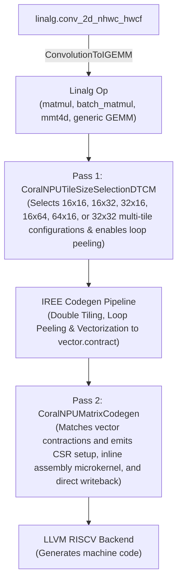

# CoralNPU Matrix Codegen Design & Implementation

This document describes the direct codegen path in the CoralNPU compiler for
the RISC-V **Zvt (Matrix)** extension.

## 1. Overview

The Zvt path lowers contractions
($C_{M \times N} \mathrel{+}= A_{M \times K} \times B_{K \times N}$, including
`linalg.matmul`, `linalg.batch_matmul`, `linalg.mmt4d`, and 2D/N-D
`linalg.generic`) and spatial convolutions directly to Zvt matrix instructions.
It supports FP32, BF16, and INT8 inputs ($A$, $B$) with 32-bit accumulation ($C$
in FP32 or INT32). Convolutions lowered via implicit GEMM (`im2col`) also use
this path once placement affinity is enabled (§2.0). Operations with unsupported
shapes, element types, or producer chains fall back to the standard RVV vector
pipeline.

Compilation happens in two CoralNPU passes around IREE's standard tiling and
vectorization pipeline. First, `CoralNPUTileSizeSelectionDTCM` (§2.1) selects
DTCM and Zvt register tile sizes and enables loop peeling for remainders. After
IREE vectorizes the tiled loop nest into 2D `vector.contract` ops,
`CoralNPUMatrixCodegen` (§2.3) fuses each contraction and its $K$-reduction
loop into a Zvt inline-assembly microkernel.

In hardware, the Zvt unit computes outer-product multiply-accumulates on
$16 \times 16$ tiles ($TM = 16, TN = 16$). Each instruction processes
$TK \in \{1, 2, 4\}$ reduction steps at once: $TK = 1$ for FP32, up to
$TK = 2$ for BF16, and up to $TK = 4$ for INT8. The unit provides 16 tile
registers (`mt0`–`mt15`); each $16 \times 16$ tile of 32-bit accumulators spans
four registers, yielding four independent accumulators (`mt0`, `mt4`, `mt8`,
and `mt12`).

To reuse vector loads across tiles and interleave accumulators across
consecutive multiplies, the compiler groups up to four $16 \times 16$ tiles per
iteration:

| Layout                                | Output Block                    | Accumulators          | Operand Tiles per $K$-Step               | When Selected (§2.1)                                                      |
| :------------------------------------ | :------------------------------ | :-------------------- | :--------------------------------------- | :------------------------------------------------------------------------ |
| **$2 \times 2$ Grid**                 | $32 \times 32$                  | `mt0, mt4, mt8, mt12` | 2 LHS + 2 RHS (each reused $2\times$)    | $M, N$ multiples of 32 that fit in DTCM                                   |
| **$1 \times 4$ / $4 \times 1$ Strip** | $16 \times 64$ / $64 \times 16$ | `mt0, mt4, mt8, mt12` | 1 shared + 4 streamed (reused $4\times$) | $M$ not mult of 32 & $N$ mult of 64, or $M$ mult of 64 & 16-col $N$ tiles |
| **$1 \times 2$ / $2 \times 1$ Strip** | $16 \times 32$ / $32 \times 16$ | `mt0, mt4`            | 1 shared + 2 streamed (reused $2\times$) | One dim multiple of 32, or 4-tile exceeds DTCM                            |
| **$1 \times 1$ Single Tile**          | $16 \times 16$                  | `mt0`                 | 1 LHS + 1 RHS                            | Smaller shapes, and all `linalg.mmt4d` ops                                |

For example, in a **$2 \times 2$ Grid**, one microkernel call computes a
$32 \times 32$ **Output Block** of $C$ split into four $16 \times 16$ hardware
tiles (`mt0`, `mt4`, `mt8`, `mt12` in row-major order). Each $K$-step loads two
16-element slices of $A$ (`A0` for rows `0..15`, `A1` for rows `16..31`) and two
16-element slices of $B$ (`B0` for cols `0..15`, `B1` for cols `16..31`),
reusing each slice across two outer-product multiplies:

```text
               B0 (cols 0..15)   B1 (cols 16..31)
             +-----------------+-----------------+
A0 (0..15)   | mt0 += A0 x B0  | mt4 += A0 x B1  |  \
             +-----------------+-----------------+   32x32 Output Block
A1 (16..31)  | mt8 += A1 x B0  | mt12 += A1 x B1 |  /
             +-----------------+-----------------+
```

By contrast, a **$1 \times 4$ Strip** places all four $16 \times 16$ tiles side
by side into a $16 \times 64$ output block (`[mt0 | mt4 | mt8 | mt12]`), loading
one 16-row slice `A0` per $K$-step and reusing it across four 16-column slices
`B0`–`B3`. For smaller shapes and peeled loop tails, the microkernel also
supports partial tiles with $M < 16$ or $N \in \{8, 12\}$ by masking vector
operand loads (§2.3).

---

## 2. Compilation Pipeline



### 2.0. ConvolutionToIGEMM (Preprocessing)

Before dispatch partitioning, `CoralNPUSession::extendPreprocessingPassPipeline`
runs IREE's `ConvolutionToIGEMMPass` with a CoralNPU affinity filter. The pass
converts matching convolutions into an implicit GEMM (`iree_linalg_ext.im2col`
plus a generic contraction) and propagates the source `stream.affinity`
attribute to the generated contraction:

- **Target Filter**: Converts only convolutions whose `stream.affinity` device
  symbol name contains `coralnpu`. The resulting contraction becomes a Zvt
  candidate if `isZvtMatrixContraction` accepts it (§2.1; unverified on
  `im2col` output, as the filter never matches in a full compile).
- **Current Status (Inactive)**: During preprocessing, convolutions do not yet
  carry a CoralNPU `stream.affinity` (`CoralNPUAffinityAnnotation` runs later in
  `DispatchCreation`, and device globals are named `@__device_N`). As a result,
  the filter never matches in a full compile and convolutions use the direct
  spatial path (§2.1) or RVV fallback. Enabling `im2col` requires earlier
  placement and a convolution allowlist, as depthwise and dilated `im2col` ops
  fail to lower.

### 2.1. Pass 1: CoralNPUTileSizeSelectionDTCM (Configuration & Loop Peeling)

Before tile-size selection in `buildConfigurationPassPipeline`,
`CoralNPURestoreConvInputChannelPass` restores unit input channels stripped by
unit-dim folding on single-channel convolutions.
`FoldReshapeIntoInterfaceTensorPass` and `CleanupBufferAllocViewPass` then fold
the resulting interface reshapes into row-major buffers. Next,
`CoralNPUTileSizeSelectionDTCM` runs after `LLVMCPUSelectLoweringStrategyPass`
(`CPUDoubleTilingExpert` pipeline) to select DTCM and Zvt register tile sizes
for the root Linalg op. When a Zvt tile fits in DTCM, the pass replaces the
root's RVV vector parallel sizes. It also erases non-root `lowering_config`
attributes (such as `linalg.fill` inits or fused elementwise consumers) so they
fuse with the Zvt tiles.

#### Contraction Eligibility (`isZvtMatrixContraction` & `isZvtReadableInputs`)

- **Target & Element Types**: Requires `+zvtbase` (`hasZvtTargetFeature`) and
  matching input types: FP32 $\times$ FP32 $\to$ FP32, BF16 $\times$ BF16 $\to$
  FP32, or INT8 $\times$ INT8 $\to$ INT32.
- **Supported Operations & Dimension Mapping**:
  - *Pre-packed `linalg.mmt4d`*: Requires static LHS and output shapes with
    $16 \times 16 \times 1$ inner tiles.
  - *Contractions and spatial convolutions* (`linalg.matmul`,
    `linalg.batch_matmul`, `linalg.conv_2d_nhwc_hwcf`, and `linalg.generic`):
    Must have a static output shape, at least two parallel loops, and at least
    one reduction loop (innermost $K$). The pass tiles any leading batch/spatial
    parallel loops and outer filter-window loops to 1, reducing each step to a
    2D $(M, N) \times K$ contraction. Within those trailing dimensions, $A$,
    $B$, and $C$ may appear in either operand or transpose order: $C$ as
    $(M, N)$ or $(N, M)$, $A$ as $(M, K)$ or $(K, M)$ (or spatial window
    `oh * sh + kh, ow * sw + kw` on the first input), and $B$ as $(K, N)$ or
    $(N, K)$.
- **Full vs. Partial $(M, N)$ Shapes**: Requires $M \ge 3$ and $N \ge 8$:
  - *Full tiles ($M, N$ multiples of 16)*: Support all operand orders and
    transpositions above.
  - *Partial $M$ ($M$ not a multiple of 16)*: Supported by masking operand loads
    when $A$ is the first input and directly indexes $C$'s rows ($M$) and $K$
    (any $M \ge 3$), or for spatial windows with $K > 1$ when $M$ has an exact
    divisor in $[3, 15]$.
  - *Partial $N$ (multiples of 8 or 12)*: Supported when $C$'s trailing
    dimensions are untransposed $(M, N)$, $A$ is the first input, and $M$ has an
    exact divisor in $[3, 15]$.
- **Surrounding Dispatch Operations**:
  - *Inputs (`isZvtReadableInputs`)*: Because the microkernel loads $A$ and $B$
    directly from memory (widenings are fused into the assembly loop), neither
    input may be computed by a tileable producer other than a single elementwise
    `arith.extf` or `arith.extsi` of matching Zvt input types with non-tileable
    inputs. Other producers (such as `arith.sitofp` or dequantization) stay on
    RVV.
  - *Accumulator init*: Must be a zero constant, a zero `linalg.fill`, or a
    value loaded from memory (tiles are cleared with `vtzero` or seeded from
    memory). Computed initializers stay on RVV.
  - *Consumers*: Fused elementwise consumers (bias, BatchNorm, activations,
    `tosa.apply_scale`) are supported; dispatches with a reduction `linalg`
    consumer stay on RVV.

#### Register Tile Selection, Peeling & DTCM Fit (`setZvtVectorSizes`)

- **Tile Selection & Loop Peeling**: When $M$ and $N$ are multiples of 16, the
  pass selects the largest layout from the §1 table (`linalg.mmt4d` always uses
  $16 \times 16$). Setting Zvt tile sizes also enables `enable_loop_peeling` on
  `translation_info` so unaligned dimensions peel into static remainder subviews
  rather than masked `affine.min` slices. When $M$ or $N$ is not a multiple of
  16, the aligned dimension keeps its §1 tile ($32$/$64$ rows or $64$/$32$
  columns) and only the unaligned one follows this table, choosing between
  **peeling full tiles** and **snapping to an exact partial-tile divisor**:

| Dimension      | Tile Choice                                                 | When Selected                                                                                                                                                                              | Examples                                                         |
| :------------- | :---------------------------------------------------------- | :----------------------------------------------------------------------------------------------------------------------------------------------------------------------------------------- | :--------------------------------------------------------------- |
| **Rows ($M$)** | **Single partial tile** ($M$)                               | $3 \le M < 16$                                                                                                                                                                             | $M = 7 \to 7$                                                    |
|                | **Exact divisor** ($d \in [3, 15]$)                         | Unaligned $M > 16$ when $d$ takes no more tile steps than peeled 16-row tiles, or when $M$-peeling is unsupported (multi-window 1D convs, conv tails $< 3$ rows, or $N \bmod 16 \neq 0$)   | $M = 30 \to 2 \times 15$, $M = 49 \to 7 \times 7$                |
|                | **Peeled 16-row tiles** ($16 + \text{tail}$)                | All other unaligned $M > 16$ on contractions and single-filter-loop convolutions                                                                                                           | $M = 50 \to 3 \times 16 + 2$, $M = 196 \to 12 \times 16 + 4$     |
| **Cols ($N$)** | **Peeled 64- or 32-col strip** ($64$ or $32 + \text{tail}$) | Contractions and single-filter-loop convs with unpeeled $M$, when $N \ge 32$ leaves an 8- or 16-col remainder ($64$ if $N \ge 64$, remainder $\le 16$, and $M$ tile $\le 16$; else $32$)   | $N = 80 \to 64 + 16$, $N = 48 \to 32 + 16$, $N = 40 \to 32 + 8$  |
|                | **16-col tile** ($\min(N, 16)$, peeled if unaligned)        | $N \bmod 16 = 0$, or peeling is enabled and $N \bmod 16 \neq 4$ (also unlocks $64 \times 16$ when $M \bmod 64 = 0$)                                                                        | $N = 24 \to 16 + 8$ (peeled), $64 \times 16$ for $N \le 16$      |
|                | **Unpeeled 12- or 8-col partial tile**                      | Peeling disabled or $N \bmod 16 = 4$: tile is $12$ when $N \bmod 12 = 0$, else $\min(N, 8)$                                                                                                | $N = 24 \to 2 \times 12$ (unpeeled)                              |

- **DTCM Budget & Shrinking**: Because Zvt accumulates across the full reduction
  loop in hardware tile registers (`vector_reduction = 1`),
  `CoralNPUMatrixCodegen` cannot lower a split reduction loop (§5). Instead, a
  single reduction step of the tile must fit in the DTCM budget
  (`--coralnpu-dtcm-size-kb` minus `--coralnpu-stack-size-kb` and
  `--coralnpu-dtcm-reserve-kb`, rounded down to 4 KB):
  1. *Register-tile step-down*: If one register tile exceeds the budget, the
     pass steps down from 4 tiles to 2 tiles ($16 \times 64 \text{ or }
     32 \times 32 \to 16 \times 32$, $64 \times 16 \to 32 \times 16$) and then
     to 1 tile ($16 \times 16$). If $16 \times 16$ still does not fit, the op
     falls back to RVV.
  2. *Workgroup (`cache_parallel`) shrinking*: Workgroup tiles shrink down to at
     least one register tile without splitting reduction loops. Dimensions that
     are exact multiples of their register tile shrink first, picking exact
     divisors of the loop range to keep workgroup tiles static, while an
     unaligned Zvt $N$ shrinks to multiples of its register tile.
- **DTCM Promotion**: Zvt contractions do not set `promote_operands`, so their
  inputs stay in memory (`TODO(zvt)`). RVV contractions do promote operands to
  DTCM via `CoralNPUPromoteOperandsPass` (see
  [DTCM Promotion](tiling_levels_explained.md#dtcm-promotion)). Pass 2 (§2.3)
  can still lower compatible RVV vector tiles (such as $2 \times 32$ or
  $4 \times 16$) to Zvt assembly reading those DTCM copies. Pass 2 also
  allocates any scratch drain tile (§2.3) in DTCM, and the footprint model
  counts it (see [DTCM Tiling](dtcm_tiling.md#dtcm-budget-and-footprint)).

### 2.2. Vectorization & Pre-LLVM Lowering Hook

During translation, IREE's `CPUDoubleTilingExpert` pipeline tiles and vectorizes
Linalg contractions into 2D `vector.contract` operations (such as
`vector<16x16xf32>`, `vector<16x32xf32>`, or `vector<16x32xi32>`). Before
converting to the LLVM dialect, `CoralNPUTargetBackend` runs its
`beforeLowerToLLVMHook` pass sequence:

1. `CoralNPULowerDTCMCopiesPass`: Lowers DTCM promotion copies into loops of
   vector loads and stores (see
   [DTCM Promotion](tiling_levels_explained.md#dtcm-promotion)).
2. `MemrefCopyToLinalgPass` and `GenericVectorizationPass`: Vectorize remaining
   small ops (`< 1024` elements, such as bufferization `memref.copy` /
   `linalg.copy` ops) and sink `arith.extsi` below `vector.extract` so
   `CoralNPUMatrixCodegen` sees narrow `i8` convolution operands.
3. `DropVectorUnitDimsPass`: Folds unit vector dimensions.
4. `CoralNPUApproximateMathPass` (`--coralnpu-fast-math`, default on) and
   `MathTransformPass`: Replace `math.tanh`, `math.exp`, `math.erf`, and `erfc`
   expansions with cheaper approximations, then expand remaining math ops.
5. `CoralNPUOptimizeVectorLoopsPass`: Accumulates loop-carried
   `vector.reduction` sums in vectors and unrolls, unroll-and-jams, and
   interchanges vectorized loops.
6. `CoralNPULimitLoopUnrollingPass`: Caps LLVM loop unrolling to bound ITCM code
   size.
7. `CoralNPUMatrixCodegenPass`: Lowers supported vector contractions to Zvt
   inline assembly.

### 2.3. Pass 2: CoralNPUMatrixCodegen

`CoralNPUMatrixCodegen` runs on `FunctionOpInterface` inside
`beforeLowerToLLVMHook` and lowers vector contractions into Zvt inline assembly.

> [!NOTE]
> **Why raw inline assembly rather than the `llvm.riscv.zvt.*` intrinsics.**
> 1. The tile configuration must live in the same assembly block as the tile
>    operations it governs (step 2 below); with intrinsics, LLVM is free to
>    place a `vsetvli` in between, which clears `mtype` and `vtype.altfmt`.
> 2. The $K$-loop is emitted as an assembly loop so its body and code size are
>    fixed by construction rather than left to the unroller — ITCM is small, and
>    a contraction-level lowering would expand per $K$ step.
> 3. The fused microkernel and seed/drain blocks use a fixed register assignment
>    (`t0`–`t6`, `v0`–`v31`); unfused multiply blocks pin their operands to the
>    bases of slots 0, 1, 2, ... (`getZvtOperandBase`). Zvt v0.4 requires each
>    operand base to be LMUL-aligned and in the first $8 / K_{\max}$ registers
>    of its 8-register group ($K_{\max} = 32 / \text{SEW}$).
>
> The cost is deliberate: the register allocator is shut out of the microkernel,
> and the `~{memory}` clobber on the microkernel and seed/drain blocks prevents
> scheduling and alias analysis across them.
> `llvm-project-0001-add-zvt-support.patch` also defines the full Zvt intrinsic
> and ISel surface; this pass does not use it today and it is kept for ISA
> completeness and eventual upstreaming. The *instruction* definitions in
> `RISCVInstrInfoZvt.td` are still required so the inline assembler can parse
> `vtmms.tvv`, `vtfmm.tvv`, `vtfmm.alt.tvv`, `vtzero`, the `vtmv` tile moves,
> and the `mset*` family.

1. **Contraction Identification & Chain Analysis**:
   - **Target Gate & Normalization**: Requires `hasZvtTargetFeature(funcOp)`
     (the `coralnpu` backend with `+zvtbase`). The pass first reassembles
     per-row outer products from strided 1D convolutions ($M$ scalar-broadcast
     FMAs/muls inserted into a 2D accumulator) into a single 2D
     `vector.contract`. For each `vector.contract` accepted by
     `isSupportedMatrixContraction`, it swaps LHS and RHS when RHS indexes C's
     rows ($M$) and LHS indexes C's columns ($N$).
   - **Accumulator Chains & Direct Writeback**: Matches an `add` contraction,
     optionally carried as the sole iter-arg of a $K$-reduction `scf.for` (and
     up to two enclosing unit-step single-iter-arg outer reduction `scf.for`
     loops for multi-reduction convolutions). The microkernel writes directly to
     the output memref when the result (optionally narrowed to `bf16` by
     `arith.truncf`) is stored in the same block. That writeback must be either
     one in-bounds `vector.transfer_write` or per-row `vector.extract` +
     `vector.store` ops covering all tile rows (including $M = 1$ peeled tails).
   - **Scratch Tile Drain**: Otherwise, the tiles drain to an entry-block
     scratch `memref.alloc` in `#iree_codegen.workgroup_local` (DTCM) memory, as
     the 4 KiB stack cannot hold a $16 \times 64$ FP32 tile. Fused 2D
     elementwise consumers then run as a 1D `scf.for` row loop over the scratch
     buffer. A `[1, 0]`-transposed FP32 writeback copies out via strided
     `vlse32.v` + `vse32.v`, and any other consumer reads the scratch buffer via
     `vector.transfer_read`.
   - **Operand Precision & Layout Tracing**: Because the microkernel loads and
     widens operands directly inside the assembly loop, the pass traces each
     `vector.contract` input back to its underlying `FP32`, `BF16`, or `INT8`
     memref read. It looks through widening casts (`arith.extsi`, `arith.extf`)
     and layout-preserving vector ops (`vector.shape_cast`, `vector.broadcast`,
     zero-offset unit-stride `vector.extract_strided_slice`, 0-indexed
     single-element `vector.extract`, and `vector.from_elements` of in-order
     extracts from one vector, with constant-step extracts on $N \times 1$
     single-channel convolution tiles stepping rows at that stride). It then
     checks whether $A$ ($K \times M$ vs. $M \times K$) and $B$ ($K \times N$
     vs. $N \times K$) are contiguous or strided along $K$, splitting $K$ out of
     combined spatial+filter indices on unit-channel tiles (`splitKIndex`).
     Fusing the $K$-loop requires row-major (unit inner stride) $A$ and $B$
     memrefs with the $K$ induction variable as the row or innermost index;
     address generation folds all remaining batch or outer `mmt4d` tile indices
     into the base pointers.
   - **BF16 `vecmat` K-Loops (`+zvfbfwma`)**: When `+zvfbfwma` is enabled with
     `VLEN = 128`, the pass also matches 1D `vector<32xf32>` (`1x m8` or jammed
     `2x m8`) BF16 `vecmat` `scf.for` loops (`vector.fma` of broadcast `bf16`
     scalars with contiguous `vector<32xbf16>` weight tiles). It lowers them to
     an $8\times$/$4\times$/$2\times$-unrolled `flh` + `vle16.v`/`vl8re16.v` +
     `vfwmaccbf16.vf` inline-assembly loop.

2. **Hardware CSR Configuration**:
   - Every emitted assembly block begins with its own CSR setup preamble
     (clobbering `t5` and `t6`):
     `li t5, <mtype>; li t6, <vtype>; msetmtype t5, t6; li t6, 16; msettn zero, t6`.
     Per-block setup is mandatory because `vsetvli`/`vsetivli`/`vsetvl` clear
     `mtype` (`mtwiden`, `tk`, `tm`) and `vtype.altfmt` (`RvvFrontEnd.sv`), and
     LLVM's VSETVLI insertion pass may insert a `vsetvli` between any two
     assembly blocks.

   | Mode                | `msetmtype` (`t5`) | `vtype` (`t6`)                    | Tile Shape & Widening                        | Multiply Op      |
   | :------------------ | :----------------- | :-------------------------------- | :------------------------------------------- | :--------------- |
   | **FP32**            | `16417`            | `18` (`SEW=32, LMUL=4`)           | $TM=16, TK=1, \text{mtwiden}=1$              | `vtfmm.tvv`      |
   | **BF16 ($TK=1/2$)** | `16418` / `16450`  | `265` (`SEW=16, LMUL=2, altfmt`)  | $TM=16, TK=1\text{ or }2, \text{mtwiden}=2$  | `vtfmm.alt.tvv`  |
   | **INT8 ($TK=1/4$)** | `16419` / `16515`  | `256` (`SEW=8, LMUL=1, altfmt`)   | $TM=16, TK=1\text{ or }4, \text{mtwiden}=3$  | `vtmms.tvv`      |

   - Setting `altfmt` (bit 8 of `vtype`) marks the *second* operand as signed
     INT8 (for `vtmms.tvv`, whose opcode only encodes the first operand's
     signedness) or as BF16 rather than FP16 (for `vtfmm.alt.tvv`).
   - Because `msetmtype` derives `LMUL`/`ta`/`ma` from `SEW` when
     `mtwiden != 0` (`SEW8` $\to$ `m1`, `SEW16` $\to$ `m2`, `SEW32` $\to$ `m4`)
     and sets `TM` and `TK` directly, it replaces a `vsetivli` + `msettm` pair.
     It zeroes `vl`, so `msettn` restores $TN = 16$ (or $TN = N \in \{8, 12\}$
     when seeding or draining a partial-$N$ tile); no `vset*` instruction
     appears inside any Zvt block.
   - Blocks that clear, seed, or drain accumulators use FP32 mode regardless of
     input type because accumulators are always 32-bit. INT8 and BF16 kernels
     then switch to their narrow mode before loading operands (for
     multi-reduction convolution chains whose outer filter loops only compute
     addresses, the narrow mode setup is hoisted into the tile-init block). A
     seeded FP32 kernel with $N < 16$ restores $TN = 16$ after seeding, and a
     BF16 narrowing drain (`+zvfbfmin`, $M \bmod 4 = 0$) alternates between FP32
     and BF16 modes every 4 rows.

3. **Accumulator Initialization & Fused Assembly Microkernels**:
   - **Accumulator Initialization**: Zero initializers clear the active tiles
     (§1 table) with `vtzero`. Row-major initializers loaded from memory seed
     the tiles row by row via `vle32.v` + `vtmv.t.v`; the pass leaves any other
     initializer (such as a computed bias) to RVV.
   - **$K$-Packing & Bounded Loop Unrolling**: When $K \bmod TK = 0$ and every
     contiguous operand is a full tile, the microkernel packs $TK = 2$ (BF16) or
     $TK = 4$ (INT8) consecutive $K$-steps held in registers $8 / TK$ apart into
     each multiply. To bound code size, it emits an assembly loop with counter
     `t6` (`li t6, numKSteps / step; 1: ...; addi t6, t6, -1; bnez t6, 1b`). It
     unrolls by $8\times$ when $K \ge 32$ and $K \bmod (8 \cdot TK) = 0$, by
     $4\times$ when $K \ge 16$ and $K \bmod (4 \cdot TK) = 0$, or fully without
     a branch when $K \le 4 \cdot TK$ and $K \bmod TK = 0$.
   - **Multi-Tile Loads & Multiply Schedule**: Each $K$-step loads the LHS and
     RHS tiles for $kk \in [0, TK)$, and each $TK$ group issues 1, 2, or 4
     outer-product multiplies across the active accumulators (§1 and §2.3
     tables). For $1 \times 4$ and $4 \times 1$ strips, it loads the single-tile
     operand once per $K$-step and walks a pointer across the 4 tiles of the
     streamed operand.
   - **Contiguous vs. Strided Vector Loads**: Contiguous $K$-rows ($K \times M$
     LHS or $K \times N$ RHS) use unit-stride loads (`vle32.v`, `vle16.v`,
     `vle8.v`) for single tiles, and whole-register loads (`vl8re32.v`,
     `vl4re16.v`, `vl2re8.v`) for adjacent tile pairs at full
     $TK = 4 / \text{inBytes}$. Strided $K$-columns ($M \times K$ LHS or
     $N \times K$ RHS) use strided vector loads (`vlse32.v`, `vlse16.v`,
     `vlse8.v`).
   - **Partial-Tile Masking**: For partial tiles ($M < 16$ or $N \in \{8, 12\}$),
     the preamble builds row or column masks (`vid.v` + `vmsltu.vx`) before the
     loop so loads never read past operand bounds. When both $M$ and $N$ are
     partial, the two masks wait in unused vector registers and are copied to
     `v0` before each operand's loads.

4. **Tile Writeback**:
   - Extracts 32-bit rows from each matrix accumulator via `vtmv.v.t` and stores
     them via `vse32.v` (or narrows 4 rows at a time to BF16 via
     `vfncvtbf16.f.f.w` + `vse16.v`) into Matrix C or the DTCM scratch buffer.
   - The drain visits active tiles in row-major order (`mt0`, `mt4` via
     `lui t0, 0x20000`, `mt8` via `lui t0, 0x40000`, and `mt12` via
     `lui t0, 0x60000`). For single-column strips ($2 \times 1$ or $4 \times 1$),
     row counter `t4` walks continuously across all 32 or 64 output rows without
     resetting between $M$-tiles.

5. **Non-Fused Fallback**:
   - The pass lowers a contraction standalone when it cannot fuse the chain (no
     enclosing `scf.for`, non-constant bounds, non-unit step, a loop body that
     may write memory, or an LHS/RHS address that is not row-major with $K$ as
     the row or innermost index). This path requires full $16 \times 16$ tiles
     and any widening `arith.ext*` to be the operand's direct defining op. It
     passes LHS and RHS vectors as inline-assembly operands pinned to the slot
     bases (`getZvtOperandBase`: A tiles, then B).
   - The pass still initializes accumulators before the first multiply. A
     standalone contraction with a zero init clears its tiles inline, whereas a
     seeded contraction or unfused loop runs a separate `vtzero` or seed block
     once before the contraction or loop so stale tile contents are never
     reused.
   - At the end of the pass, MLIR's generic contract lowering lowers any
     remaining `vector.contract` ops, because `iree-0006` makes
     `LLVMCPUVirtualVectorLowering` skip contract lowering in any function
     containing a Zvt-shaped contraction.

### 2.4. LLVM RISCV Backend

The LLVM RISC-V backend adds Zvt v0.4 support via
`llvm-project-0001-add-zvt-support.patch`:

- **Extension Features** (`RISCVFeatures.td`): Defines `Zvtbase`, `Zvt8e`,
  `Zvt16e`, `Zvt64e`, `Zvti8i32mm`, `Zvtf8f32mm`, `Zvtf16f32mm`, and
  `Zvtf32f32mm`. By default, `CoralNPUTargetBackend` enables
  `+zvtbase,+zvt8e,+zvt16e,+zvti8i32mm,+zvtf16f32mm,+zvtf32f32mm`
  (`vtfmm.alt.tvv` is gated by `Zvtf16f32mm` or `Zvtf8f32mm`).
- **Instruction Registration** (`RISCVInstrInfoZvt.td`): Registers encodings,
  pseudos, and assembler parsing for `vtfmm.tvv`, `vtfmm.alt.tvv`, `vtmms.tvv`,
  `vtmmu.tvv`, `vtzero`, `vtmv.v.t`, `vtmv.t.v`, `msetmtype`, `msetmtypei`,
  `msettm`/`msettn`/`msettk`, and tile load/store instructions.
- **VSETVLI Awareness** (`RISCVInsertVSETVLI.cpp`,
  `RISCVVSETVLIInfoAnalysis.cpp`): Teaches the VSETVLI passes the SEW/VL
  demands of Zvt intrinsic pseudos (inline assembly emitted by
  `CoralNPUMatrixCodegen` remains opaque to them).
- **Intrinsics & ISel** (`IntrinsicsRISCVZvt.td`, `RISCVISelDAGToDAG.cpp`):
  Defines the `llvm.riscv.zvt.*` intrinsic surface (unused by
  `CoralNPUMatrixCodegen` today; see the note in §2.3).

---

## 3. Supported Configurations

| Linalg Operation                   | Input Type                     | Accumulator Type     | Extension                                        | Target Instruction / Path                    | Status                                                            |
| :--------------------------------- | :----------------------------: | :------------------: | :----------------------------------------------: | :------------------------------------------: | :---------------------------------------------------------------: |
| `matmul`, `batch_matmul`, `mmt4d`  | **FP32**                       | **FP32**             | `+zvtf32f32mm`                                   | `vtfmm.tvv` (Zvt Hardware)                   | **Supported**                                                     |
| `matmul`, `batch_matmul`, `mmt4d`  | **BF16**                       | **FP32**             | `+zvtf16f32mm`                                   | `vtfmm.alt.tvv` (Zvt Hardware)               | **Supported**                                                     |
| `matmul`, `batch_matmul`, `mmt4d`  | **INT8**                       | **INT32**            | `+zvti8i32mm`                                    | `vtmms.tvv` (Zvt Hardware)                   | **Supported**                                                     |
| `matmul`, `batch_matmul`, `mmt4d`  | **INT16**                      | **INT32**            | `+m,+f,+zvl128b,+zve32f`                         | RVV Vector Path / Fallback                   | **Supported**                                                     |
| `matmul`, `batch_matmul`, `mmt4d`  | **INT32**                      | **INT32**            | `+m,+f,+zvl128b,+zve32f`                         | RVV Vector Path / Fallback                   | **Supported**                                                     |
| `conv_2d_nhwc_hwcf` / spatial conv | **FP32** / **BF16** / **INT8** | **FP32** / **INT32** | `+zvtf32f32mm` / `+zvtf16f32mm` / `+zvti8i32mm`  | `vtfmm.tvv` / `vtfmm.alt.tvv` / `vtmms.tvv`  | **Supported** (direct multi-reduction loop chain; IGEMM see §2.0) |

Both compiler passes gate only on `+zvtbase`. The `Extension` column lists each
multiply instruction's feature flag, though the assembler also accepts
`vtfmm.tvv` under `+zvtf16f32mm` and `vtfmm.alt.tvv` under `+zvtf8f32mm`. If
`+zvtbase` is enabled without an accepted multiply sub-extension, the inline
assembler rejects the instruction rather than falling back.

### Fallback Behavior

An operation compiles through IREE's standard RVV pipeline unless the target has
`+zvtbase`, `isZvtMatrixContraction` accepts the op (§2.1), and
`setZvtVectorSizes` finds a register tile that fits in DTCM (§2.1). Any
Zvt-shaped `vector.contract` that `CoralNPUMatrixCodegen` still leaves unlowered
(§2.3 item 5) falls back to MLIR's generic contract lowering at the end of that
pass.

---

## 4. Verification

### 4.1. Transform Unit Tests (MLIR Lit)

Unit tests for the Zvt passes live in `tests/transforms/`:

- `matrix_codegen.mlir`: Verifies `CoralNPUMatrixCodegen` pattern matching,
  per-block CSR setup (`msetmtype`, `msettn`), and generated assembly:
  - **Tile Shapes & Precisions**: Covers $1 \times 1$ (FP32, BF16, INT8),
    $1 \times 2$ (INT8, BF16), $1 \times 4$ and $4 \times 1$ (BF16 with $TK=2$
    and $4\times$ $K$-unrolling), and $2 \times 1$ / $2 \times 2$ (FP32). Also
    covers peeled partial-$M$ ($M < 16$, including $M = 1$) and partial-$N$
    ($8 \le N < 16$, $N \bmod 4 = 0$, including an $N \times K$ RHS).
  - **Convolutions & `vecmat`**: Covers nested outer spatial reduction loops,
    strided 1D outer-product reassembly, single-channel $K$-loops over
    $N \times 1$ image columns (unit and strided rows), and jammed BF16 `vecmat`
    $K$-loops (`vfwmaccbf16.vf`).
  - **Addressing, Init & Writeback**: Covers transposed LHS/RHS/output,
    non-zero $K$ lower bounds, zero and memory-seeded accumulators, fused and
    unfused loops, and direct writeback (`transfer_write` or per-row stores).
    Also covers BF16 narrowing drain (`arith.truncf` with `+zvfbfmin`, or
    consumer-loop truncation without it). For fused elementwise consumers, it
    tests DTCM scratch drain via a 1D row loop, or via `transfer_read` when two
    chains share a scratch tile or transpose an FP32-converted INT8 result.
  - **Negative & Fallback Cases**: Verifies that targets without `+zvtbase` or
    non-CoralNPU backends remain untouched, unsupported $8 \times 4$ shapes fall
    back to generic contract lowering, and `vecmat` loops without a broadcast
    scalar LHS keep their original loop.
  - **Additional `FileCheck` Runs**: A second prefix verifies that no `vset*`
    instruction appears in any Zvt block (while checking the expected `vsetvli`
    in `@vecmat_bf16_jammed`). A third runs `LLVMCPUVirtualVectorLowering` to
    verify that `iree-0006` preserves partial-$N$ contractions with an
    $N \times K$ RHS for `CoralNPUMatrixCodegen`.
- `convolution_to_igemm.mlir`: Tests affinity-aware `im2col` conversion in
  `ConvolutionToIGEMM`.

To run the transform test suite:

```bash
# Using Bazel:
bazel test --config=dev //tests/transforms/...

# Or using CMake / CTest:
ctest -L ci -R transforms
```

### 4.2. End-to-End Model & Operator Integration Tests

Integration tests for StableHLO and Linalg models (matmuls, batched matmuls, and
2D convolutions) execute compiled modules on the CoralNPU simulator:

```bash
# Run all CI test targets:
# Using Bazel:
bazel test --config=dev --keep_going //tests:ci

# Or using CTest (with matching CI label):
ctest -L ci -j 64
```

### 4.3. AOT Matmul Harness (MPACT / Verilator)

The harness in `examples/matmul-aot/` exports a JAX matmul to StableHLO,
compiles it for the host plus CoralNPU, and runs it via the IREE Python runtime
on **MPACT** (functional simulator, default) or **Verilator** (cycle-accurate
RTL, `--use-verilator`). Each `test_matmul.sh` invocation compiles and runs with
and without Zvt, printing simulated cycle counts to `stderr`. It passes
`--coralnpu-roofline-speedup-threshold=0` so the matmul always dispatches to
CoralNPU; otherwise the default roofline threshold keeps small INT8 matmuls
(such as $N = 32$) on the host unless Zvt is enabled.

```bash
cd examples/matmul-aot

# 1. Functional Simulation on MPACT (default):
# Run standard FP32:
./test_matmul.sh

# Run FP32 with transposed LHS:
./test_matmul.sh --transpose-lhs

# Run INT8 with transposed LHS:
./test_matmul.sh --int8 --transpose-lhs

# Run BF16:
./test_matmul.sh --bf16

# 2. Cycle-Accurate Hardware RTL Simulation on Verilator:
# Pass --use-verilator to run on Verilator:
./test_matmul.sh --transpose-lhs --use-verilator

# 3. End-to-End linalg.mmt4d Verification (FP32, BF16 and INT8; zero and accumulator inits):
# Needs: bazel build --config=dev @iree_core//tools:iree-compile @iree_core//tools:iree-run-module
python3 test_mmt4d.py --bazel

# 4. Large matrices with 1 MB ITCM/DTCM on MPACT (default N=128):
./test_matmul_highmem.sh
```

#### Key Script Options

- `--use-verilator`: Runs on the cycle-accurate Verilator RTL simulator instead
  of MPACT (default: `false`).
- `-n`, `--size <N>`: Sets the square matrix dimension $N \times N$ (default:
  `32`). `test_matmul_highmem.sh` builds with the 1 MB ITCM/DTCM linker script
  and `--coralnpu-dtcm-size-kb=1024`, enabling larger tiles and $N$.
- `--transpose-lhs`: Exercises the contiguous unit-stride LHS load path
  (`vle32.v` / `vle16.v` / `vle8.v`) for $A^T B$.
- `--int8`: Exercises INT8 $\times$ INT8 $\to$ INT32 matmul via `vtmms.tvv`.
- `--bf16`: Exercises BF16 $\times$ BF16 $\to$ FP32 matmul via `vtfmm.alt.tvv`.

---

## 5. Limits & `TODO`s

- **Split-Reduction (`cache_reduction`) Lowering & DTCM Operand Promotion
  (`TODO(zvt)`)**: `CoralNPUMatrixCodegen` currently rejects split-$K$ loops
  when an outer `cache_reduction` loop contains DTCM copy stores (leaving the
  inner loop's accumulator as a `BlockArgument` rejected by Pass 2) or folds
  `memref.subview` offsets into `k_outer + k_inner` indices. Enabling
  `promote_operands` on Zvt contractions (`TODO(zvt)` in
  `CoralNPUTileSizeSelectionDTCM`) and updating `CoralNPUMatrixCodegen` to
  accept outer split-$K$ loops will let large-$K$ contractions stage $A$ and $B$
  chunks in DTCM without falling back to RVV.
- **Shared Zvt Eligibility & Scratch Footprint (`TODO(zvt)`)**:
  `CoralNPUTileSizeSelectionFootprint` duplicates part of
  `CoralNPUMatrixCodegen`'s eligibility checks to count DTCM scratch tiles and
  does not count the $16 \times 32$ FP32 scratch tile of the BF16 `vecmat` path
  (see [DTCM Tiling](dtcm_tiling.md#limits)).
- **`ConvolutionToIGEMM` Placement & Allowlist (§2.0)**: `ConvolutionToIGEMMPass`
  currently runs in global `Preprocessing` with an inactive `"coralnpu"`
  affinity filter. Enabling implicit GEMM requires moving it after placement (or
  into target configuration) with an allowlist that excludes depthwise and
  dilated convolutions.
