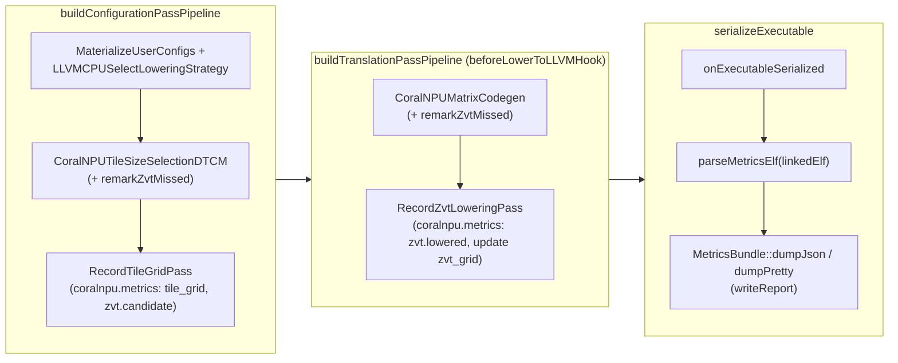
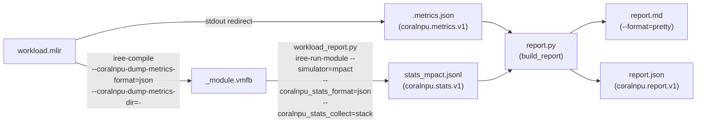

# CoralNPU Metrics Architecture (`metrics/`)

This document describes the architecture of the CoralNPU telemetry, compiler
metrics, and workload reporting subsystem under `metrics/`. For CLI flag and
environment variable usage, see [metrics/README.md](../../metrics/README.md) and
[README.md](../../README.md).

---

## 1. Runtime Dispatch Statistics & Memory Footprint (`metrics/runtime/`)

### 1.1 Overview & Boundary Design

Runtime dispatch telemetry is decoupled from the HAL driver (`runtime/driver/`)
and simulator backends (`runtime/sim/`) across two narrow C boundaries:

1. **Device-Level Dispatch Observer (`iree_hal_coralnpu_dispatch_observer_t` in
   `runtime/driver/coralnpu_dispatch_observer.h`)**:
   - Configured on `iree_hal_coralnpu_device_params_t.dispatch_observer`. Driver
     registration (`runtime/driver/registration/driver_module.c`) installs the
     default flag-driven observer from `metrics/runtime/stats_flags.h`.
   - `iree_hal_coralnpu_device_dispatch` (`runtime/driver/coralnpu_device.c`)
     calls `begin_dispatch` before invoking `exec_backend.dispatch`
     (`runtime/driver/coralnpu_exec_backend.h`). In `stats_writer.c`,
     `begin_dispatch` looks up or parses and caches the static ELF memory layout
     for `info->dispatch_image` under `stats->mutex` (`firmware_memory.h`) and
     heap-allocates a per-dispatch collector (`hooks.self`) so concurrent
     callers are thread-safe before the backend acquires
     `iree_hal_coralnpu_simulator_mutex`.
   - When `begin_dispatch` succeeds and the backend returns, the device calls
     `end_dispatch` with the dispatch status code (including failed runs) and
     frees the collector. If `begin_dispatch` fails, its error is logged as a
     warning and the dispatch runs without hooks and without `end_dispatch`.
   - Device parameter validation rejects a non-null `begin_dispatch` when
     `end_dispatch` is `NULL`. Any error from `begin_dispatch` or `end_dispatch`
     is logged as a warning to `stderr` and ignored, and the device passes
     `NULL` hooks to the backend whenever no observer is active.
2. **Simulator-Level Run Hooks (`iree_hal_coralnpu_run_hooks_t` in
   `runtime/driver/coralnpu_run_hooks.h`)**:
   - `iree_hal_simulator_issue_dispatch_inline`
     (`runtime/sim/simulator_inline.c`) invokes `before_run` and `after_run`
     immediately around `coralnpu_simulator_run`. Hooks are not called if ELF
     loading or `.heap` staging fails before the core runs.
   - Each hook receives `iree_hal_coralnpu_run_t`, which provides core
     callbacks (`cycle_count`, `read_mem`, `write_mem`), the mailbox address
     (`dispatch_request_addr`), the `.heap` bump-allocator end address
     (`heap_cursor`), and whether the core halted at `mpause` (`halted`).
   - **Cycle Counter Ordering Invariant on RTL**: On Verilator, `read_mem` and
     `write_mem` advance the simulator cycle counter. Therefore, `before_run` in
     `metrics/runtime/stats_collector.c` reads `cycle_count` last (after any
     stack painting), and `after_run` reads `cycle_count` first (before reading
     the mailbox or scanning the stack).

```text
             +----------------------------------------------------+
             |   driver_module.c (runtime/driver/registration/)   |
             +------------+--------------------------+------------+
                          |                          |
             runs module  |                          | stats_writer_from_flags()
                          v                          v
+----------------------------------+   :   +----------------------------------+
| HAL DRIVER (runtime/driver/)     |   :   | METRICS (metrics/runtime/)       |
|  [coralnpu_device.c]             |  [B1] |  [stats_writer.c]                |
|   1. begin_dispatch(&info) ------+===:==>|   - caches ELF memory layout     |
|   2. exec_backend.dispatch()     |   :   |   - creates dispatch collector   |
|   7. end_dispatch(status) -------+===:==>|   - writes JSON / pretty stats   |
+-----------------+----------------+   :   |                 |                |
                  | 2. dispatch        :   |                 | (per dispatch) |
                  v                    :   |                 v                |
+----------------------------------+   :   |  [stats_collector.c]             |
| SIMULATOR (runtime/sim/)         |  [B2] |   - heap.used, optional stack    |
|  [simulator_inline.c]            |   :   |     paint, start cycle_count     |
|   3. before_run(&run) -----------+===:==>|   - end cycle_count, mailbox     |
|   4. coralnpu_simulator_run()    |   :   |     read, optional stack scan    |
|   6. after_run(&run) ------------+===:==>|                                  |
+-----------------+----------------+   :   +----------------------------------+
                  | 4. run             :
                  v                    :   [B1] coralnpu_dispatch_observer.h
+----------------------------------+   :   [B2] coralnpu_run_hooks.h
| FIRMWARE (crt/)                  |   :
|  [coralnpu_main.c]               |   :
|   5. mcycle / minstret around    |   :
|      workgroup loop -> mailbox   |   :
+----------------------------------+   :
```

### 1.2 Firmware-Measured Kernel Counters (`crt/`)

- **64-bit RV32 CSR Reads (`crt/coralnpu_main.c`)**:
  `coralnpu_read_mcycle()` and `coralnpu_read_minstret()` use the standard
  RISC-V RV32 `mcycleh` / `mcycle` / `mcycleh` (and `minstreth` / `minstret` /
  `minstreth`) retry loop to guard against 32-bit low-word rollover. Before the
  3D workgroup loop, `main()` samples `mcycle` first and `minstret` second;
  after the loop, it samples `minstret` first and `mcycle` second so the
  `minstret` read sequence does not inflate `instret.kernel`.
- **Mailbox Layout (`crt/coralnpu_dispatch.h`)**:
  `coralnpu_dispatch_request_t` (84 bytes, enforced by `static_assert` and by a
  runtime ELF symbol-size check in `simulator_inline.c`) reserves 20 output
  bytes starting at offset 64 (`valid_mask`, `kernel_cycles_lo`,
  `kernel_cycles_hi`, `kernel_instret_lo`, `kernel_instret_hi`). The firmware
  sets `CORALNPU_DISPATCH_VALID_KERNEL_CYCLES` (`1u << 0`) and
  `CORALNPU_DISPATCH_VALID_KERNEL_INSTRET` (`1u << 1`) only after the 3D
  workgroup loop completes; early validation or workgroup execution failures
  call `coralnpu_dispatch_fail`, leaving `valid_mask = 0`.
- **ITCM Footprint Guardrails in `crt/coralnpu_main.c`**:
  `crt/coralnpu_main.o` is linked into every dispatch ELF against an 8 KiB ITCM
  budget. To stay within that budget, `coralnpu_dispatch_fail` is marked
  `__attribute__((noinline))` and writes directly to
  `coralnpu_dispatch_request`. In addition, `coralnpu_read_{mcycle,minstret}`
  are marked `__attribute__((always_inline))` with a `"memory"` clobber to
  prevent out-of-line emission under `-Os` and memory reordering across CSR
  reads, and the zero-initialized 80-byte `environment` struct is placed in
  `.bss` (`DTCM`) rather than `.rodata` (`ITCM`).

### 1.3 ELF Memory Footprint & Stack High-Water Mark (`metrics/runtime/`)

- **ELF Linker Symbol & `PT_LOAD` Parsing (`firmware_memory.{c,h}`)**:
  `iree_hal_coralnpu_firmware_memory_read` looks up 8 CRT linker symbols via
  `iree_hal_coralnpu_executable_find_symbol`
  (`runtime/driver/coralnpu_executable.h`): `__itcm_start`, `__itcm_size`,
  `__dtcm_start`, `__dtcm_size`, `__heap_start`, `__heap_end`, `__stack_start`,
  and `__stack_size` (generated from `@coralnpu_hw//toolchain:coralnpu_tcm.ld.tpl`
  in `crt/BUILD.bazel`, with `--defsym=__stack_size__` set from
  `--coralnpu-stack-size-kb`). It then sums the `p_memsz` overlap
  of `PT_LOAD` segments with ITCM and DTCM. Because the linker script places
  `.heap` and `.stack` inside a DTCM `PT_LOAD` segment without `(NOLOAD)`, their
  byte overlaps are subtracted so `memory.dtcm.used` measures static DTCM
  sections (`.data`, `.bss`, `.sdata`, `.sbss`, and `.noinit`) plus any unusable
  alignment padding before `__heap_start` (preserving
  `dtcm.used + heap.size + stack.size == dtcm.size`).
  `memory.heap.used` is `max(heap_cursor, __heap_start) - __heap_start`, which
  includes push constants, binding tables, and any 4 KiB `workgroup_local_memory`
  pages allocated in DTCM for promoted RVV contraction tiles or Zvt scratch
  tiles.
- **Opt-In Stack Painting & Scanning (`stack_peak.{c,h}`)**:
  Enabled via `--coralnpu_stats_collect=stack` (`CORALNPU_STATS_COLLECT=stack`,
  parsed by `iree_hal_coralnpu_stats_collect_parse` in `stats_writer.h`). Before
  execution, `iree_hal_coralnpu_stack_paint` writes `0xDEADBEEF` in 256-byte
  chunks across the word-aligned stack. When the heap ends at `__stack_start`
  and `heap_cursor` leaves unallocated space below `__stack_start`, painting
  extends up to 256 bytes (`IREE_HAL_CORALNPU_STACK_GUARD_SIZE`) into that
  unused heap guard region. After execution (even if the core did not halt),
  `iree_hal_coralnpu_stack_scan` scans upward from the bottom of the painted
  region to the first modified word to compute the peak stack usage. It sets
  `overflow` to `true` if any guard word was overwritten, or if no guard
  existed and the bottom word of the stack was overwritten.
- **Output Schemas & Verification (`stats_writer.{c,h}`,
  `metrics/tests/runtime/`)**:
  `stats_writer.c` emits `coralnpu.stats.v1` JSON (`cycles.{total,kernel}`,
  `instret.kernel`, `memory.{itcm,dtcm,heap,stack}`) or `pretty` summary tables.
  In `pretty` tables, `itcm(max)`, `data(max)`, `heap(max)`, and `stack(max)`
  report `max(itcm.used)`, `max(dtcm.used)`, `max(heap.used)`, and
  `max(stack.peak)` (with `"!"` appended on overflow). Behavior is verified by
  `//metrics/tests/runtime:stats_test`, `//metrics/tests/runtime:memory_test`,
  and `//metrics/tests/runtime:stack_peak_test`.

---

## 2. Compiler Metrics Bundle, Tile Grid & Static Zvt Status (`metrics/compiler/`)

### 2.1 Overview & Backend Hook Architecture

The compiler metrics library (`metrics/compiler/`) is decoupled from
`compiler/Target/` through `CoralNPUTargetHooks`
(`compiler/Target/CoralNPUTargetHooks.h`), with its passes registered in
`CoralNPUSession::registerPasses` via `registerMetricsPasses()`. Enabling
`--coralnpu-dump-metrics-format` obeys a **zero-codegen-impact invariant**: the
hooks only attach discardable `coralnpu.metrics` attributes on dispatch
functions and serialize the sideband report, never altering tile selection, pass
pipelines, or generated code:

1. **`addConfigurationPasses(OpPassManager &funcPassManager)`**:
   Called at the end of `CoralNPUTargetBackend::buildConfigurationPassPipeline`
   after `createLLVMCPUSelectLoweringStrategyPass()` and
   `createCoralNPUTileSizeSelectionDTCMPass(dtcmOptions)`. Schedules
   `RecordTileGridPass` on `FunctionOpInterface`.
2. **`addPostMatrixCodegenPasses(OpPassManager &funcPassManager)`**:
   Called in `CoralNPUTargetBackend::buildTranslationPassPipeline` inside
   `beforeLowerToLLVMHook` right after `createCoralNPUMatrixCodegenPass()`.
   Schedules `RecordZvtLoweringPass`.
3. **`onExecutableSerialized(variantOp, target, linkedElf)`**:
   Called at the end of `CoralNPUTargetBackend::serializeExecutable` after
   translating the inner module to LLVM IR and linking the executable.
   `MetricsTargetHooks::onExecutableSerialized` (`MetricsTargetHooks.cpp`)
   collects target metadata (`MetricsTargetInfo`), export metadata
   (`MetricsDispatchInfo`), and any `coralnpu.metrics` dictionary entries on
   each dispatch function (`MetricsAttr.{h,cpp}`). When
   `serializeDynamicLibraryExecutable` links an embedded firmware ELF
   (`target.getLinkEmbedded()`, so `linkedElf` is non-empty), it parses the ELF
   via `parseMetricsElf` (`MetricsElf.{h,cpp}`); any ELF parse failure logs via
   `LDBG()` and omits the `"elf"` section without failing compilation. Finally,
   it writes the `coralnpu.metrics.v1` JSON or `pretty` bundle
   (`MetricsBundle.{h,cpp}`) to `<executable>.metrics.{json,txt}`, `stdout`
   (`-`), or `stderr` via `writeReport` (`compiler/Target/Utils.h`). Any file
   I/O error emits a warning on `variantOp` without failing compilation.



### 2.2 Per-Dispatch `coralnpu.metrics` Channel, Tile Grid, ELF & Zvt Tracking

- **Linked Firmware ELF & Target Metadata (`MetricsElf.{h,cpp}`,
  `MetricsBundle.{h,cpp}`, `MetricsTargetHooks.cpp`)**:
  `makeTargetInfo` extracts `vlen` (largest `+zvl<N>b`), `hasFloat` (`+f`), and
  `hasZvt` (`+zvtbase`) from `variantOp` using the shared
  `getVlenFromTargetFeatures`, `hasCoralNPUTargetFeature`, and
  `hasZvtTargetFeature` helpers in `compiler/Target/Utils.h`, and reads `abi`
  from `target.llvmTargetOptions.MCOptions.ABIName`. For embedded dynamic
  libraries (`target.getLinkEmbedded()`), `parseMetricsElf` inspects the 32-bit
  little-endian ELF via `llvm::object::ObjectFile::createELFObjectFile`
  (`ELF32LEObjectFile`), resolves defined `__itcm_{start,size}` and
  `__dtcm_{start,size}` symbols, and classifies non-empty `SHF_ALLOC` sections
  whose full `[address, address + size)` range lies within ITCM or DTCM into
  `itcm`, `dtcm`, or `other` (accumulating `.stack` bytes into `dtcm->stack`).
  It then iterates over `PT_LOAD` program headers (`p_memsz > 0`) to compute
  `itcm.used` and `dtcm.used`, subtracting the byte overlap of `.heap` and
  `.stack` sections from `dtcm.used` so `itcm.used`, `dtcm.used`, and
  `dtcm.free()` match `metrics/runtime/firmware_memory.c` to the byte.
- **Discardable Function Attribute Channel (`MetricsAttr.{h,cpp}`,
  `MetricsTargetHooks.cpp`)**:
  Passes attach metrics to the enclosing `FunctionOpInterface` under the
  discardable `DictionaryAttr` key `coralnpu.metrics` (`getMetricsEntry`,
  `setMetricsEntry`). During serialization, `MetricsTargetHooks.cpp` converts
  supported MLIR attributes (booleans, unit, `<= 64`-bit integers, floats,
  strings, arrays, and dictionaries) into `MetricsDispatchInfo::extra`, skipping
  reserved dispatch keys (`isReservedDispatchKey` in `MetricsBundle.h`: `name`,
  `ordinal`, `workgroup_size`, `binding_count`, `constant_count`) and
  unsupported attributes via `LDBG()`.
- **Tile Grid Recording (`RecordTileGridPass.{h,cpp}`)**:
  Finds the dispatch's tiled root compute operation via
  `iree_compiler::getComputeOps` + `getTiledRootOp`
  (`CoralNPUTileSizeSelectionUtils.h`). When the root op implements
  `TilingInterface` with static loop ranges (`getStaticLoopRanges`) and carries
  an `IREE::CPU::LoweringConfigAttr`, it records
  `tile_grid = {op, loops, workgroup, dtcm, vector}` (clamping each level's
  positive tile sizes to the enclosing level's tile size, and inheriting the
  enclosing level's tile size when a loop is left untiled with `0`). On Zvt
  targets (`hasZvtTargetFeature` in `compiler/Target/Utils.h`), it also records
  `zvt = {candidate: true/false}` via `isZvtMatrixContraction` and, for any
  candidate, `tile_grid.zvt_grid = [ceil(M_vec / 16), ceil(N_vec / 16)]` via
  `getZvtMNLoops` (including `[1, 1]` for partial $< 16 \times 16$ tiles).
- **Post-Matrix-Codegen Zvt Lowering Check (`RecordZvtLoweringPass.{h,cpp}`)**:
  Walks `LLVM::InlineAsmOp` operations in the function after
  `CoralNPUMatrixCodegenPass`, checks `containsZvtMatmulMnemonic`
  (`compiler/Target/Utils.h`: `"vtmms.tvv"`, `"vtfmm.alt.tvv"`, `"vtfmm.tvv"`),
  and updates `zvt` in `coralnpu.metrics` to `{candidate, lowered}`
  (synthesizing `{candidate: false, lowered: true}` if a function without a
  prior `zvt` entry contains a Zvt matmul). When `lowered` is `false`, it
  removes `tile_grid.zvt_grid`. Workload-level static Zvt lowering rate
  aggregation across bundles is performed by `metrics/tools/report.py` (§3).
- **Missed-Optimization Remarks (`remarkZvtMissed` in
  `CoralNPUTileSizeSelectionUtils.{h,cpp}`)**:
  Emits opt-in `mlir::remark::missed` diagnostics (category `"coralnpu-zvt"`,
  remark name `"ZvtLowering"`), surfaced via `--remarks-filter=coralnpu-zvt`
  while keeping normal compilation silent on `stdout` and `stderr`. Subcategory
  `"dtcm-tiling"` (`CoralNPUTileSizeSelectionDTCM.cpp`) reports when a fused
  input producer or the DTCM tile budget prevents Zvt tiling of a candidate, and
  `"matrix-codegen"` (`CoralNPUMatrixCodegen.cpp`) reports at most once per
  function (when no contraction in the function lowered to Zvt) why the first
  contraction or strided 1D conv outer-product loop with Zvt element types
  (`hasZvtElementTypes`) was rejected by shape, accumulator/use-chain, or
  address checks (non-Zvt element types such as `i32` stay silent).

### 2.3 Why Not Alternative Compiler Metrics Designs

- **Why `coralnpu.metrics` on `FunctionOpInterface` rather than op attributes or
  side tables?** Root Linalg operations are tiled, vectorized, bufferized, and
  erased during translation, whereas the enclosing dispatch `func.func` persists
  through `serializeExecutable` and survives `-compile-to` / `-start-from`
  round-trips without thread-unsafe side tables.
- **Why detect Zvt lowering by scanning `LLVM::InlineAsmOp` in a separate
  pass?**
  Keeping `RecordZvtLoweringPass` in `metrics/compiler/` avoids coupling
  `compiler/Transforms/CoralNPUMatrixCodegen.cpp` to `metrics/compiler/` and
  directly verifies that Zvt inline assembly was emitted into the IR.

---

## 3. Workload Report & Bazel Integration (`metrics/tools/`)

### 3.1 Overview, Pipeline & Join Key

The workload report tools in `metrics/tools/` join compile-time
`coralnpu.metrics.v1` bundles with runtime `coralnpu.stats.v1` JSON Lines traces
into a unified `coralnpu.report.v1` JSON document and space-aligned Markdown
tables (`# CoralNPU workload report`):



- **Exact `(executable, name)` Join Across Compiler and Runtime**: During
  compilation, `MetricsTargetHooks::onExecutableSerialized`
  (`metrics/compiler/MetricsTargetHooks.cpp`) records `"executable"` from
  `IREE::HAL::ExecutableOp::getName()` and each dispatch's `"name"` from
  `IREE::HAL::ExecutableExportOp::getName()`. IREE's ELF library generator
  embeds those strings into the ELF executable library header's `name` and
  `exports.names` tables inside the linked firmware ELF. At runtime,
  `coralnpu_executable.c` reads those exact strings from the ELF library header
  (rather than the `.vmfb` module filename stem), so joining on
  `(executable, name)` correlates multi-executable workloads deterministically.

### 3.2 Report Schema, Aggregation Rules & Bazel Runner

- **Compile-Time Bundle Capture (`build_tools/bazel/bytecode_module.bzl`)**:
  `coralnpu_bytecode_module(..., metrics_name = "<name>.metrics.json")` adds
  `metrics_name` to the genrule `outs`, appends
  `--coralnpu-dump-metrics-format=json --coralnpu-dump-metrics-dir=-` to
  `iree-compile`, and redirects `stdout` to `$(execpath <metrics_name>)`.
- **Bundle & Stats Loading (`metrics/tools/report.py`)**:
  - `load_bundles(paths)` expands directory paths to sorted `*.metrics.json`
    files, decodes one or more concatenated JSON objects per file via
    `json.JSONDecoder.raw_decode`, and keeps dicts with
    `schema == "coralnpu.metrics.v1"`, raising `ValueError` on duplicate
    `executable` names.
  - `read_stats(paths)` parses JSON Lines files and keeps dicts with
    `schema == "coralnpu.stats.v1"`.
- **Merging & Completeness Invariants (`build_report`, `find_problems`)**:
  - `build_report(bundles, records)` produces a `coralnpu.report.v1` dict with
    `target` (from `bundles[0]` when `bundles` is non-empty, adding `itcm_kb`
    from the ELF region size), `simulators` (in first-seen order),
    `executables`, `dispatches`, and `summary` (`{firmware, zvt, simulators}`).
    Each entry in `executables` copies the region dicts from
    `bundle.elf.regions` into `{executable, itcm, dtcm}` when present, and
    `dispatches` lists bundled dispatches (`in_bundle = True`, with `itcm_used`
    and `data_used` copied from the executable's `itcm` and `dtcm` regions or
    from the runtime stats record as a fallback, raising `ValueError` if the two
    disagree) in bundle order followed by any runtime-only `(executable, name)`
    pairs (`in_bundle = False`).
  - Each per-simulator `run` aggregates all records for one dispatch on one
    simulator into `runs`, `failures` (`status.code != "OK"`), `cycles_per_run`
    and `instret_per_run` (integer floor division over successful runs, emitted
    **only** when every successful run reported that counter), `cycles`
    (`{total, kernel}` sums), `instret` (`{kernel}` sum), and `memory` (maxima
    across runs for `heap_used`, `stack_peak`, and `stack_overflow`). A `cycles`
    or `instret` sum (per-dispatch or in
    `summary.simulators.<sim>.{cycles,instret}`) is emitted **only** when every
    constituent run reported that counter; for example, a failed run omits
    `cycles.kernel` while still reporting `cycles.total`, and backends without a
    total cycle counter omit `cycles.total`.
  - `summary.firmware` records `{executables, itcm_used, dtcm_used}` (peak
    static ELF usage across executables), and `summary.zvt` computes
    `{candidates, lowered_candidates, rate}`
    (`round(lowered_candidates / candidates, 4)`, omitting `rate` when
    `candidates == 0`) statically over all entries in `report["dispatches"]`
    with `candidate == True` (`{candidate: False, lowered: True}` dispatches are
    excluded from `summary.zvt` and rendered as `no/yes` in `## Dispatches`).
  - `find_problems(report, simulators)` returns error strings for missing
    compiler bundles, missing simulator stats, runtime dispatches without a
    compiler bundle, failed runs, and stack overflows.
- **Pretty Markdown Format (`format_pretty`)**:
  Renders `# CoralNPU workload report` with a bullet summary (`Target` with
  `ITCM` and `DTCM` capacities, peak `Firmware` ITCM/DTCM `used` bytes without
  heap/stack, `Static Zvt rate`, and per-simulator run/failure/cycle totals) and
  space-aligned fenced code tables for `## Dispatches` and `## Tile grid`
  (omitted when no dispatch has `tile_grid`). Dispatch names are qualified as
  `<executable>::<name>` when non-unique across executables. In `## Dispatches`,
  the `zvt` column renders `yes` or `no` when `candidate` and `lowered` match,
  and `<cand>/<low>` (such as `yes/no`) when they differ; in `## Tile grid`, the
  `zvt` column is left blank when `zvt_grid` is absent. Bundled dispatches that
  did not run render a single row with `n/a` runtime columns in `## Dispatches`;
  lists render as `MxNxK` and stack overflows as `<peak>!`:

  ~~~markdown
  # CoralNPU workload report

  - Target: riscv32-unknown-elf, VLEN 128, Zvt yes, ITCM 8 KB, DTCM 32 KB
  - Firmware: up to 1824 bytes of ITCM and 64 bytes of DTCM, without the heap and the stack, in 1 executables
  - Static Zvt rate: 1 of 1 Zvt candidates lowered to Zvt (100.0%)
  - mpact: 1 dispatch runs, 0 failed, 420 cycles, 310 in the kernels

  ## Dispatches

  Per run: the cycles of the run and of the kernel (the workgroup loop), the instructions of the kernel, the ITCM and static DTCM data of the executable, the heap and the stack peak in bytes ("!" for an overflow), and whether the root op is a Zvt candidate and lowered to Zvt ("cand/low" when they differ).

  ```
  dispatch           simulator  runs  failed  cycles  kernel  kinstret  itcm  data  heap  stack  zvt
  matmul_dispatch_0  mpact      1     0       420     310     280       1824  64    512   128    yes
  ```

  ## Tile grid

  The loop ranges of the root op, and its workgroup, DTCM and vector tile sizes; the Zvt grid is the number of 16x16 Zvt tiles of a vector tile along M and N.

  ```
  dispatch           op             loops       workgroup   dtcm        vector    zvt
  matmul_dispatch_0  linalg.matmul  64x96x128   64x96x128   64x96x128   32x32x1   2x2
  ```
  ~~~

- **Bazel Workload Report Macro & Runner (`metrics/tools/defs.bzl`,
  `metrics/tools/workload_report.py`)**:
  `coralnpu_workload_report` compiles the `.mlir` source via
  `coralnpu_bytecode_module(..., metrics_name = "<name>.metrics.json")` and
  defines a `native_test` running `//metrics/tools:workload_report` on the
  configured `simulators` (default `["mpact"]`, tagged `driver=coralnpu`,
  `simulator=<sim>`, `target=coralnpu`). Before each simulator run,
  `workload_report.py` removes any existing `stats_<simulator>.jsonl` in
  `--output-dir` (default `$TEST_UNDECLARED_OUTPUTS_DIR`, because
  `stats_writer.c` opens stats files in `"a"` append mode) and strips ambient
  `CORALNPU_SIMULATOR` and `CORALNPU_STATS_*` environment variables. It then
  runs `iree-run-module` with
  `--coralnpu_stats_format=json --coralnpu_stats_collect=stack`, writes
  `report.md` and `report.json` on exit `0` or `1` (even if a run failed), and
  exits with `0` (no problems), `1` (`iree-run-module` non-zero exit, simulator
  stats read/parse failure, or `find_problems` errors), or `2`
  (unreadable/malformed `--compiler-metrics` bundles or bundle/stats footprint
  mismatches; standalone `report.py` exits with `2` on any unreadable or
  inconsistent bundle or stats input). Behavior is verified by
  `//metrics/tests/tools:report_test` and `//metrics/tests/report:mlp_f32`.

### 3.3 Why Not Alternative Report Designs

- **Why split `report.py` (offline merger) from `workload_report.py` (simulator
  runner) instead of merging inside `metrics/runtime/` C?** Keeping report
  merging in standalone Python preserves the strict separation between
  `metrics/compiler/` and `metrics/runtime/` and avoids adding a JSON parser to
  the C HAL driver. It also lets developers re-format saved `.metrics.json` and
  `.jsonl` files offline without re-running simulators.
- **Why require all runs to report a counter before emitting `cycles` sums?**
  A dispatch that fails before finishing the workgroup loop omits
  `cycles.kernel` (while still reporting `cycles.total`), and some targets (such
  as FPGA) do not report `cycles.total`. Omitting any `cycles` sum that is
  missing on a constituent run prevents a partial sum from being misread as a
  complete workload total.
- **Why run `iree-run-module` inside `workload_report.py` (`native_test`) rather
  than a build-time `genrule`?** Running simulation and report generation in a
  test target keeps compilation cached as a normal build action while only
  executing the simulator during `bazel test`. It also still writes `report.md`
  and `report.json` to `$TEST_UNDECLARED_OUTPUTS_DIR` when a dispatch fails.

---

## TODOs

- [ ] Record DTCM tile footprint estimate in `RecordTileGridPass` using
  `DTCMFootprintModel` (`metrics/compiler/RecordTileGridPass.cpp`,
  `compiler/Transforms/CoralNPUTileSizeSelectionFootprint.h`).
- [ ] Evaluate unifying standalone $M = 2$ Zvt contraction candidacy and tiling
  without regressing DTCM operand promotion or `subTileM` divisor snapping
  (`compiler/Transforms/CoralNPUTileSizeSelectionUtils.cpp`,
  `compiler/Transforms/CoralNPUTileSizeSelectionDTCM.cpp`).
- [ ] Record BF16 `vecmat` K-loop candidate and `vfwmaccbf16.vf` lowering status
  in `coralnpu.metrics` and emit missed remarks when falling back to generic RVV
  (`metrics/compiler/*`, `compiler/Transforms/CoralNPUMatrixCodegen.cpp`).
- [ ] Add dynamic instruction mix and runtime-weighted Zvt execution rate to
  runtime stats and workload reports (`metrics/runtime/`,
  `metrics/tools/report.py`).
- [ ] Add optional performance and memory threshold checks to
  `workload_report.py` (`metrics/tools/workload_report.py`,
  `metrics/tools/defs.bzl`).
