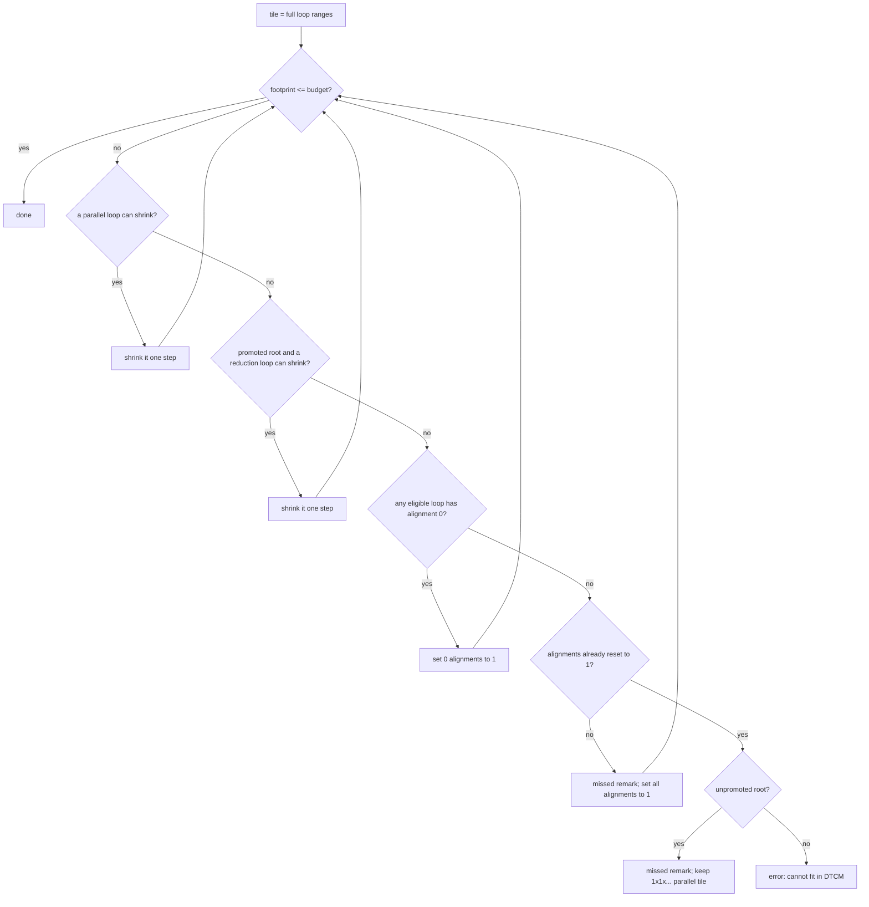

# CoralNPU Tiling and DTCM Promotion

This document describes how the CoralNPU compiler selects workgroup, DTCM
(data tightly-coupled memory), and register tile sizes across dispatches, and
how it promotes workgroup tiles into DTCM.

## 1. Overview

A **dispatch** is a standalone kernel that IREE splits out of a model, usually
one main operation (such as a matmul or convolution) plus the operations fused
with it. The compiler builds each dispatch into its own function, and the
runtime launches it on CoralNPU across a grid of **workgroups**.

CoralNPU executes compute kernels out of fast on-core SRAM (**DTCM**, 32 KB by
default), while dispatch input and output bindings reside in external memory. To
keep active working sets inside DTCM and maximize register reuse, the compiler
configures tile sizes in two steps (`CoralNPUTileSizeSelectionDTCM` after IREE's
strategy pass) and promotes workgroup tiles into DTCM during translation
(`CoralNPUPromoteOperands` and `CoralNPULowerDTCMCopies`).

When operand promotion is enabled on a dispatch, each workgroup processes one
DTCM parallel tile and:

1. picks tile sizes whose DTCM buffers fit within the DTCM tile budget;
2. copies the input tiles from memory into DTCM;
3. runs the root operation and fused operations on the DTCM input buffers;
4. writes each output tile into a DTCM staging buffer and copies it back to
   memory.

Although the promotion passes (`CoralNPUPromoteOperands` and
`CoralNPULowerDTCMCopies`) support any `LinalgOp` root and its fused producers
and consumers in the `DoubleTilingExpert` pipeline,
`CoralNPUTileSizeSelectionDTCM` currently enables `promote_operands` only for
**RVV contractions with 2D reuse** (`linalg.matmul`, `linalg.batch_matmul`, or a
contraction `linalg.generic` with $M > 1$ and $N > 1$, checked by
`hasContractionReuse` in
[CoralNPUTileSizeSelectionUtils.cpp](../../compiler/Transforms/CoralNPUTileSizeSelectionUtils.cpp))
for two reasons:

- **Synchronous copy cost (`TODO(DMA)`)**: Without DMA, the CPU copies tiles
  itself using RVV vector loads and stores, so copying costs as much as reading
  the data directly. The copy helps only when a tile reuses each input value
  several times, serving the extra reads from fast DTCM instead of external
  memory. In a 2D contraction ($M > 1$ and $N > 1$), inner vector loops reuse
  each LHS slice across $N / \text{vec}_N$ column tiles and each RHS slice
  across $M / \text{vec}_M$ row tiles. By contrast, elementwise operations,
  reductions, and matrix-vector products (`vecmat`, `matvec`, `dot`) read each
  input value once. Copying their inputs into DTCM first just adds work: instead
  of one external read, the CPU performs an external read, a DTCM write, and a
  DTCM read.
- **Pipeline and backend scope (§8.4 `TODOs`)**: Convolutions also reuse their
  inputs, so copying into DTCM could help them too. However, convolutions use a
  different compiler pipeline (`ConvTileAndDecomposeExpert`), and
  `afterCacheTilingHook` (IREE patch `0014`) connects the copy step only to
  `DoubleTilingExpert` (`TODO(scope)`). Zvt contractions do not use the copy
  step yet either (`TODO(zvt)`). Unpromoted operations still get DTCM and
  register tile sizes chosen to fit DTCM, keeping their working sets and stack
  within its limits.

Target-specific register tiling and special cases are covered in dedicated
sections below: **§6** covers RVV vector tile selection, multi-op reductions
(`linalg.softmax`), and `linalg.pack`/`unpack` roots; **§7** covers Zvt matrix
tiling, hybrid RVV-to-Zvt tile lowering, and Zvt scratch-tile footprint
accounting.

---

## 2. Background: IREE Multi-Level Tiling on CoralNPU

CoralNPU extends IREE's `llvm-cpu` backend, which applies tiling to compute
operations across three logical levels corresponding to the hardware hierarchy:

```text
[Problem Size] (External Memory / DDR)
      |
      |  <-- Level 0: Distribution (Workgroups)
      v
[Workgroup Tile]
      |
      |  <-- Level 1: Cache / Local Memory (DTCM)
      v
[DTCM Tile] (32 KB SRAM)
      |
      |  <-- Level 2: Vector (Registers)
      v
[Vector Tile] (32 RVV Vector Registers / Zvt Tile Registers)
```

Within each dispatch, IREE's `LLVMCPUSelectLoweringStrategyPass` picks one
**root operation** (`root.op`, such as a matmul, convolution, or reduction) to
anchor tiling. Every other compute operation in the dispatch is a **non-root
operation** (such as a dequantization, bias add, or ReLU); tiling the root
normally fuses non-root operations into the root's parallel tile loops
automatically (see **§6.2** for multi-op reductions where non-root ops need
explicit register configs):

```text
[dequantize] ──► [matmul] ──► [add bias] ──► [relu]
  non-root         ROOT         non-root       non-root
 (fused in)                    (fused in)     (fused in)
```

During configuration, `LLVMCPUSelectLoweringStrategyPass` and
`CoralNPUTileSizeSelectionDTCM` attach two attributes to the dispatch:

1. **`#iree_codegen.translation_info`** on the dispatch `func.func`, selecting
   the lowering pipeline (`DoubleTilingExpert` for contractions, reductions, and
   elementwise ops, or `ConvTileAndDecomposeExpert` for convolutions and
   poolings) and optional flags such as `enable_loop_peeling`.
2. **`#iree_cpu.lowering_config`** on compute operations, specifying per-loop
   tile sizes at each IREE `TilingLevel` (`0` means untiled at that level).
   Levels 0 and 1 are set only on `root.op`, while Level 2 is set on `root.op`
   and, when needed, non-root operations:

| Level                | Config Key (`TilingLevel`)                             | Loop      | Maps To                                                     | Who Sets It                                    |
| :------------------- | :----------------------------------------------------- | :-------- | :---------------------------------------------------------- | :--------------------------------------------- |
| **0: Distribution**  | `distribution` (`DistributionTiles`)                   | Parallel  | Workgroups (`scf.forall`, one DTCM parallel tile per slice) | DTCM pass (`= cache_parallel`, `root.op` only) |
| **1: Cache / DTCM**  | `cache_parallel` (`CacheParallelTiles`)                | Parallel  | Parallel dimensions of the DTCM working set                 | DTCM pass (`root.op` only)                     |
| **1: Cache / DTCM**  | `cache_reduction` (`CacheReductionTiles`)              | Reduction | DTCM reduction chunks (`scf.for` inside the workgroup)      | DTCM pass (`root.op` only)                     |
| **2: Vector / Reg.** | `vector_common_parallel` (`VectorCommonParallelTiles`) | Parallel  | RVV register groups or Zvt tile grids                       | IREE strategy pass, refined by DTCM pass       |
| **2: Vector / Reg.** | `vector_reduction` (`VectorReductionTiles`)            | Reduction | RVV SIMD reduction step, or `1` for Zvt                     | IREE strategy pass, refined by DTCM pass       |
| **2: Vector / Reg.** | `vector_inner_parallel` (`VectorInnerParallelTiles`)   | Parallel  | Inner parallel tiles (`pack`/`unpack`, post-reduction ops)  | IREE strategy pass or `syncNonRootRVVConfigs`  |

Because CoralNPU is a single-core target, it sets `distribution =
cache_parallel`, so each workgroup processes one DTCM parallel tile. Level 0 and
Level 1 parallel tiling therefore collapse into one step: workgroups are already
the size of a DTCM parallel tile, leaving `cache_parallel` nothing further to
split. Inside each workgroup, only Level 1 `cache_reduction` still tiles,
splitting reduction loops into chunks. After Level 2 tiling,
`LLVMCPUTileToVectorSizePass` and `GenericVectorizationPass` convert the
register-sized Linalg tiles into MLIR `vector` dialect operations.

**CoralNPU addition — `promote_operands` (`kPromoteOperandsName`)**: This is not
one of IREE's tiling levels, but an extra key that CoralNPU adds to `root.op`'s
`lowering_config` (for example, `promote_operands = [0, 1, 2]`). The entries are
`root.op`'s operand indices: for `linalg.matmul`, `0` is the LHS, `1` is the
RHS, and `2` is the output initializer (`outs`). The format mirrors IREE GPU's
`promote_operands`, but CoralNPU uses it only as an on/off flag:
`CoralNPUTileSizeSelectionDTCM` lists every operand of `root.op`, and
`CoralNPUPromoteOperands` only checks that the list is non-empty before copying
all external inputs, split-$K$ accumulators, and stored outputs of the fused
tile (including fused producers and consumers such as a bias) into
`#iree_codegen.workgroup_local` memory. The promotion pass runs right after
DTCM-level tiling via `afterCacheTilingHook` (IREE patch `0014`). IREE's
`IREECPUTypes` schema needs no change because `#iree_cpu.lowering_config` is
stored as an open `DictionaryAttr` that accepts extra keys.

---

## 3. Pipeline & Passes

The compiler configures and lowers each tiling level across the following
passes, where the third column lists the attributes, loops, buffers, or target
instructions produced at each step:

| Step                                            | Pass                                                    | Attributes / IR Produced                                                                                            |
| :---------------------------------------------- | :------------------------------------------------------ | :------------------------------------------------------------------------------------------------------------------ |
| 1. Initial strategy (IREE)                      | `LLVMCPUSelectLoweringStrategyPass`                     | Initial `translation_info` pipeline, Level 0 `distribution`, and Level 2 `vector_*` tile sizes.                     |
| 2. CoralNPU tile selection (Level 2 $\to$ 1/0)  | `CoralNPUTileSizeSelectionDTCM`                         | Refined Zvt/RVV Level 2 `vector_*` sizes & pipeline, Level 1/0 `cache_*`/`distribution` sizes, `promote_operands`.  |
| 3. Level 0 & Level 1 tiling (IREE)              | `LLVMCPU` tile-and-fuse passes                          | Level 0/1 workgroup `scf.forall` loop and Level 1 split-reduction `scf.for` loop of the DTCM tile.                  |
| 4. Level 1 operand promotion                    | `CoralNPUPromoteOperands` (`afterCacheTilingHook`, 0014)| `#iree_codegen.workgroup_local` `alloc_tensor` buffers and `materialize_in_destination` input copies on DTCM tiles. |
| 5. Level 2 tiling & bufferization (IREE)        | `LLVMCPU` vectorization & One-Shot Bufferization        | Level 2 register-tile loops, vectorized inner loops, `memref.alloc` in DTCM (0013), and `linalg.generic` copies.    |
| 6. DTCM copy lowering                           | `CoralNPULowerDTCMCopies` (`beforeLowerToLLVMHook`)     | `scf.for` loops of RVV `vector.load`/`store` (or `maskedload`/`maskedstore`) along contiguous rows.                 |
| 7. Zvt matrix codegen                           | `CoralNPUMatrixCodegen` (`beforeLowerToLLVMHook`)       | Zvt inline-assembly microkernels and DTCM scratch tiles (`memref.alloc` in `workgroup_local` space).                |
| 8. Local memory packing (IREE)                  | `LLVMCPUAssignWorkgroupLocalMemory`                     | Single packed DTCM buffer and the export's `workgroup_local_memory` byte size.                                      |

The CoralNPU pass implementations live in
[compiler/Transforms/](../../compiler/Transforms), and the pipeline hooks are
wired in
[CoralNPUTargetBackend.cpp](../../compiler/Target/CoralNPUTargetBackend.cpp).

When compiler metrics are enabled (`--coralnpu-dump-metrics-format`),
`RecordTileGridPass`
([RecordTileGridPass.cpp](../../metrics/compiler/RecordTileGridPass.cpp)) runs
at the end of `buildConfigurationPassPipeline` via
`CoralNPUTargetHooks::addConfigurationPasses` to record
`tile_grid = {op, loops, workgroup, dtcm, vector, zvt_grid}` and
`zvt = {candidate}` in the dispatch function's `coralnpu.metrics` attribute
(`zvt_grid` is later pruned by `RecordZvtLoweringPass` if Zvt lowering does not
occur; see [metrics.md](metrics.md)).

---

## 4. DTCM Budget, Footprint, and Tile Search (Levels 1 & 0)

### 4.1. Dispatch Eligibility (`getDTCMRoot`)

`CoralNPUTileSizeSelectionDTCM`
([CoralNPUTileSizeSelectionDTCM.cpp](../../compiler/Transforms/CoralNPUTileSizeSelectionDTCM.cpp))
runs on dispatches that have a unique root compute operation carrying
`distribution` tile sizes from `LLVMCPUSelectLoweringStrategyPass` and function
`translation_info`. The root operation must implement `TilingInterface`, have
static loop ranges, and produce at least one `ShapedType` result with an integer
or float element type of at least 8 bits. Dispatches with dynamic loop ranges,
sub-byte root results (such as `i1` or `i4`), or unsupported non-root compute
operations (see §6.2) emit an opt-in missed remark and keep IREE's strategy
configuration.

### 4.2. DTCM Tile Budget

The DTCM tile budget (`getDTCMTileBudgetBytes` in
[CoralNPUTileSizeSelectionUtils.cpp](../../compiler/Transforms/CoralNPUTileSizeSelectionUtils.cpp))
is the total DTCM capacity minus the stack and the static-data reserve, rounded
down to a multiple of 4 KB:

$$
\text{Budget} =
  \lfloor (\text{dtcmSizeKb} - \text{stackSizeKb} - \text{dtcmReserveKb}) / 4 \rfloor
  \times 4\text{ KB}
$$

With the default flags (`--coralnpu-dtcm-size-kb=32`,
`--coralnpu-stack-size-kb=4`, `--coralnpu-dtcm-reserve-kb=4`), the tile budget
is **24 KB** (or **1016 KB** for a 1 MB highmem DTCM). Because the runtime
allocates workgroup local memory in 4 KB pages, any footprint that fits within
the 4 KB-aligned budget also fits after page rounding. See
[README.md](../../README.md) ("DTCM tiling and stack") and
[dma.md](dma.md#22-memory-map--dtcm-layout) for the full DTCM memory map.

### 4.3. Footprint Model (`DTCMFootprintModel`)

The footprint of a candidate DTCM tile (`DTCMFootprintModel` in
[CoralNPUTileSizeSelectionFootprint.cpp](../../compiler/Transforms/CoralNPUTileSizeSelectionFootprint.cpp))
is the sum of the DTCM buffers required by the root operation and the compute
operations fused with it, with each buffer rounded up to **64 bytes**
(`kBufferAlignmentBytes`, matching MLIR One-Shot Bufferization's default
`alignment = 64` on `memref.alloc` when `LLVMCPUAssignWorkgroupLocalMemory`
packs buffers sequentially; see §8.4 `TODOs` for lowering this to 16 B):

- **Input slices**: the input tiles that the root and fused operations read from
  external memory, sized in their memory element types (for example, `i8` before
  a fused `arith.extsi` or `arith.sitofp`) and multiplied by
  `--coralnpu-dtcm-buffers-per-operand` (default `1`, or `2` to reserve space
  for double buffering). Tensors produced by fused operations need no buffer of
  their own; the walker (`FootprintWalker`) traverses through fused producers
  (including producers of `outs` initializers, such as a bias broadcast) to
  count their external inputs instead, and shares a single buffer sized to the
  largest slice when multiple fused ops read the same tensor.
- **Output staging buffers**: the DTCM buffers that hold each result leaving the
  fused operations (such as a tensor stored to a dispatch binding) before it is
  copied back to memory, sized in the stored element type.
- **Reduction accumulator**: an intermediate buffer for the root result when the
  DTCM tile splits a reduction loop (`cache_reduction`) and the root result is
  consumed by a fused operation rather than stored directly (when stored
  directly, the output staging buffer also serves as the accumulator).
- **Zvt scratch tiles**: temporary DTCM buffers of `alignTo(M, 16) x N`
  accumulator elements allocated when `CoralNPUMatrixCodegen` drains Zvt matrix
  accumulators for a fused consumer (detailed in **§7.3**).

`CoralNPUTileSizeSelectionFootprint` estimates these buffers,
`CoralNPUPromoteOperands` allocates the promoted operand buffers, and
`CoralNPUMatrixCodegen` allocates the Zvt scratch tiles; keep all three in sync.

### 4.4. Tile Search, Alignment, and Fallback (Level 2 $\to$ Levels 1 & 0)

`CoralNPUTileSizeSelectionDTCM` picks tile sizes **from the inside out**: first
the register tile (Level 2), then the DTCM tile (Level 1) around it, and finally
the workgroup tile (Level 0), which equals the DTCM parallel tile. Keeping each
outer tile a multiple of the inner tile avoids vector cleanup loops.

```text
  Stage 1                 Stage 2                      Stage 3
  ┌──────────────┐        ┌──────────────────────┐     ┌──────────────────────┐
  │ Level 2      │ align  │ Level 1 search       │     │ write lowering_config│
  │ register tile├───────►│ (shrink until the    ├────►│ Level 0 = Level 1 par│
  │ (Zvt or RVV) │        │  footprint fits)     │     │ sync non-root ops    │
  └──────────────┘        └──────────────────────┘     └──────────────────────┘
```

#### Stage 1: Pick the Register Tile (Level 2)

`selectDTCMTileSizes` first selects the Level 2 register tile sizes
(`vector_common_parallel` and `vector_reduction`) via the Zvt strategy (**§7.1**)
or RVV refinement (**§6.1**). These sizes become the initial **alignments** of
the DTCM search so outer DTCM tiles stay multiples of the register tiles.

Whether the root is **promoted** (its tiles are copied into DTCM, **§5.1**)
determines how the search treats reduction loops:

| Root Kind                          | Examples                                                            | Reduction Loops in DTCM Tile        | Input Slice in Footprint                     |
| :--------------------------------- | :------------------------------------------------------------------ | :---------------------------------- | :------------------------------------------- |
| **Promoted**                       | RVV contraction with 2D reuse                                       | Can split (`cache_reduction > 0`)   | Full DTCM tile                               |
| **Unpromoted** (`streamReduction`) | Zvt root, `matvec`/`vecmat`/`dot`, conv, reduction, `pack`/`unpack` | Never split (`cache_reduction = 0`) | One `vector_reduction` step (or full if `0`) |

An unpromoted root streams its inputs straight from external memory one register
reduction step at a time, so only that single step counts toward the DTCM
footprint.

#### Stage 2: Search for the DTCM Tile (Levels 1 & 0)

The search starts from the **full static loop ranges** so any loop that already
fits stays untiled (`0`), except on 2D channel-last depthwise convolutions,
which pre-tile channels to one RVV vector tile when untiled exceeds budget
(**§6.1**). It then shrinks **one loop by one step** at a time until the
estimated footprint fits within the DTCM budget:



**Which loop shrinks next (`shrinkLoops`).** Parallel loops shrink before
reduction loops. Among parallel loops, those whose full range is a multiple of
their alignment shrink first, from outermost to innermost. Each loop shrinks all
the way down to its alignment before the next loop starts.

**How one step works.** Each step halves the tile down to a multiple of the
alignment (`max(align, alignDown(tile / 2, align))`) and snaps to an exact
divisor of the loop range when one exists, avoiding partial boundary tiles:

```text
  Aligned loop (range 96, alignment 8):
      96 ──► 48 ──► 24 ──► 8            every tile divides 96

  Unaligned loop (range 100, alignment 8):
      100 ──► 50 ──► 25 ──► 10 ──► 8    divisors of 100 while one >= 8 exists,
                                        then max(8, alignDown(tile / 2, 8)):
                                        100 = 12 * 8 + 4
```

For an unaligned loop, the step looks for the largest divisor of the range that
is at least `align` (first $\le \text{tile}/2$, then $< \text{tile}$), falling
back to `max(align, alignDown(tile / 2, align))` when none exists. Two Zvt
exceptions apply (**§7.1**):

- **Zvt $N$** always steps via `max(align, alignDown(tile / 2, align))` because
  Zvt cannot lower arbitrary column remainders.
- **Unaligned Zvt $M$** refuses to shrink when no divisor $\ge \text{align}$
  exists, keeping workgroup $M$ slices static so they stay on the Zvt
  microkernel.

**When nothing fits at vector alignments.** At the alignment limits, the search
relaxes alignments in two steps:

1. Eligible loops with no vector tile (alignment `0`—parallel loops, plus
   reduction loops when promoted) get alignment `1` so they can shrink too.
2. If that still exceeds the budget, the pass emits a `DTCMTileSizes` missed
   remark, resets **all** alignments to `1`, and continues shrinking, trading
   vector efficiency for memory fit.

If even a `1x1x...` parallel tile exceeds the budget, an unpromoted root keeps
that tile with a missed remark (it allocates no promoted DTCM buffers), whereas
a promoted root emits an error and fails compilation.

**After the search:**

- Any register tile larger than its final DTCM tile is clamped down to it
  (`clampToTileSizes`).
- On multi-op reductions, parallel register tiles snap to
  `gcd(dtcmSize, vectorSize)` when the DTCM tile divides the loop range, or to
  `1` otherwise (`snapParallelVectorSizesToStaticTiles`, **§6.2**).

#### Stage 3: Write the Configuration (`applySelectedTileSizes`)

The pass writes the selected levels to `root.op`'s `lowering_config`:

```text
  cache_parallel   = DTCM tile of the parallel loops    (0 = untiled)
  cache_reduction  = DTCM tile of the reduction loops   (0 = untiled)
  distribution     = cache_parallel                     (one DTCM tile per workgroup)
  vector_*         = updated register tiles
  promote_operands = [0, ..., N-1] (only for RVV contractions with reuse)
```

When Zvt or refined RVV heuristics apply, it also updates `translation_info`
(setting the selected pipeline and enabling `enable_loop_peeling` for Zvt or any
unaligned parallel register tile $> 1$), erases stale strategy configs on
non-root ops, and synchronizes multi-op reduction configs
(`syncNonRootRVVConfigs`, **§6.2**).

---

## 5. Workgroup Tile Promotion and Copy Lowering

### 5.1. Tensor-Level Operand Promotion (`CoralNPUPromoteOperands`)

During translation, after IREE lowers Level 0/1 `distribution`/`cache_parallel`
to a workgroup `scf.forall` loop and Level 1 `cache_reduction` to a split-$K$
`scf.for` loop, `afterCacheTilingHook` (IREE patch 0014) runs
`CoralNPUPromoteOperands`
([CoralNPUPromoteOperands.cpp](../../compiler/Transforms/CoralNPUPromoteOperands.cpp);
see [promote_operands.mlir](../../tests/transforms/promote_operands.mlir) for
representative IR before Level 2 register tiling and One-Shot Bufferization):

1. **Static DTCM buffer allocation (`createLocalTensor`)**: At the start of the
   workgroup `scf.forall` body (or of the function if there is no workgroup
   loop), the pass allocates static `bufferization.alloc_tensor` buffers in the
   `#iree_codegen.workgroup_local` memory space sized to the constant upper
   bounds of each tile (`getUpperBoundShape`). When a boundary tile has dynamic
   runtime sizes, the pass extracts a dynamic slice from the static buffer.
   Placing static buffers at the top of the workgroup body ensures that loop
   peeling clones only the inner compute loops (not the DTCM allocations) and
   avoids MLIR's `ReplaceStaticShapeDims` canonicalizer pattern, which drops the
   memory space when turning a dynamic `alloc_tensor` static.
2. **Input promotion and reduction accumulation (`promoteInputs`,
   `promoteRootInit`)**: For each external binding slice read by the root or
   fused operations, `Promoter::copyToLocalMemory` inserts a
   `bufferization.materialize_in_destination` operation immediately after the
   `tensor.extract_slice` (or at the start of the workgroup body if the value is
   defined outside the loop) to copy the slice into its DTCM buffer. When $K$ is
   split (`outerLoop`) or the root result is stored directly, `promoteRootInit`
   redirects a `linalg.fill` initializer to write directly into a DTCM
   accumulator buffer (or copies a non-fill initializer into it), and each
   iteration of the split-$K$ `scf.for` loop accumulates into that DTCM buffer.
   Otherwise, an un-split reduction accumulates in registers without a DTCM
   accumulator buffer.
3. **Output staging and writeback (`promoteOutputs`)**: For each result leaving
   the fused operations, `promoteOutputs` rewrites the operation's `outs`
   operand to write into a DTCM staging buffer. In the `scf.forall.in_parallel`
   terminator, `tensor.parallel_insert_slice` writes the staged tile into the
   external output binding, which One-Shot Bufferization lowers into a
   DTCM-to-external-memory copy.

### 5.2. Key Design Details for Downstream Passes

- **Why `materialize_in_destination` instead of `linalg.copy`**: Because
  `bufferization.materialize_in_destination` is not a Linalg operation, IREE's
  vector-level tiling passes do not tile or fuse it into consumer loops, and
  `GenericVectorizationPass` does not fold it away (whereas `linalg.copy` on a
  static tile is folded by the vectorizer, causing bufferization to emit scalar
  copy loops).
- **Moving un-sliced elementwise producers into the tile loop
  (`ProducerCloner`)**: IREE pulls a producer into the workgroup loop
  (`scf.forall`) only when tiling slices its result. A producer that no tiled
  loop slices stays outside the loop—for example, an RHS dequantization when
  only $M$ is tiled. Such a producer cannot read the DTCM copies because those
  copies live inside the loop, where One-Shot Bufferization sees a fresh buffer
  written before it is read in every iteration. Before promoting inputs,
  `cloneProducersIntoTileLoop` copies each such single-result elementwise
  producer (whose inputs come from dispatch bindings) into the loop body and
  deletes the unused original (`eraseDeadProducers()`). This adds no work at the
  workgroup level because each workgroup runs the loop body once. Later, Level 2
  vector tiling fuses the cloned producer into the inner register loops: DTCM
  holds the narrow input (such as `i8`), while the producer runs on each inner
  register tile (see `TODO(promotion)` in §8.4).
- **Preserving outer-first loop peeling (IREE patch 0015)**: Because promoted
  input copies precede the inner compute loops inside the same block, upstream
  `LLVMCPUPeel` would skip peeling the outer loop first and instead duplicate
  the inner compute loops. Patch 0015 ensures outer loops peel first even when
  preceded by input copies, bounding ITCM code size.
- **Bufferization and vectorized copy lowering (`CoralNPULowerDTCMCopies`)**:
  One-Shot Bufferization lowers `#iree_codegen.workgroup_local` `alloc_tensor`
  ops to `memref.alloc` in the function entry block (IREE patch 0013) and turns
  both `materialize_in_destination` and `parallel_insert_slice` into
  `linalg.generic` memref copies between external memory and DTCM. In
  `beforeLowerToLLVMHook`, `CoralNPULowerDTCMCopies`
  ([CoralNPULowerDTCMCopies.cpp](../../compiler/Transforms/CoralNPULowerDTCMCopies.cpp))
  matches any `memref.copy` or bufferized Linalg copy (`isaCopyOpInterface`)
  with at least one DTCM endpoint, contiguous unit-stride inner rows on both
  source and target, non-zero extents, and byte-multiple integer/float elements
  (`bitWidth % 8 == 0`). It lowers each copy into nested `scf.for` loops
  stepping along the innermost row by
  `min(nativeVectorBytes * 8 / bitWidth, PowerOf2Ceil(rowLength))` elements
  (using a single `vector.create_mask` + `vector.maskedload`/`maskedstore` loop
  when `rowLength` is dynamic or not a multiple of the vector step to keep ITCM
  code size small). `TODO(DMA)`: replace eligible row copies here with DMA
  transfers (see [dma.md](dma.md#72-dtcm-tile-promotion--workgroup-local-memory)).

---

## 6. RVV Vector Tile Selection & Special Root Categories

### 6.1. RVV Register Tile Heuristics (`CoralNPUTileSizeSelectionRVV`)

IREE's generic RISC-V strategy in `KernelDispatch.cpp` uses conservative vector
widths (capping reduction vector tiles to `16 / elementBytes` and splitting
`cache_reduction` on multi-op reductions). For non-Zvt dispatches,
`refineRVVTileSizes`
([CoralNPUTileSizeSelectionRVV.cpp](../../compiler/Transforms/CoralNPUTileSizeSelectionRVV.cpp))
selects `LMUL=4` or `LMUL=8` register tiles (`vectorWidth = VLEN / bitWidth`,
within the 32-register file enforced by IREE patch 0011, with batch vector
sizes set to `1` via patch 0012) and snaps tiles to exact loop-range divisors via
`capVectorSizes`. It retains IREE's strategy sizes for 2D contractions with
reuse without $K$-innermost inputs, dispatches containing `linalg.pack` or
`linalg.unpack`, data-tiled or bare spatial convolutions, `NCHW` convolutions
and poolings that only IREE decomposes, and dispatches where divisor snapping
would collapse an inner parallel or reduction vector tile below
`min(vectorWidth, 4)`:

| Operation Family                                | Selected Pipeline            | RVV Vector Tile Policy (`vector_common_parallel` / `vector_reduction`)                                                            |
| :---------------------------------------------- | :--------------------------- | :-------------------------------------------------------------------------------------------------------------------------------- |
| **Elementwise**                                 | `DoubleTilingExpert`         | Inner parallel loop: $4\text{--}8 \times \text{vectorWidth}$; outer unroll $\le 8$ on broadcasts.                                 |
| **2D+ Transposes & Pure Broadcasts**            | `DoubleTilingExpert`         | Standalone transposes: $8 \times 8$ tile; pure broadcasts: $4\text{--}8 \times \text{vectorWidth}$.                               |
| **Grouped & Channel-Last Convs / Poolings**     | `ConvTileAndDecomposeExpert` | Channels: $4\text{--}8 \times \text{vectorWidth}$; ungrouped 1D/2D output width unrolled to $4$ or $7$ ($1$ if unaligned).        |
| **2D Channel-Last Depthwise Convs (no mult.)**  | `ConvTileAndDecomposeExpert` | Channels: $4\text{--}8 \times \text{vectorWidth}$; output width & widening filter ($\text{KW} \le 5$) unrolled.                   |
| **Zero-Reuse (`vecmat`/`matvec`) Contractions** | `DoubleTilingExpert`         | Contiguous output/LHS axis: $4\text{--}8 \times \text{vectorWidth}$ (up to $16\times$ on widening `vecmat`).                      |
| **Quantized (3/4-input) & $K$-Innermost GEMMs** | `DoubleTilingExpert`         | $M \le 8$, $N = 2\text{--}4 \times \text{vectorWidth}$; $K$-innermost uses $K = \text{vectorWidth}$ (or $4\text{--}8\times$ @ 1D).|
| **Single-Op & Multi-Op Reductions**             | `DoubleTilingExpert`         | Column reductions: inner parallel $4\text{--}8 \times \text{vectorWidth}$; row/multi-op: inner reduction $4 \times \text{effVw}$. |

In the table above, widening depthwise convolutions (`inBits < outBits`) and
`f32` zero-reuse contractions use the $8 \times \text{vectorWidth}$ multiplier
(versus $4 \times \text{vectorWidth}$ for non-widening or integer ops), and
channel-last depthwise convolutions pre-tile the DTCM channel loop to one RVV
vector tile when the untiled footprint exceeds the DTCM budget.

### 6.2. Multi-Op Reductions (`DTCMRoot::nonRootOps`, e.g., `linalg.softmax`)

In general prose, **non-root operations** means all compute operations in a
dispatch other than `root.op` (**§2**). In code, however, `DTCMRoot::nonRootOps`
([CoralNPUTileSizeSelectionUtils.h](../../compiler/Transforms/CoralNPUTileSizeSelectionUtils.h))
is narrower: it holds **only** non-root operations that root-anchored parallel
fusion cannot tile on its own—operations that have reduction loops themselves or
**more parallel loops than `root.op`**. The main example is decomposed
`linalg.softmax` over $[M, K]$, where `root.op` has only one parallel loop ($M$)
and one reduction loop ($K$):

```text
  [max over row] ──► [exp(x - max)] ──► [sum over row] ──► [divide]
   1D reduction      2D elementwise      1D reduction      2D elementwise
```

`getDTCMRoot` accepts such operations into `root.nonRootOps` only when both
`root.op` and each peer live in the same block, satisfy `isSupportedMultiOp`
(single-result, non-contraction `LinalgOp` with monotonic projected-permutation
maps), and share `root.loopRanges` with a single innermost reduction loop:

| Non-Root Operation Kind                                         | In `root.nonRootOps`? | Configuration & Lowering Behavior                                                        |
| :-------------------------------------------------------------- | :-------------------- | :--------------------------------------------------------------------------------------- |
| Elementwise op with $\le$ `root.op` parallel loops (bias, ReLU) | No                    | Skipped in `getDTCMRoot`; fuses automatically into `root.op`'s parallel tile loops.      |
| Same-domain reduction peer (`softmax`'s other reduction)        | Yes                   | `syncNonRootRVVConfigs` attaches matching `vector_common_parallel` + `vector_reduction`. |
| Same-domain 2D elementwise feeding only reductions (`exp`)      | Yes                   | Left without `lowering_config` (`onlyFeedsReduction`) so it fuses without stack arrays.  |
| Same-domain stored / post-reduction 2D elementwise (`divide`)   | Yes                   | `syncNonRootRVVConfigs` attaches `vector_common_parallel` + `vector_inner_parallel`.     |
| Any other op with reductions or extra parallel loops            | —                     | Dispatch is skipped with a `NonRootTiling` missed remark and keeps IREE's configs.       |

Two additional invariants keep multi-op reductions aligned across loops:

- **No `cache_reduction` splitting**: `streamReduction` is `true`, preventing
  `CacheReductionTiles` from splitting the reduction loop and recomputing
  producer reductions on every outer reduction step.
- **Static parallel slices (`snapParallelVectorSizesToStaticTiles`)**: After the
  DTCM tile search, each parallel vector tile snaps to `gcd(dtcmSize,
  vectorSize)` when the DTCM tile divides the loop range, or `1` when it leaves
  a partial tile. Keeping parallel slices static at the `vector_reduction` stage
  lets identity `tensor.extract_slice` ops on 1D producer reduction results fold
  away instead of fusing producer reductions inside `root.op`'s reduction loop.

### 6.3. Non-`LinalgOp` Roots (`linalg.pack` and `linalg.unpack`)

When the root operation is a `linalg.pack` or `linalg.unpack` (which implement
`TilingInterface` and `DestinationStyleOpInterface`, not `LinalgOp`),
`DTCMFootprintModel` calls `estimateNonLinalgRootFootprint`
([CoralNPUTileSizeSelectionFootprint.cpp](../../compiler/Transforms/CoralNPUTileSizeSelectionFootprint.cpp)):

- **Operand slices**: Counts each shaped input operand (`* buffersPerInput`) and
  `outs` init operand (each rounded up to 64 bytes), scaling outer tiled
  dimensions by the inner tile sizes (`getInnerTileSize`) when mapping between
  packed and unpacked layouts.
- **`linalg.unpack` transpose temporaries (`estimateUnpackTemporariesFootprint`)**:
  Lowering `linalg.unpack` allocates temporary stack buffers in DTCM for the
  register transpose and unpacking step. For 2D `unpack`, the estimator scales
  the unpacked tile dimensions from `vectorParallelSizes` (falling back to the
  DTCM `tileSizes` when unset). It conservatively budgets the three-buffer
  unaligned decomposition worst case, adding `+ 2` vectorization boundary
  padding and `+ 10` column padding when the resolved $N$ tile is not a multiple
  of the inner $N$ tile size (or $2 \times \text{totalElements}$ for non-2D
  `unpack`).

---

## 7. Zvt Special Handling & Scratch-Tile Footprint

### 7.1. Pure Zvt Contractions and Convolutions (`useZvt`)

When the target includes `+zvtbase` and the root operation satisfies
`isZvtMatrixContraction` and `isZvtReadableInputs`, `setZvtVectorSizes` selects
a Zvt register layout ($2 \times 2$, $1 \times 4$, $4 \times 1$, $1 \times 2$,
$2 \times 1$, or $1 \times 1$ of $16 \times 16$ hardware tiles, or a partial
$M$/$N$ tile) and sets `vector_reduction = 1`. Full eligibility and layout
selection rules are documented in
[matrix_codegen.md](matrix_codegen.md#21-pass-1-coralnputilesizeselectiondtcm-configuration--loop-peeling).
Within the DTCM tile selection and promotion pipeline, a Zvt root has three
special behaviors:

1. **Streamed reduction & register-tile step-down**: Because
   `CoralNPUMatrixCodegen` accumulates across the full $K$ loop in Zvt tile
   registers (`mt0`–`mt12`) and cannot lower a split reduction loop,
   `setZvtVectorSizes` sets `streamReduction = true` (`cache_reduction = 0`). If
   even a single register tile's footprint exceeds the DTCM budget, the pass
   steps down from 4 tiles to 2 tiles ($16 \times 64 \text{ or } 32 \times 32
   \rightarrow 16 \times 32$, $64 \times 16 \rightarrow 32 \times 16$) and then
   to 1 tile ($16 \times 16$), falling back to RVV if $16 \times 16$ still does
   not fit.
2. **Zvt $M$ and $N$ divisor guards in `shrinkLoops`**: When shrinking workgroup
   (`cache_parallel`) tiles on an unaligned loop range, `shrinkLoops` keeps an
   unaligned Zvt $N$ loop on exact multiples of its register tile (because Zvt
   cannot lower arbitrary column remainders) and refuses to shrink an unaligned
   Zvt $M$ loop if no exact divisor of the range is at least the alignment (so
   workgroup $M$ slices stay static and do not fall back to masked RVV outer
   products on the stack).
3. **No operand promotion yet (`TODO(zvt)`)**: Zvt roots do not set
   `promote_operands`, so their inputs remain in memory (`matrix_codegen.md`
   §5).

### 7.2. Hybrid RVV Contractions Lowered to Zvt Assembly

Even when `CoralNPUTileSizeSelectionDTCM` chooses the RVV strategy for a
contraction (for example, when a full Zvt tile does not fit or an unsupported
dimension triggers RVV), `CoralNPUMatrixCodegen` (running later in
`beforeLowerToLLVMHook`) inspects each vectorized 2D `vector.contract` operation
independently. If an individual vector tile—such as a 2-row or 4-row peeled
remainder tile produced by the RVV strategy—matches `CoralNPUMatrixCodegen`'s
shape and operand constraints, `CoralNPUMatrixCodegen` lowers that tile to Zvt
inline assembly. Because the parent contraction was configured as an RVV
contraction with reuse, `CoralNPUPromoteOperands` has already promoted its
inputs into DTCM, so the Zvt assembly reads the promoted DTCM input buffers
directly.

### 7.3. Zvt Scratch-Tile Footprint (`estimateZvtScratchBytes`)

When `CoralNPUMatrixCodegen` lowers a contraction tile to Zvt assembly and no
fused operation reads the contraction result, the assembly drains the Zvt matrix
accumulators (`mt0`–`mt12`) directly into the output memref. However, if a fused
consumer (such as a bias addition or activation) reads the contraction result
before the final store, `CoralNPUMatrixCodegen` cannot write directly to the
final output buffer; instead, the Zvt assembly drains its matrix accumulators
into a temporary **DTCM scratch tile**, from which the fused consumer loads RVV
vectors.

`estimateZvtScratchBytes`
([CoralNPUTileSizeSelectionFootprint.cpp](../../compiler/Transforms/CoralNPUTileSizeSelectionFootprint.cpp))
reserves DTCM budget for these scratch tiles whenever a contraction or
Zvt-shaped convolution with `+zvtbase`, Zvt-readable inputs, a zero or loaded
initializer, un-split $K$, and at least one fused consumer has vector or peeled
remainder tile shapes that `isZvtAccumulatorShape` accepts:

- **Scratch buffer size**: One 64-byte-aligned buffer of
  `alignTo(M, 16) x N` accumulator elements (`f32` or `i32`) for each distinct
  `(M, N)` vector tile shape produced inside the DTCM tile, including peeled
  remainder tiles (`getVectorTileExtents`).
- **Direct-drain exception for `+zvfbfmin` `f32 -> bf16` truncation
  (`isStoredBF16Truncation`)**: When `+zvfbfmin` is enabled, $M$ is a multiple
  of 4, and the sole fused consumer only truncates the `f32` result to `bf16`
  for storage (such as the narrowing copy from `CoralNPUPromoteBF16Accumulator`),
  the Zvt drain narrows and writes 4 rows at a time directly into the stored
  `bf16` output buffer (`drainsToStore = true`), requiring no DTCM scratch tile.

---

## 8. Runtime, IREE Patches, Tests, TODOs, and Upstream Mapping

### 8.1. Runtime & Local Memory Allocation

1. `LLVMCPUAssignWorkgroupLocalMemory` packs all `#iree_codegen.workgroup_local`
   allocations (`CoralNPUPromoteOperands` buffers and `CoralNPUMatrixCodegen`
   scratch tiles) into a single buffer and records its byte size in the
   `workgroup_local_memory` attribute of the `hal.executable.export`.
2. `LibraryBuilder` rounds `workgroup_local_memory` up to 4 KB pages as
   `local_memory_pages` in the executable library metadata.
3. Before each dispatch, the simulator runtime
   ([simulator_inline.c](../../runtime/sim/simulator_inline.c)) allocates that
   many pages from the DTCM firmware heap, zeroes the buffer once per dispatch,
   and writes its address and size to the dispatch request
   ([coralnpu_dispatch.h](../../crt/coralnpu_dispatch.h)).
4. The CRT entry point ([coralnpu_main.c](../../crt/coralnpu_main.c)) passes
   `local_memory` and `local_memory_size` in the workgroup state to each
   workgroup invocation. Generated code writes its DTCM buffers before reading
   them in every workgroup and does not preserve contents across workgroups.

### 8.2. IREE Patches

The root-level `iree-*.patch` files are applied by
[patch-third_party.sh](../../scripts/patch-third_party.sh):

| Patch  | Name                                          | Purpose                                                                                       |
| :----- | :-------------------------------------------- | :-------------------------------------------------------------------------------------------- |
| `0011` | `llvmcpu-riscv-register-space`                | Limits RISC-V matmul vector tile sizes to the 32-register RVV file ($32 \times \text{VLEN}$). |
| `0012` | `llvmcpu-matmul-batch-vector-sizes`           | Sets the vector tile size of contraction batch loops (e.g., `linalg.batch_matvec`) to `1`.    |
| `0013` | `codegen-cpu-allocate-workgroup-local-memory` | Allocates `#iree_codegen.workgroup_local` buffers with `memref.alloc` in the entry block.     |
| `0014` | `llvmcpu-add-after-cache-tiling-hook`         | Adds `afterCacheTilingHook` after cache-level tiling so `CoralNPUPromoteOperands` can run.    |
| `0015` | `llvmcpu-peel-outer-loops-first`              | Ensures `LLVMCPUPeel` peels outer loops first even when preceded by promoted input copies.    |

### 8.3. Tests

- **Lit transform tests** in [tests/transforms/](../../tests/transforms):
  - [tile_size_selection_dtcm.mlir](../../tests/transforms/tile_size_selection_dtcm.mlir):
    DTCM tile sizes, budget validation, footprint (including Zvt scratch tiles
    and `linalg.pack`/`linalg.unpack` roots), alignment fallback, and
    `promote_operands`.
  - [tile_size_selection_footprint.mlir](../../tests/transforms/tile_size_selection_footprint.mlir):
    `DTCMFootprintModel` tests on hand-authored executable sources (fused
    producers whose results are also stored to dispatch bindings, and multi-op
    `softmax` reductions with stored and unfused 2D parallel producers).
  - [tile_size_selection_vector.mlir](../../tests/transforms/tile_size_selection_vector.mlir):
    Zvt and RVV vector tile selection, pipeline selection, divisor snapping, and
    `syncNonRootRVVConfigs` under the default DTCM budget.
  - [promote_operands.mlir](../../tests/transforms/promote_operands.mlir):
    tensor-level IR produced by `CoralNPUPromoteOperands` (input copies, split-$K$
    accumulators, output staging, producer cloning, and dynamic boundary slices).
  - [promote_operands_pipeline.mlir](../../tests/transforms/promote_operands_pipeline.mlir):
    end-to-end `workgroup_local_memory` size (including Zvt scratch tiles) and
    lowered vector copy loops after the full translation pipeline.
  - [lower_dtcm_copies.mlir](../../tests/transforms/lower_dtcm_copies.mlir):
    row-vector copy lowering and masked tail handling in
    `CoralNPULowerDTCMCopies`.
- **IREE lit tests** for the patches (`bufferize_workgroup_local_memory.mlir`
  for patch 0013, and `peel.mlir` for patch 0015).
- **Simulator integration tests** in
  [tests/models/linalg/](../../tests/models/linalg):
  `matmul_bias_relu_trunc_i8` (bias, output staging, and split $K$) and
  `dequant_matmul_f32` (narrow input tiles and cloned producers), together with
  the contraction suites and model tests in
  [tests/examples/](../../tests/examples).

### 8.4. TODOs

- [ ] Support two DTCM promotion and copy-lowering paths—**with DMA** and
  **without DMA**—across `CoralNPUTileSizeSelectionDTCM`, `DTCMFootprintModel`,
  `CoralNPUPromoteOperands`, and `CoralNPULowerDTCMCopies` (`TODO(DMA)`).
- [ ] **With DMA**: Lower eligible DTCM tile copies in `CoralNPULowerDTCMCopies`
  to asynchronous DMA transfers, collapsing contiguous trailing dimensions into
  single 1D transfers and using per-row 1D DMA transfers for strided-row tiles
  (`TODO(DMA)`).
- [ ] **Without DMA**: Stage non-DMA promoted copies through tensor-level
  `linalg.copy` + `iree_codegen.fusion_barrier` (or a copy `lowering_config`) so
  standard tensor-level tiling and `GenericVectorizationPass` vectorize both
  contiguous and strided/transposed copies before bufferization (removing the
  duplicate post-bufferization `GenericVectorizationPass` in
  `CoralNPUTargetBackend.cpp`), or widen `CoralNPULowerDTCMCopies` from
  `getNativeVectorBytes` (`LMUL=1`/`2`, 16–32 B) to `LMUL=4`/`8` (64–128 B),
  collapse contiguous trailing dimensions, peel masked tails, and vectorize
  strided-row copies.
- [ ] **Without DMA vs. with DMA staging**: When compiling without DMA, stop
  budgeting and allocating DTCM output staging buffers for write-once stored
  results (`leavesFusedOps` / `promoteOutputs`) and require $>1\times$
  intra-tile reuse before promoting consumer inputs (avoiding redundant DTCM
  vector store-and-reload round-trips); when compiling with DMA, retain DTCM
  output and input staging so asynchronous DMA transfers and double buffering
  (`buffersPerInput = 2`) overlap external-memory traffic with compute.
- [ ] Across both DMA and non-DMA paths, skip budgeting and allocating a
  split-$K$ DTCM accumulator (`needsAccumulator` / `promoteRootInit`) when the
  DTCM parallel tile equals a single Level 2 register tile (which
  `OptimizeTensorInsertExtractSlicesPass` hoists into vector register
  `iter_args`), and redirect single-use fused `LinalgOp` `outs` initializer
  producers (such as 1D-to-2D bias broadcasts in `makeLocalInit`) to write
  directly into the DTCM accumulator instead of copying from an unmodeled stack
  `alloca`.
- [ ] Enable DTCM operand promotion and split-$K$ lowering for Zvt contractions
  (`TODO(zvt)`).
- [ ] Split `CoralNPUTileSizeSelectionDTCM` into a Level 2 register/pipeline
  strategy pass and a Level 1/0 DTCM fitting pass, and record the chosen
  execution unit (Zvt vs. RVV, including `+zvfbfwma` BF16 `vecmat`) on the
  lowering config so `DTCMFootprintModel` and `CoralNPUMatrixCodegen` consume a
  single decision instead of re-deriving Zvt eligibility and peeled scratch-tile
  shapes (`TODO(zvt)`).
- [ ] Size Zvt DTCM scratch buffers to the actual drained row count $\max(M)$
  rather than `alignTo(M, 16)` (saving up to $1,920\text{ B}$ on BF16 `vecmat`
  and partial-$M$ tiles), and materialize the Zvt scratch buffer before Level 2
  vectorization so fused consumers tile to 1D RVV rows via IREE's standard
  tiling and `GenericVectorizationPass` instead of relying on post-bufferization
  2D vector DAG deconstruction in `CoralNPUMatrixCodegen::tryEmitConsumerRowLoop`
  (which falls back to 4 KB 2D stack-spilling loads when consumer loads precede
  the root).
- [ ] Balance parallel ($M$, $N$) and reduction ($K$) loop shrinking in
  `CoralNPUTileSizeSelectionDTCM` so large matmuls do not shrink $M$ all the way
  to a thin register tile with full $K$ and low DTCM reuse (`TODO(search)`).
- [ ] Promote the widened output of eligible fused elementwise/dequantization
  producers directly into DTCM (or sink un-sliced producer slices during
  tile-and-fuse) so each element is widened once during the external-to-DTCM
  write rather than re-evaluated on every inner-loop register use, deleting
  `ProducerCloner` in `CoralNPUPromoteOperands.cpp` (`TODO(promotion)`).
- [ ] Wire `afterCacheTilingHook` into `ConvTileAndDecomposeExpert` and enable
  DTCM operand promotion for convolutions (`TODO(scope)`).
- [ ] Keep outer parallel tile loops inside a single workgroup (`distribution =
  [0, ...]`, `cache_parallel = dtcmTileSizes`, or omit redundant
  `CacheParallelTiles` when `distribution` is used) and erase all-zero
  `CacheReductionTiles` via `setOrEraseTilingLevel` in
  `CoralNPUTileSizeSelectionDTCM.cpp`, hoisting loop-invariant DTCM copies
  across sequential parallel tiles (avoiding $M / M_{\text{tile}}$ or
  $N / N_{\text{tile}}$ redundant full-tile copies) and preventing duplicate
  nested `scf.forall` boundary loops.
- [ ] Extract a shared `TilingInterface` / `DestinationStyleOpInterface`
  tile-buffer analysis used by both `DTCMFootprintModel` (`FootprintWalker`) and
  `CoralNPUPromoteOperands` so fused producer/init traversal and
  `linalg.pack`/`linalg.unpack` slice sizing are defined in one place and
  support `pack`/`unpack` ops fused with `LinalgOp` roots.
- [ ] Preserve `inner_tiles` alignment for `linalg.pack` and `linalg.unpack` in
  `CoralNPUTileSizeSelectionDTCM` (clamping outer dimensions to `1` before
  splitting an inner tile, matching `adjustTileSizesForRootUnPackOp` in
  `KernelDispatch.cpp`) so `DecomposePackUnPackOpsPass(tileOuterToOne = true)`
  decomposes `linalg.unpack` in-register without stack buffers, and remove
  `estimateUnpackTemporariesFootprint` in
  `CoralNPUTileSizeSelectionFootprint.cpp`.
- [ ] Preserve `memory_space` in `AllocTensorOp`'s `ReplaceStaticShapeDims`
  canonicalizer in MLIR (`BufferizationOps.cpp`) so `CoralNPUPromoteOperands`
  can emit dynamic `bufferization.alloc_tensor(%dynamicSizes)` directly at the
  promotion site and delegate static upper-bound hoisting to `cpuAllocationFn`
  during bufferization.
- [ ] Prevent `LLVMCPUTileRootAndFuseInputOperandsPass(VectorReductionTiles)`
  from fusing producer reductions across dynamic identity parallel slices in
  IREE (`LLVMCPUTileAndFuseProducerConsumer.cpp`) so multi-row dynamic parallel
  vector tiles do not need `vector_common_parallel` snapped to `1`.
- [ ] Support `linalg.softmax` (`AggregatedOpInterface`) and other non-`LinalgOp`
  compute roots in `CoralNPUAffinityAnnotationPass` and its roofline estimator
  (`CoralNPUAffinityAnnotation.cpp`).
- [ ] Run target tile-size selection before `setLoweringConfigForComputeOps` in
  IREE (and fix `cache_reduction` propagation in
  `MultiLoweringConfigGenerator`) so non-root compute op configs are derived
  automatically from the DTCM-refined root config.
- [ ] Upstream CoralNPU RVV register tile heuristics from
  `CoralNPUTileSizeSelectionRVV.cpp` into IREE's
  `LLVMCPUSelectLoweringStrategyPass` (`KernelDispatch.cpp`).
- [ ] In `CoralNPUTileSizeSelectionFootprint.cpp`, account for multi-user
  producers when consumers read different slices (`FootprintWalker`) and include
  scalar operands of non-Linalg roots in `totalBytes` (`TODO(sflur)`).
- [ ] Lower DTCM and stack buffer alignment from MLIR One-Shot Bufferization's
  64-byte x86 cache-line default (`BufferizationOptions::bufferAlignment = 64`)
  to CoralNPU's 16-byte (`VLEN / 8`) beat/ABI alignment in
  `beforeLowerToLLVMHook`, `CoralNPUMatrixCodegen`, and
  `kBufferAlignmentBytes` (`CoralNPUTileSizeSelectionFootprint.cpp`).
- [ ] Remove unconditional per-dispatch zeroing of page-aligned
  `local_memory_size` (4 KB–24 KB, or up to 1,016 KB on `highmem`) in
  `iree_hal_simulator_issue_dispatch_inline`
  (`runtime/sim/simulator_inline.c`), or gate it behind a debug sanitizer flag,
  since generated code explicitly initializes or overwrites all
  `#iree_codegen.workgroup_local` buffers before reading them.

### 8.5. Upstream Mapping

| Current CoralNPU Mechanism                | Upstream IREE Target                                                                         |
| :---------------------------------------- | :------------------------------------------------------------------------------------------- |
| `CoralNPUTileSizeSelectionDTCM` post-pass | Generic "fit to local memory" step after `setLoweringConfigForComputeOps`.                   |
| `promote_operands` extra config key       | `promote_operands` / `promotion_types` in `#iree_cpu.lowering_config`.                       |
| `CoralNPUPromoteOperands` (hook 0014)     | `LLVMCPUPromoteOperandsPass` and a promotion attribute interface.                            |
| `cpuAllocationFn` (patch 0013)            | Upstream bug fix for `workgroup_local` allocation in `LLVMCPU`.                              |
| `--coralnpu-dtcm-*-kb` budget flags       | Local memory size in the `#hal.executable.target` configuration dictionary.                  |
| `CoralNPULowerDTCMCopies`                 | Vectorized memref copies in `LLVMCPU`, plus a `#coralnpu.dma` promotion attribute for DMA.   |
