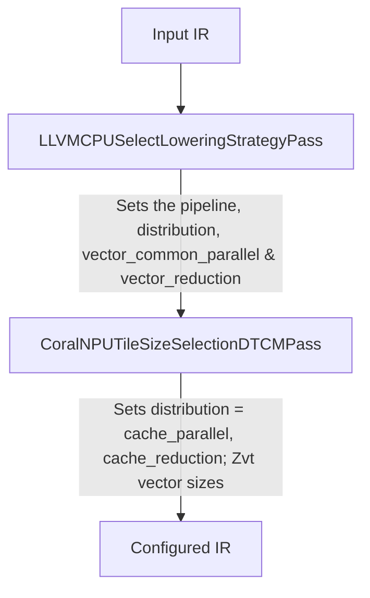
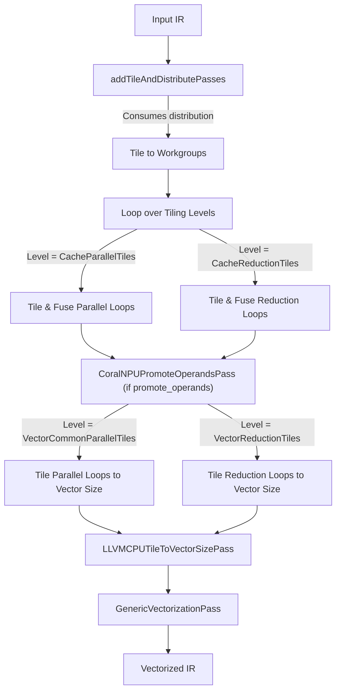

# CoralNPU Tiling Levels and Attributes (Based on IREE LLVMCPU) Explained

This document provides a detailed explanation of the tiling levels and attributes used in the IREE LLVMCPU target backend, which the Coral NPU backend extends.
It describes the purpose of each level, how they map to hardware, and where they are processed in the compiler pipeline.

The tile sizes are selected in two steps during the configuration phase of the compiler pipeline:
- IREE's **`LLVMCPUSelectLoweringStrategyPass`** picks the lowering pipeline and the tile sizes of all levels, including the vector (register) levels. It attaches a `lowering_config` to the compute operations and a `translation_info` to the function of each dispatch.
- **`CoralNPUTileSizeSelectionDTCMPass`**
  ([CoralNPUTileSizeSelectionDTCM.cpp](../../compiler/Transforms/CoralNPUTileSizeSelectionDTCM.cpp))
  then refines the `lowering_config` of the root operation (`getDTCMRoot`): it
  computes the DTCM-level tile sizes (and the vector tile sizes of Zvt
  contractions and convolutions) and sets the workgroup (`distribution`) tile
  sizes to the DTCM parallel tile sizes (`cache_parallel`). For non-Zvt
  dispatches (including multi-op reductions such as decomposed
  `linalg.softmax`), non-root compute operations keep the `lowering_config` set
  by `LLVMCPUSelectLoweringStrategyPass`: IREE's cache and vector parallel
  tiling passes anchor on the unique operation with `distribution` (the root),
  and RISC-V vectorization infers vector sizes directly from the tiled IR.

In the translation phase, **`CoralNPUPromoteOperandsPass`** ([CoralNPUPromoteOperands.cpp](../../compiler/Transforms/CoralNPUPromoteOperands.cpp)) copies the DTCM tiles to DTCM (see [DTCM Promotion](#dtcm-promotion)).


## Table of Contents
- [Multi-Level Tiling](#multi-level-tiling)
- [Alignment of DTCM Tiles](#alignment-of-dtcm-tiles)
- [DTCM Promotion](#dtcm-promotion)
- [Guided Tiling Example](#guided-tiling-example)

##  Multi-Level Tiling

IREE's `llvm-cpu` backend, which the CoralNPU relies on heavily, uses a structured approach where tiling is performed in three main logical levels, mapping to different layers of the hardware hierarchy:

```
[Problem Size] (DRAM)
      |
      |  <-- Level 0: Distribution (Workgroups)
      v
[Workgroup Tile] (SRAM / L2 Cache)
      |
      |  <-- Level 1: Cache (L1 Cache / DTCM)
      v
[Cache Tile] (Registers)
      |
      |  <-- Level 2: Vector (Registers)
      v
[Vector Tile] (Execution Units)
```

Each level is configured via the [lowering_config](../../third_party/iree/compiler/src/iree/compiler/Codegen/Dialect/Codegen/IR/IREECodegenAttrs.td#L338) attribute attached to the root operation of a dispatch.

The `LoweringConfigAttr` for CPU backends defines the following attributes (keys in the dictionary):

| Attribute Key | Enum Value ([TilingLevel](../../third_party/iree/compiler/src/iree/compiler/Codegen/Dialect/CPU/IR/IREECPUTypes.h#L18)) | Target Hardware | Loop Type | Purpose |
| :--- | :--- | :--- | :--- | :--- |
| `distribution` | `DistributionTiles` | Multiple Cores / Clusters | Parallel | Partitions work into independent Workgroups. |
| `cache_parallel` | `CacheParallelTiles` | L1/L2 Cache (or DTCM) | Parallel | Tiles parallel loops to fit in local memory. |
| `cache_reduction` | `CacheReductionTiles` | L1/L2 Cache (or DTCM) | Reduction | Tiles reduction loops to fit in local memory. |
| `vector_common_parallel` | `VectorCommonParallelTiles` | Registers / Vector Regs | Parallel | Tiles parallel loops to match vector register width. |
| `vector_reduction` | `VectorReductionTiles` | Registers / Vector Regs | Reduction | Tiles reduction loops to match vector register width. |
| `vector_inner_parallel` | `VectorInnerParallelTiles` | Registers / Vector Regs | Parallel | Tiles inner parallel loops (typically for pack/unpack). |

### 1. Level 0: Distribution (`DistributionTiles`)

*   **Configured by**: [CoralNPUTileSizeSelectionDTCMPass](../../compiler/Transforms/CoralNPUTileSizeSelectionDTCM.cpp)
*   **Attribute Key**: `distribution`
*   **Purpose**: To partition the global iteration space of the operation into independent chunks called **Workgroups**. Each workgroup can be executed concurrently by different CPU cores or NPU clusters.
*   **Hardware Constraint**: Number of available compute cores/clusters.
*   **Optimization Goal**: Even workload distribution (load balancing) and alignment with Level 1 tiles.
*   **Factors**:
    *   **Core Count**: If the target has $C$ cores, we want the number of workgroups to be at least $C$.
    *   **Alignment**: The workgroup tile size must be a multiple of the Level 1 (DTCM) tile size. Typically, we set `DistributionTiles` equal to `CacheParallelTiles` so that each workgroup processes exactly one DTCM-sized tile, delegating the outer loop management to the runtime.
*   **Loop Types**: Only applies to **parallel loops**. Reduction loops cannot be distributed across workgroups without synchronization (which is avoided at this level).
*   **Example (Matmul 128x128x128)**:
    If `distribution = [8, 32, 0]`:
    *   The M-dimension (128) is tiled by 8.
    *   The N-dimension (128) is tiled by 32.
    *   This generates $\frac{128}{8} \times \frac{128}{32} = 16 \times 4 = 64$ workgroups.
    *   The K-reduction dimension is not tiled at this level (size 0).
*   **Lowering Pass**: Consumed by the pass [addTileAndDistributePasses](../../third_party/iree/compiler/src/iree/compiler/Codegen/LLVMCPU/Passes.cpp#L127) at the start of the codegen pipeline. It lowers the loops to `scf.forall` (or `scf.for` if distribution is disabled) which represents the workgroup grid.


### 2. Level 1: Cache (`CacheParallelTiles` & `CacheReductionTiles`)

This level is crucial for memory-constrained accelerators like the Coral NPU.

*   **Configured by**: [CoralNPUTileSizeSelectionDTCMPass](../../compiler/Transforms/CoralNPUTileSizeSelectionDTCM.cpp)
*   **Purpose**: To tile the workgroup's iteration space so that the active data working set (inputs, weights, outputs) fits entirely within a specific level of the cache hierarchy (L1/L2 cache on standard CPUs) or the local SRAM (DTCM on the Coral NPU).
*   **Hardware Constraint**: Local memory size (DTCM / SRAM limit: e.g., 8KB to 32KB on Coral NPU).
*   **Optimization Goal**: Maximize data reuse in local memory and minimize slow DRAM accesses.
*   **Factors**:
    *   **DTCM Capacity**: The DTCM buffers of one tile must fit in the DTCM tile budget: the DTCM size minus the stack and the reserve for static data, rounded down to 4 KB (`--coralnpu-dtcm-size-kb`, `--coralnpu-stack-size-kb`, `--coralnpu-dtcm-reserve-kb`). The footprint of a tile is the sum of its buffers ([CoralNPUTileSizeSelectionFootprint.cpp](../../compiler/Transforms/CoralNPUTileSizeSelectionFootprint.cpp)), each rounded up to 64 bytes:
        *   an input slice for each tensor that the fused operations read from memory, in its type in memory;
        *   an output staging buffer for each result that leaves the fused operations, in the stored type;
        *   an accumulator for the root result, if the tile splits a reduction loop and the root result is not stored directly;
        *   the scratch tiles of the Zvt asm, if a fused operation reads the root result (see [Matrix Codegen](matrix_codegen.md)).
    *   **Fusion Boundary**: The footprint includes the elementwise producers and consumers that are fused into the root operation. An input that a fused producer computes needs no buffer, but the inputs of the producer do (e.g. an `i8` tensor before a fused `arith.sitofp` counts as `i8`). The inputs of a fused producer of the init also count (e.g. the bias tensor of a broadcast into the init), and a result of a fused producer that leaves the fused operations (e.g. that the dispatch also stores) gets an output staging buffer.
    *   **Double Buffering**: If the runtime pipelines data transfers (DMA) with computation, each input slice needs a second buffer for the next tile. `--coralnpu-dtcm-buffers-per-operand=2` counts each input slice twice.
    *   **Vector Alignment**: DTCM tile sizes must be multiples of Level 2 (Vector) tile sizes to avoid generating clean-up loops (peeling) which increase code size and reduce efficiency.
*   **Attribute Keys**:
    *   `cache_parallel`: Tiles the parallel loops (e.g., M, N in Matmul).
    *   `cache_reduction`: Tiles the reduction loops (e.g., K in Matmul).
*   **Why split Parallel and Reduction?**
    *   Tiling parallel loops (`cache_parallel`) creates independent tiles that can be processed in any order. It is also where **producer-consumer fusion** happens (fusing elementwise operations).
    *   Tiling reduction loops (`cache_reduction`) is done to limit the footprint of the reduction dimension (e.g., K-dimension in matmul, or channels in conv). It requires accumulating intermediate results into a local buffer.
*   **Example (Matmul 128x128x128 inside a 8x32 workgroup)**:
    If `cache_parallel = [8, 32, 0]` and `cache_reduction = [0, 0, 128]`:
    *   Since the workgroup size is already 8x32, `cache_parallel` matching `8, 32` means no further parallel tiling is done (the whole workgroup is processed as one L1 tile).
    *   `cache_reduction = [0, 0, 128]` means the reduction loop K (128) is processed in chunks of 128 (meaning no reduction tiling is needed because 128 already fits in local memory).
*   **Lowering Passes**:
    Processed in the loop in [addMultiTilingExpertPassPipeline](../../third_party/iree/compiler/src/iree/compiler/Codegen/LLVMCPU/Passes.cpp#L225) (in [LLVMCPU/Passes.cpp](../../third_party/iree/compiler/src/iree/compiler/Codegen/LLVMCPU/Passes.cpp#L230)):
    *   `CacheParallelTiles` is lowered by `createLLVMCPUTileAndFuseProducerConsumerPass`, which generates `scf.forall` loops.
    *   `CacheReductionTiles` is lowered by `createLLVMCPUTileRootAndFuseInputOperandsPass`, which generates `scf.for` loops.
    After the vector levels, `ForallToForPass` changes the `scf.forall` loops (except the workgroup loop) to `scf.for` loops.
    After the cache levels, `CoralNPUPromoteOperandsPass` copies the tiles to DTCM (see [DTCM Promotion](#dtcm-promotion)).


### 3. Level 2: Vector (`VectorCommonParallelTiles` & `VectorReductionTiles`)

*   **Configured by**: IREE's `LLVMCPUSelectLoweringStrategyPass`. For a Zvt contraction or convolution, `CoralNPUTileSizeSelectionDTCMPass` replaces `vector_common_parallel` with the Zvt tile sizes, and sets `vector_reduction` to 1 (the Zvt asm takes a K of 1). It also clamps any vector tile that is larger than its DTCM tile.
*   **Note**: IREE limits the vector tile sizes so that the tiles of all operands fit in the vector register file (`limitVectorTileSizes`). For RISC-V, this needs IREE patch 0011: `getRegisterSpaceBitsIfKnown` returns 32 x VLEN, and the matmul path also applies the limit. IREE patch 0012 gives the batch loops of contractions (e.g. `linalg.batch_matvec`) the vector tile size 1.
*   **Purpose**: To tile the cache-level tiles down to sizes that can fit directly into the processor's registers (register file). This is the final tiling step before vectorization.
*   **Hardware Constraint**: Number of vector registers (e.g., 32 in RISC-V V extension) and vector register width (VLEN).
*   **Optimization Goal**: Maximize register reuse (register tiling) and ensure full utilization of SIMD execution units.
*   **Factors**:
    *   **Vector Width (VLEN)**: The tile size along the vectorized dimension should match or be a multiple of the number of elements that fit in a single vector register. E.g., for VLEN=128 bits:
        *   32-bit elements (float32, int32) $\rightarrow$ vector width = 4. Tile size should be a multiple of 4.
        *   8-bit elements (int8) $\rightarrow$ vector width = 16. Tile size should be a multiple of 16.
    *   **Register File Capacity**: For a matrix multiplication register tile of shape $M_{reg} \times N_{reg}$:
        *   We need $M_{reg} \times N_{reg}$ registers to accumulate the output.
        *   We need $M_{reg}$ registers to hold LHS vector cache.
        *   We need $N_{reg}$ registers to hold RHS vector cache.
        *   Total registers required: $(M_{reg} \times N_{reg}) + M_{reg} + N_{reg} \le \text{Available Vector Registers}$ (typically 32).
        *   Common configurations are $8 \times 4$ (32 accumulators, requires reusing registers or VLEN extensions) or $4 \times 4$ (16 accumulators, leaves 16 registers for LHS/RHS and temporary variables).
*   **Attribute Keys**:
    *   `vector_common_parallel`: Tiles the parallel loops.
    *   `vector_reduction`: Tiles the reduction loops.
*   **Goal**: The sizes selected here must match the target architecture's vector register width (e.g., 4 for float32 on RVV with 128-bit vectors).
*   **Example (Matmul 8x32 DTCM tile)**:
    If `vector_common_parallel = [8, 32, 0]` and `vector_reduction = [0, 0, 1]`:
    *   The parallel loops are tiled to 8 and 32. This matches the register unrolling strategy (e.g., a register tile of $8 \times 32$).
    *   The reduction loop is tiled to 1 (`vector_reduction = [0, 0, 1]`). This means we load 1 element along the K dimension at a time, multiply-accumulate it into the $8 \times 32$ accumulator registers.
*   **Lowering Passes**:
    *   Tiled by `createLLVMCPUTileAndFuseProducerConsumerPass` (for parallel) and `createLLVMCPUTileRootAndFuseInputOperandsPass` (for reduction) in the same loop in `Passes.cpp`.
    *   The resulting tiled loops are then vectorized by:
        *   [createLLVMCPUTileToVectorSizePass()](../../third_party/iree/compiler/src/iree/compiler/Codegen/LLVMCPU/Passes.cpp#L293): Ensures the loops are annotated or structured for vectorizer.
        *   [createGenericVectorizationPass()](../../third_party/iree/compiler/src/iree/compiler/Codegen/LLVMCPU/Passes.cpp#L298): Converts the `linalg` operations operating on these vector-sized tiles into MLIR `vector` dialect operations (like `vector.contract`, `vector.transfer_read/write`).
        *   Later, LLVM translates these MLIR vector ops to native CPU vector instructions (e.g., RVV `vfmacc.vv`).

### Summary of Configuration Pipeline

The following diagram shows how the IREE strategy pass and
`CoralNPUTileSizeSelectionDTCMPass` configure the tiling attributes during the
configuration phase:



### Summary of Lowering Pipeline Flow (CPUDoubleTilingExpert)

The following diagram shows where each tiling attribute is consumed in the `CPUDoubleTilingExpert` pipeline during the translation phase:



## Alignment of DTCM Tiles

`CoralNPUTileSizeSelectionDTCMPass` aligns the DTCM tile sizes to the vector tile sizes that `LLVMCPUSelectLoweringStrategyPass` set:

1.  **Parallel loops** are aligned to `vector_common_parallel`, and **reduction loops** to `vector_reduction`. A vector tile size of 0 means that the loop has no alignment at first.
2.  The search starts from the full loop ranges, so a loop that fits stays
    untiled. When it shrinks a tile, it halves the tile and aligns it down to a
    multiple of the alignment. Then it takes the largest multiple of the
    alignment that divides the loop range, so that there is no partial DTCM
    tile. If the range is not a multiple of the alignment, it takes the largest
    divisor of the range that is at least the alignment (at most half the tile
    if possible, else the largest divisor below the tile), if there is one (but
    not for the N loop of a Zvt contraction, which Zvt cannot lower with all
    column remainders; and for the M loop of a Zvt contraction, if no such
    divisor exists, the loop does not shrink so workgroup M slices stay static
    and do not fall back from the static Zvt microkernel to masked RVV outer
    products on the stack). The loops whose ranges are multiples of their
    alignments shrink first, and the outermost loop first. The search does not
    shrink the streamed reduction loops of a Zvt contraction or of an
    unpromoted operation (such as a convolution, a zero-reuse contraction, or a
    multi-op reduction like decomposed `linalg.softmax`, where splitting
    `cache_reduction` would recompute producer reductions inside the outer
    reduction loop). If the footprint still does not fit, the search relaxes
    the alignments (see
    [Graceful Degradation](#graceful-degradation-alignment-fallback)).
3.  After the search, a vector tile that is larger than its DTCM tile is
    clamped to the DTCM tile size. For a multi-op reduction dispatch, each
    parallel vector tile also snaps to a divisor of the DTCM tile (or `1` when
    the DTCM tile leaves a partial boundary tile) so parallel slices stay
    static at the `vector_reduction` tiling stage (allowing `extract_slice`
    folding on 1D producer reduction results) and producer reductions do not
    fuse inside the root's `vector_reduction` loop.


## DTCM Promotion

For an RVV contraction with reuse across both M and N (not a Zvt contraction or
a zero-reuse contraction such as `vecmat`, `matvec`, or `dot`),
`CoralNPUTileSizeSelectionDTCMPass` adds `promote_operands` to the lowering
config of the root operation. In the translation phase, IREE patch 0014 calls a
CoralNPU hook (`afterCacheTilingHook`) after the cache-level tiling. The hook
adds `CoralNPUPromoteOperandsPass` if the root operation has
`promote_operands`. The pass makes the buffers of the footprint model (see
[Level 1](#2-level-1-cache-cacheparalleltiles--cachereductiontiles)) real:

*   **Input slices**: The pass copies each tile that the fused operations read from memory (a slice of a binding, or a whole binding) to a DTCM buffer, with a `bufferization.materialize_in_destination` operation. If a fused producer reads the tile, the copy comes before the producer (e.g. the `i8` tile before a fused `arith.sitofp`). IREE fuses a producer into the tile loop only through a slice of its result, and the tiling makes no slice of an input that no tiled loop indexes (e.g. the RHS when only M is tiled). So the pass first clones such elementwise producers into the tile loop, and their inputs get DTCM copies too.
*   **Accumulator**: If the tile splits K, or if the root result is stored directly, the root operation accumulates in a DTCM buffer (its `linalg.fill` writes into DTCM).
*   **Output staging**: The operation that computes a stored result (the root operation or a fused consumer) writes it into a DTCM buffer. The store operation (`tensor.parallel_insert_slice` or `iree_codegen.store_to_buffer`) copies it to memory when it bufferizes.

`materialize_in_destination` is not a linalg operation: the vector-level tiling does not tile it or fuse it into the loops of its users, and the vectorization does not fold it away. It is a destination-style operation, so the sizes of its result are the sizes of the DTCM tensor (peeling can make them static).

After bufferization, the copies of both kinds are `linalg.generic` copies of whole tiles between memory and DTCM. In the pre-LLVM hook of the CoralNPU target, `CoralNPULowerDTCMCopiesPass` ([CoralNPULowerDTCMCopies.cpp](../../compiler/Transforms/CoralNPULowerDTCMCopies.cpp)) lowers each copy to and from DTCM to loops of vector loads and stores along the rows (the last vector of a row has a mask if necessary). Without it, the pre-LLVM hook makes a copy of fewer than 1024 elements one vector (`GenericVectorizationPass`), and IREE lowers the other copies to scalar loops. TODO(DMA): this pass is the place where the copies must become DMA transfers (one descriptor for each row), with the vector loops as the fallback.

The DTCM buffers are static `bufferization.alloc_tensor` operations in the `#iree_codegen.workgroup_local` memory space. Their sizes are the upper bounds of the tile sizes. They are at the start of the workgroup loop body (or of the function if there is no workgroup loop). A tile with dynamic sizes (a partial tile at the boundary) uses a slice of its buffer. Thus:

*   Loop peeling clones the inner loops, but not the buffers, and the DTCM use does not increase.
*   The canonicalizer does not change the buffers. (When it makes a dynamic `bufferization.alloc_tensor` static, it drops the memory space.)
*   After bufferization, the buffers are `memref.alloc` operations (IREE patch 0013) in the entry block of the function. `iree-llvmcpu-assign-workgroup-local-memory` packs them into one buffer, and sets its size in the `workgroup_local_memory` attribute of the export. The runtime gives each workgroup a DTCM buffer of this size.

The input copies come before the compute loops in the same loop body. IREE patch 0015 makes `LLVMCPUPeel` peel the outer loops first in this case too; without it, a partial tile gets two copies of the compute loops, which uses much more ITCM.


## Guided Tiling Example

Below is a step-by-step walkthrough of how a large matrix multiplication is tiled by the compiler across all levels.

> [!NOTE] 
> This example is meant to show how an operation that targets RVV vectorization
> works. Matmul was chosen as it is relatively simple, and demonstrates most of
> the relevant details. In the near future, matmul will be targeting the MAC
> block, instead of the RVV, and it will have a slightly different handling. The
> example is still relevant for when the MAC is disabled, and it is a good
> explanation, even if not 100% accurate.

*   **Operation**: Matmul ($1024 \times 1024 \times 1024$) of 32-bit integer elements (`i32`).
*   **Hardware Target**: CoralNPU with 16 KB DTCM, 128-bit VLEN, and 32 vector registers.
*   **Vector Width**: $\frac{128}{8 \times 4} = 4$ elements.

### Step 1: Level 2: Vector (Register) Tiling
*   **Set by**: `LLVMCPUSelectLoweringStrategyPass` (IREE heuristics).
*   **Assumption for this walkthrough**: the strategy pass sets `vector_common_parallel = [4, 24, 0]` and `vector_reduction = [0, 0, 1]`, which gives a register tile of `[4, 24, 1]`. The real values depend on the IREE heuristics.

### Step 2: Level 1: Cache (DTCM) Tiling
*   **Goal**: Fit active tiles of LHS (M x K), RHS (K x N), and Out (M x N) in DTCM.
*   **Budget**: 16 KB DTCM - 4 KB stack - 4 KB reserve = 8 KB (8192 bytes; already a multiple of 4 KB).
*   **Process**:
    1.  **Initialize**: Start with the full static loop ranges: `[1024, 1024, 1024]`.
    2.  **Footprint Search**: The initial footprint is $(1024 \times 1024 \times 3) \times 4$ bytes $= 12$ MB (exceeds 8 KB). The compiler enters the shrink loop:
        *   **Shrink Parallel Loops (M, N)**: Shrunk by halving first (dividing by 2, aligning down to the vector tile size, and taking an exact divisor of the loop range if there is one), down to their alignment limits. M (1024 is a multiple of 4) shrinks before N (1024 is not a multiple of 24):
            *   M shrinks: $1024 \rightarrow 512 \rightarrow \dots \rightarrow 4$ (stops at the alignment limit of 4).
            *   N shrinks: $1024 \rightarrow 512 \rightarrow 256 \rightarrow 128 \rightarrow 64 \rightarrow 32 \rightarrow 24$ (1024 is not a multiple of 24, so the search takes divisors of 1024 that are at least 24; below 32 there is none, so it stops at the alignment limit of 24).
            *   Current tile: `[4, 24, 1024]` (Footprint: $(4\times 1024 + 1024\times 24 + 4\times 24) \times 4 \approx 115$ KB, still exceeds 8 KB).
        *   **Shrink Reduction Loops (K)**: Shrunk next:
            *   K shrinks: $1024 \rightarrow 512 \rightarrow 256 \rightarrow 128 \rightarrow 64$.
            *   At `[4, 24, 64]`, the footprint is (each buffer is already a multiple of 64 bytes; the output staging buffer also holds the accumulator, because the matmul result is stored directly):
                $$\text{LHS (4x64)} + \text{RHS (64x24)} + \text{Out (4x24)} = 1024 + 6144 + 384 = 7552 \text{ bytes} \le 8192 \text{ bytes (Fits!)}$$
*   **Resulting DTCM Tile**: `[4, 24, 64]` (configured via `cache_parallel` and `cache_reduction`).

#### Graceful Degradation (Alignment Fallback)

If the shrink loop reaches the alignment limits (e.g., `M` reaches 4 and `N` reaches 24) and the footprint *still* exceeds DTCM capacity, the compiler falls back to a finer granularity. It resets all loop alignments to `1` and attempts to shrink the tile sizes further (e.g., trying to fit `[2, 24, 32]`, `[1, 12, 16]`, etc.). Then it clamps each vector tile size to the DTCM tile size of the same loop.

This degradation preserves memory correctness (avoiding DTCM overflow) but will
result in scalar or less-efficient vector code because the tile sizes are no
longer multiples of the register vector widths. For a multi-op reduction
dispatch (which does not allocate promoted DTCM buffers and does not split its
reduction loop), if a `1x1x...` parallel tile still exceeds the DTCM budget, the
pass emits a missed remark and keeps the `1x1x...` parallel tile. For all other
dispatches, if the workload cannot fit even with a `[1, 1, 1]` tile size, the
pass emits an error and aborts compilation.


### Step 3: Applying Level 1 (Cache) Tiling
*   **Goal**: Map the computed DTCM tile sizes to `cache_parallel` and `cache_reduction` attributes.
*   **Resulting Attributes**:
    *   `cache_parallel` = `[4, 24, 0]` (tiling parallel loops M and N).
    *   `cache_reduction` = `[0, 0, 64]` (tiling reduction loop K).

### Step 4: Level 0: Distribution (Workgroup) Tiling
*   **Goal**: Distribute work across cores. We map it to DTCM tile sizes so each workgroup handles exactly one DTCM-sized tile (enabling DMA/Compute pipelining).
*   **Resulting Attribute**: `distribution = [4, 24, 0]`.

### Final Lowering Configuration
The root operation (`linalg.matmul`) gets this lowering config. The function keeps the translation info that the strategy pass set. The matmul is an RVV contraction, so `promote_operands` asks for the [DTCM promotion](#dtcm-promotion) of its operands.
```mlir
// On the linalg.matmul operation:
lowering_config = #iree_cpu.lowering_config<
  cache_parallel = [4, 24, 0],
  cache_reduction = [0, 0, 64],
  distribution = [4, 24, 0],
  promote_operands = [0, 1, 2],
  vector_common_parallel = [4, 24, 0],
  vector_reduction = [0, 0, 1]
>
// On the function:
translation_info = #iree_codegen.translation_info<pipeline = #iree_cpu.pipeline<DoubleTilingExpert>>
```
